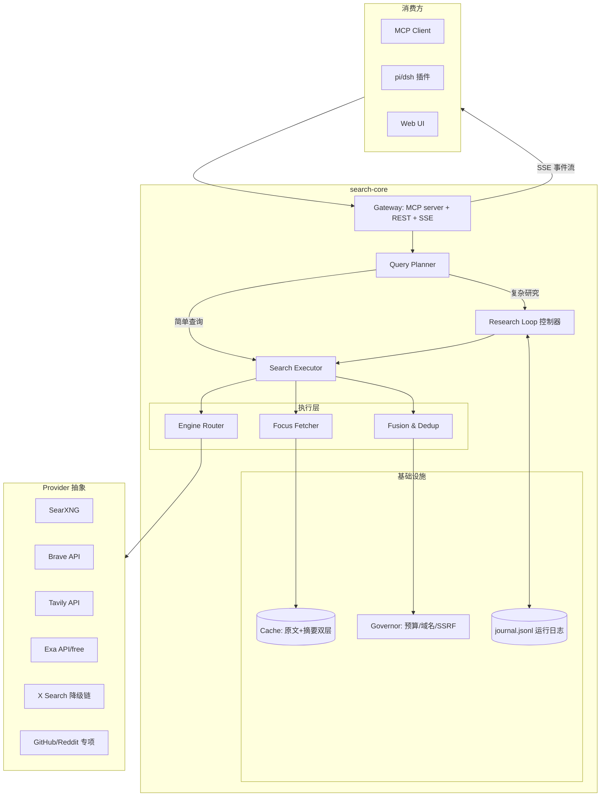
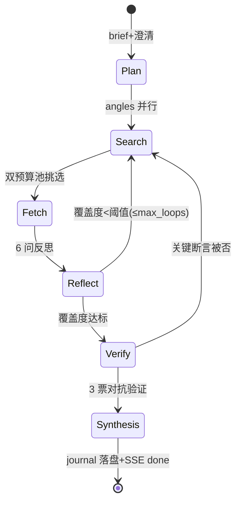

# search-core v0 设计规格

> 基于 12 份逆向分析报告(01-12)与综合对比(13)的收敛结论。
> 目标:把我们 search-boost 插件里的编排逻辑抽出来,进化成一个**独立的客户端搜索编排器**,
> 同一个 Core 服务:Agent(MCP) / 插件(pi/dsh) / 人(Web UI)。

---

## 1. 定位与非目标

### 1.1 定位

**Search Intelligence 层**:介于"搜索引擎"(SearXNG/Brave/Tavily/Exa)与"Research Agent"(宿主 AI)之间。

```text
┌────────────────────────────────────────────────────┐
│  消费方: MCP client / pi 插件 / dsh 插件 / Web UI   │
└──────────────────────┬─────────────────────────────┘
                       │ MCP / stdio / HTTP+SSE
┌──────────────────────▼─────────────────────────────┐
│                search-core v0                       │
│  Query Planner → Engine Router → Fusion →           │
│  Focus Fetch → (Research Loop) → Citation           │
└──────────────────────┬─────────────────────────────┘
        ┌──────────────┼──────────────┐
        ▼              ▼              ▼
   SearXNG(免费底座)  付费 API(可选)   专项源(X/GitHub/Reddit)
   [12]标准姿势      Brave/Tavily/Exa  [10]降级链
```

不做的事:
- 不自建网页索引/爬虫池(那是 Perplexica/大厂的位置 [12])
- 不做托管 SaaS(大厂的位置 [05][07][08])
- 不锁死任何一个引擎(SearXNG 只是 Router 下的一个 Provider,可换可删 [02])

### 1.2 设计目标(按优先级)

| # | 目标 | 来源依据 |
|---|------|---------|
| G1 | **免 key 可用**:SearXNG+DDG+Yahoo+Exa-free 四路免费层,质量达到"勉强可用";有 key 自动升级 | dsh v0.1 实践 [10],解决作者自述痛点#1 |
| G2 | **token 可控**:全链路预算制,抓取省 90%+ | dsh focus fetch 95% [10];Trae 双预算池 [06] |
| G3 | **全链路可观测**:每步可追踪、可恢复、可回放 | 反面教材:Perplexica 裸奔 [12]、ODR 无预算 [11] |
| G4 | **子代理防火墙**:中间结果不进宿主 context | 4 个目标独立验证 [05][07][08][09] |
| G5 | **引擎可换**:Provider 接口抽象,单点故障不瘫 | Trae 无本地 fallback 的教训 [05] |

非目标:RL 训练主动式搜索(作者自述与 RL 训练的差距),用 prompt 政策+工具描述优化逼近。

---

## 2. 总体架构



**模块职责一句话:**
- **Gateway**: 对外三种协议同一 Core(MCP 工具、REST、SSE 事件)[07]
- **Query Planner**: 一次调用出"路由决策+查询改写+复杂度分级"[12][05]
- **Research Loop**: 复杂查询的多步研究状态机 [11][06]
- **Engine Router**: Provider 抽象 + 健康探测 + 并行调度 [10][01]
- **Focus Fetcher**: 抓取+关键段提取,双预算池 [10][06]
- **Fusion**: RRF 粗排 + embedding 双阈值精排 [12]
- **Governor**: 预算/域名/SSRF/配额 全局管控 [10][07]

---

## 3. 对外接口(MCP 优先)

### 3.1 MCP 工具集(渐进披露,两级)

第一级(默认暴露,4 个工具):

```text
search(query, opts?)     # 单轮搜索: Planner→并行引擎→Fusion→top N 摘要
fetch(url, focus?)       # 单页抓取: 命中段+邻接段,缓存原文 [10]
research(brief, opts?)   # 多步研究: Research Loop,只返回 synthesis [07][08]
x_search(query, kind?)   # X 专项: 四模式+降级链 [10]
```

第二级(deferred,经 tool_search 发现)[08][09]:

```text
search_providers()       # 列引擎健康状态/配额
cache_stats()            # 缓存命中/省 token 统计
journal_tail(run_id)     # 研究过程回放
```

**工具描述里写死委派约束**(学 WorkBuddy):query 一句话意图、禁 checklist、复杂研究必须走 research [07]。

### 3.2 SSE 事件形态(学 WorkBuddy agentic_search)

`research()` 返回 SSE 流,事件类型收敛为:

```text
tool_call   / tool_result / phase      # 进度(供 UI)
synthesis   # 最终结果(唯一进宿主 context 的东西)
done / error
```

关键: **中间事件默认不进宿主 context**,只有 synthesis 进;Web UI 可以消费全部事件 [07][08]。

### 3.3 统一引用体系

搜索结果不自成协议,输出统一 Reference 结构(学 Trae [05]):

```json
{ "ref_id": 1, "kind": "web|x|github", "url": "...", "title": "...",
  "snippet": "...", "fetched": true, "confidence": 0.82 }
```

引用生成三段式(学 Perplexica [12]):context 编 `ref_id=N` → prompt 要求每句 `[N]` → 出口校验(修 ODR 无校验的洞 [11])。

---

## 4. 模块设计

### 4.1 Query Planner(单次调用,便宜模型)

输入: 用户 query + 最近对话摘要(可选)。一次 LLM 调用输出 [12]:

```json
{ "complexity": "simple|multi|research",
  "rewritten": ["查询变体1", "变体2"],
  "angles": ["角度1", "角度2"],
  "domains": { "allow": [], "block": [] },
  "freshness": "d7|m1|y1|any" }
```

- 查询改写对应 Trae `query_rewrite` [05];角度并行对应 deep-research 5 角度 [06];freshness 用 Brave 风格域语法 [07]。
- simple → Search Executor 单轮;research → Research Loop。
- **澄清机制**: brief 原则五条(含"不编造用户未说内容")+ 单次追问 [11],仅 research 模式触发。
- Planner 挂了 → 跳过预决策直接搜(降级不阻塞)。

### 4.2 Engine Router + Search Executor

- Provider 统一接口: `search(q, opts) -> Reference[]`,各 Provider 自己适配 [10]。
- 并行: 全引擎 `Promise.allSettled`,单引擎超时 12s `Promise.race` 剔除(学 dsh 慢腿 [10],WorkBuddy 竞速 [07])。
- 免费层默认: SearXNG(engines 参数按 SearchProfile 编译 [12]) + Exa-free;付费层: Brave/Tavily/Exa 按 key 自动启用。
- **健康探测**: 每引擎滚动成功率,连续失败自动降权 + `search_providers()` 可查 — 修 Perplexica 单点裸奔 [12]。
- X 专项: 官方 API(有凭证)∥ 多引擎 `site:x.com` ∥ oEmbed ∥ Guest GraphQL(queryId 轮换自愈),allSettled 并行取先 [10]。

### 4.3 Fusion & Dedup

1. URL 归一化去重(ODR keep_first [11])
2. RRF 粗排(重写 dsh 版: 多引擎 rank 融合)
3. embedding 双阈值精排: snippet 相关性 >0.5 过滤、跨源去重 >0.75,top 20(Perplexica 方案 [12],本地 bge-m3 + sqlite-vec,Trae 验证过的栈 [05])
4. 可选: research 模式走对抗验证 — 每条关键断言 3 源投票,弃权≠存活 [06]

### 4.4 Focus Fetcher + Cache(省 token 主战场)

**双预算池**(Trae deep-research fetchSlots [06]):
- `reference_budget`: 最多收集多少条引用(默认 30)
- `fetch_budget`: 最多全文抓取多少页(默认 8,research 15)
- 引用先行,抓取后置: 先全部出引用卡片,planner/用户挑选后再抓正文

**Focus Fetch**(dsh [10]):
- 抓回全文 → 定位查询命中段 → 返回命中段+邻接段(~90% 省)
- 抓取结果**原文存缓存**(SQLite),focus 过滤在读时做 → 一页服务多角度查询

**按需提炼**(WorkBuddy [07]/Claude [08]):
- 缓存命中但 focus 段仍 >15k → 小模型按需提炼,带 60s 超时降级原文 [11]
- 竞速: 本地 fetch 与(可选)服务端 fetch `Promise.race` [07]

**缓存 TTL**: 抓取 15min 起步 [07][08],研究类 24h;TTL 按 domain 可配(新闻类短、文档类长)。

### 4.5 Research Loop(复杂查询状态机)



- **Stop condition 三保险** [11]: 显式 `research_complete` 工具信号 + 反思隐式判断 + 硬上限(默认 depth 3 × breadth 5,**全局预算参数必须存在** — 修 ODR 的洞 [11])
- **6 问量化反思**(WorkBuddy Q1-Q6 [07]): 证据够吗/有矛盾吗/覆盖了几角度/可信源占比/预算剩多少/下一步最值得查什么
- **journal.jsonl**: 每节点落盘,崩溃可恢复(Trae [06])
- 子代理执行: 循环体在 search-core 进程内(自身就是防火墙),宿主只见 synthesis

### 4.6 Governor(全局管控)

| 职能 | 设计 | 来源 |
|------|------|------|
| token 预算 | run 级全局 budget,各模块申请-核销 | 修 ODR [11] |
| SSRF 守卫 | 内网段/IP 直连/DNS rebinding 拦截 + TUN fake-ip 豁免 | dsh 182 行 [10] |
| 域名治理 | 全局黑名单 + run 级 allow/block + 威胁域名单 | Trae [05] + WorkBuddy Galileo [07] |
| 配额 | hosted 引擎配额跟踪,超限软停止(Claude 200 次/会话风格 [08]) | — |
| 模型分层 | planner/extractor/verify 用便宜模型,synthesis 用宿主指定模型 | 共识(13 §7) |

### 4.7 上下文输出规约

- 工具输出截断: 默认 10k token、**保头尾**(Codex [09])
- 搜索结果注入统一 Reference 块(带 ref_id 序号)
- 长 run 输出带 `checkpoint` 段: 核心原文是否还全在的**保真自检提示**(Trae checkpoint.sh 思想 [05],宿主侧执行)

---

## 5. 工程化

| 项 | 方案 |
|----|------|
| 语言/形态 | TypeScript 单包(与 pi/dsh 插件同栈);MCP server 入口 + 可选 HTTP 网关 |
| 技能格式 | SKILL.md 事实标准,生态兼容(13 §3) |
| 测试 | **回归清单**: 剪枝/缓存等好机制不得在迭代中丢失(pi→dsh 教训 [10]);每 Provider 一个黄金样本集 |
| 观测 | 结构化日志 + journal;省 token/命中率/引擎成功率 上仪表 |
| 错误处理 | 任何引擎失败不阻塞(allSettled);禁止裸 catch;超时全部显式 [12][11] |

---

## 6. 分阶段路线

| 阶段 | 范围 | 验收 |
|------|------|------|
| **v0.1 MVP**(1-2 周) | Gateway(MCP)+Planner(仅复杂度路由)+Engine Router(SearXNG+Exa-free+DDG 并行)+Focus Fetch+缓存+Governor(SSRF/预算) | pi/dsh 插件迁移成功;串行 160s → <70s 保持;省 token ≥85% |
| **v0.2**(2-4 周) | Research Loop(journal+6 问反思+三保险)+Fusion(embedding 双阈值)+X 降级链+tool_search 渐进披露+SSE | 深度研究端到端可恢复;引用出口校验 100% |
| **v0.3**(4-8 周) | 对抗验证+双预算池 UI(挑引用再抓)+Web UI+付费引擎健康路由+REST 公开 API | 与 Perplexica 盲测对比质量;引擎单点故障不影响可用性 |

---

## 7. 开放问题

1. **免费层质量天花板**: dsh 实测免费引擎+原生 websearch 质量仍不理想 [10] — v0.1 先量化建立基线(同一问题集跑分),有数据再决定付费引擎的必要度。
2. **embedding 栈部署**: bge-m3 本地需要 ~1GB 内存,插件场景可接受吗?备选: 远程 embedding API(Trae 就是远程 [05])或纯词法双阈值。
3. **Planner 模型来源**: 用宿主模型(零额外依赖)还是固定小模型(稳定但多一个依赖)?v0.1 先用宿主模型+prompt 约束。
4. **X 搜索凭证共享**: 读 grok-build 本地凭证(pi 版行为 [02])在新版本是否仍稳定,还是全面转 dsh 版显式 opt-in [10]?
5. **对抗验证成本**: 3 票验证 = 3× 模型调用,只在 research 模式默认开,simple 模式关闭。
