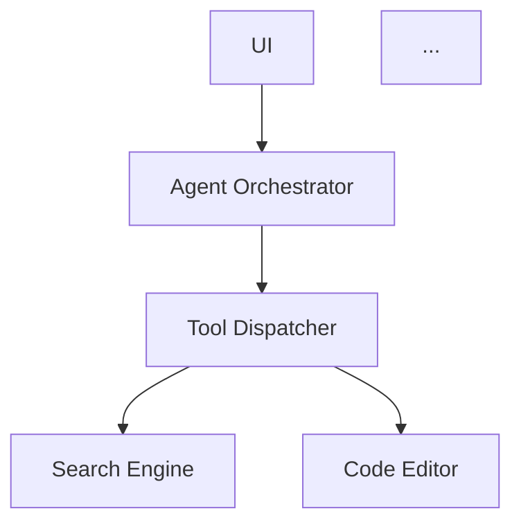

# 分析报告模板(单目标)

> 复制此文件到 `reports/NN-<target>.md` 并填充。

---

# <Target Name> 逆向分析报告

**目标**: <full name>
**版本**: <version>
**平台**: <win32/linux/darwin>
**类型**: <开源 / 闭源>
**分析日期**: YYYY-MM-DD
**原始下载链接**: <url>
**SHA256**: <hash>

---

## 0. 摘要(TL;DR)

(150 字以内,说清楚这个工具是干什么的 + 它最值得学的 1-2 个机制)

---

## 1. 整体架构

### 1.1 进程拓扑

- 是单进程 / 多进程?
- Electron 的话:main 进程做什么,renderer 进程做什么,有没有 worker?
- 有没有后端服务?本地 server / 远程 SaaS?

### 1.2 关键模块图



---

## 2. Agent 工作流

### 2.1 拓扑选择

- [ ] 单 agent
- [ ] Planner + Executor
- [ ] 多 agent(数量 ___, 协作方式 ___)
- [ ] 其他: ___

### 2.2 主循环伪代码

```
loop {
  context = buildContext(history, user_msg)
  resp = llm.call(context, tools)
  if resp.has_tool_call:
    result = dispatchTool(resp.tool_call)
    history.append(result)
    continue
  else:
    return resp.content
}
```

### 2.3 关键决策点

| 决策 | 位置 | 判断依据 |
|---|---|---|
| 调工具还是回话 | `path:line` | LLM 返回 tool_use 块 / 状态机判断 / ___ |
| 搜索还是思考 | `path:line` | ___ |
| 停止条件 | `path:line` | round > N / LLM 自判 / 用户中断 |

### 2.4 异常处理

- 工具调用失败时给 LLM 返回什么?
- LLM 返回格式错误时如何恢复?
- 用户中断时如何 save state?

---

## 3. 技能仓库 (Skill Repo)

### 3.1 概念对照表

| 本工具叫法 | 通用名 | 注册位置 |
|---|---|---|
| ___ | skill | `path/to/skills.json` |
| ___ | rule | ___ |

### 3.2 注册流程

### 3.3 用户自定义入口

- 配置文件路径:
- UI 入口:
- 第三方技能市场:

### 3.4 调用方式

- [ ] prompt 注入
- [ ] 代码 hook
- [ ] 工具自动暴露
- [ ] 其他: ___

---

## 4. 工具系统

### 4.1 协议

- [ ] MCP
- [ ] OpenAI function calling
- [ ] 自定义 JSON-RPC
- [ ] 内部 dispatch(无标准协议)
- [ ] 其他: ___

### 4.2 工具签名生成

### 4.3 工具列表(节选)

| 工具名 | 输入 schema | 输出格式 | 是否需要用户确认 |
|---|---|---|---|
| ___ | ___ | ___ | ___ |

### 4.4 授权机制

- 全部静默 / 全部确认 / 有 allowlist / ___

---

## 5. 搜索实现(重点)

### 5.1 后端

| 后端 | 是否使用 | 配置方式 | 备注 |
|---|---|---|---|
| 自家 search API | ? | ? | |
| Brave | ? | env? 配置文件? | |
| Tavily | ? | ? | |
| Exa | ? | ? | |
| DDG | ? | ? | |
| SearXNG | ? | ? | |

### 5.2 Query 处理

- 是否重写?  LLM / 规则 / 无
- 是否拆分?  单 query / 多 query 并发
- 多 query 的话,合并策略是什么?

### 5.3 抓取策略

- 全文 / Readability / 关键段落 / ___
- token 预算如何控制?

### 5.4 融合 & 排序

- RRF / 加权 / 第一命中 / ___
- 是否做 dedup?怎么做?

### 5.5 缓存

- 有 / 无 / TTL / 存储位置

### 5.6 关键代码片段(如有)

> 文件: `path:line`
> 用途: ___

```
// ≤30 行片段
```

---

## 6. 上下文管理

### 6.1 context window 策略

### 6.2 长期记忆

- 无 / 向量库(哪个?) / 文件 / 自定义

### 6.3 截断策略

---

## 7. 模型路由

### 7.1 默认模型

### 7.2 任务到模型的映射

| 任务类型 | 模型 | 理由 |
|---|---|---|
| 主对话 | ? | ? |
| query 重写 | ? | ? |
| 代码补全 | ? | ? |
| 嵌入 | ? | ? |

### 7.3 fallback 链

---

## 8. 综合发现(Findings)

### 8.1 最聪明的 3 个设计

1.
2.
3.

### 8.2 最蠢的 3 个设计

1.
2.
3.

### 8.3 可借鉴的机制

### 8.4 应避免的坑

---

## 9. 我们自己的设计参考

基于本目标的分析,我们的搜索工具 v0 应该:

- **必须复制**: ___
- **必须避免**: ___
- **可选改进**: ___

---

## 10. 引用 & 二次查阅

- 公开 issue / blog / 论文:
- 仓库 commit hash:
- 其他相关链接:
