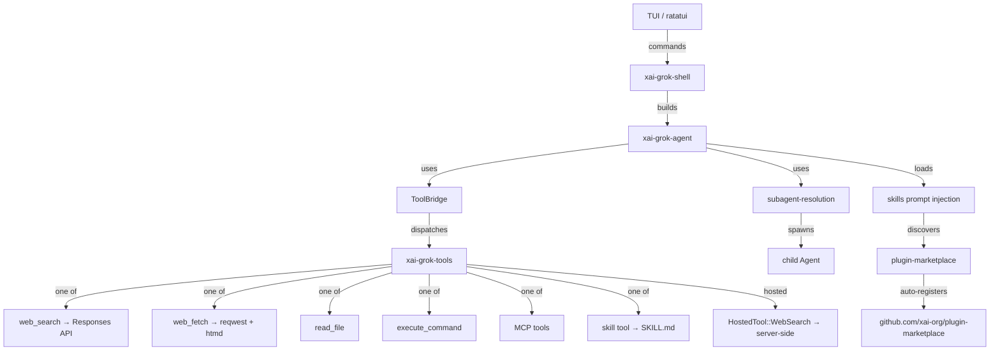

# Grok Build 逆向分析报告

**目标**: Grok Build (`grok` CLI/TUI)
**版本**: main 分支(2026-09 snapshot)
**平台**: 跨平台 (macOS / Linux / Windows),Rust 实现
**类型**: 开源 (Apache 2.0)
**分析日期**: 2026-09-02
**原始下载**: https://github.com/xai-org/grok-build
**SHA256**: N/A (git clone)

---

## 0. 摘要 (TL;DR)

Grok Build 是 SpaceXAI 的终端 AI coding agent,Rust workspace 实现,90+ 个 crate。最重要的发现是:

1. **它本身没有"搜索引擎"** — `web_search` 工具只是把请求转发给 xAI 的 Responses API,真正的搜索由 LLM 端的 agentic sampler 在 xAI 服务器上完成。这意味着 Grok Build 之所以"搜索能力强",本质是因为 LLM 强,不是因为它有更聪明的客户端搜索代码。
2. **客户端真正做的是 `web_fetch`** — 含 SSRF 防护、PDF/图像/视频分支、HTML→Markdown 转换、缓存。这部分代码量是 `web_search` 的 **5 倍以上**。
3. **Skill 系统明显继承自 Claude Code** — 文件名直接保留了 `${CLAUDE_PLUGIN_ROOT}` / `${CLAUDE_PLUGIN_DATA}` 变量名,5 层 scope 优先级 (Local > Repo > User > Server > Bundled > Plugin)。
4. **有官方 plugin marketplace** — git 仓库 `xai-org/plugin-marketplace`,首次运行自动注册。
5. **多 agent 通过 `subagent-resolution` crate 编排** — 子 agent 有独立 ToolBridge / 隔离级别 / persona 系统。

对我们要做的搜索工具的启示:**别再去找"如何复刻 Grok 搜索"了,因为它根本就没有客户端搜索**。真正要复刻的是 (a) 强大的 web_fetch,(b) Skill 调度系统,(c) 子 agent 隔离。

---

## 1. 整体架构

### 1.1 进程拓扑

Grok Build 是单进程 Rust TUI 应用,内部通过 tokio runtime 调度多个并发任务。没有独立的子进程,但通过 workspace daemon (`xai-grok-workspace-daemon`) 与外部协调。



### 1.2 Cargo Workspace 概览

```
grok-build/
├── crates/
│   ├── build/        (1 个 crate,协议生成)
│   ├── codegen/      (~70 个 crate,主功能)
│   └── common/       (~12 个 crate,共享底座)
├── prod/             (1 个 crate, MCP 代理)
├── third_party/      (4 个,移植的 JS 库)
└── bin/              (入口)
```

关键 crate 分类:

| 类别 | 代表 crate | 行数(主要文件) |
|---|---|---|
| Agent 核心 | `xai-grok-agent` | agent.rs 220, builder.rs 2715 |
| 工具系统 | `xai-grok-tools` | 实现层 ~500+ 文件 |
| 工具运行时 | `xai-tool-runtime` | dispatch.rs 68, search.rs 83 |
| 工具协议 | `xai-tool-protocol`, `xai-tool-types` | |
| MCP | `xai-grok-mcp`, `xai-computer-hub-mcp-adapter` | |
| Skill | `xai-grok-tools/implementations/skills` | types.rs 232 |
| 插件市场 | `xai-grok-plugin-marketplace` | scanner/installer |
| 子 agent | `xai-grok-subagent-resolution` | definition.rs |
| Hooks | `xai-grok-hooks` | dispatcher/runner |
| 会话存储 | `xai-grok-memory`, `xai-sqlite-journal` | |

---

## 2. Agent 工作流

### 2.1 拓扑选择

主 agent + 可选子 agent (subagent) 编排,但没有全局 orchestrator。

- **主 agent**: 由 `AgentBuilder` 从 `AgentDefinition` 构建,持有 `Arc<ToolBridge>`
- **子 agent**: 通过 `subagent-resolution` 在主 agent 运行时被 spawn,有独立的 ToolBridge、独立的 prompt、独立的隔离模式
- **没有 Planner-Executor 拆分**: 整个 LLM loop 由一个 agent 串行驱动,工具调用是 loop 内的一个分支

> 文件: `crates/codegen/xai-grok-agent/src/agent.rs:18-43`

```rust
// ≤30 行片段
pub struct Agent {
    definition: AgentDefinition,
    prompt_context: PromptContext,
    system_prompt: String,
    tool_bridge: Arc<ToolBridge>,
    reminder_policy: ReminderPolicy,
    compaction_policy: CompactionPolicy,
    hosted_tools: Vec<HostedTool>,
    backend_search_enabled: bool,
}
```

注释明确写:

> "The Agent is effectively immutable after construction. It holds Arc<ToolBridge>; mutations to tool state (MCP registration, completion tracking, retry config) go through ToolBridge's internal locks."

**这是一个非常关键的设计选择**: Agent 不可变,所有状态变化通过内部锁的 ToolBridge 暴露。这意味着:
- 中途切 agent 模式 (mode switching) 不需要重建 Agent,只重渲染 prompt
- `render_prompt_for_definition()` 允许复用 ToolBridge 给新定义的 agent

### 2.2 主循环伪代码

虽然源码里没找到 agentic sampler 的实际调用代码(可能在 `xai-grok-shell` 里),但从 `agent.rs` 和 `tool-runtime/dispatch.rs` 可以推断:

```
loop {
    context = buildContext(history, user_msg, skills, agents_md)
    request = buildRequest(model, system_prompt, context, tool_definitions, hosted_tools)
    response = sampling_api.call(request)  // xAI Responses API
    if response.has_tool_call:
        tool_result = tool_bridge.dispatch(tool_call)  // → xai-tool-runtime::dispatch
        history.append(tool_result)
        if should_auto_compact(total_tokens, context_window):
            history = compaction.compact(history)
        continue
    else:
        return response.content
}
```

### 2.3 关键决策点

| 决策 | 位置 | 判断依据 |
|---|---|---|
| 调工具 vs 回话 | 服务器端 (xAI agentic sampler) | LLM 自己返回 tool_use 块,客户端只是 dispatch |
| 是否使用 backend search | `agent.rs:155-160` `backend_search_enabled()` | build-time 配置 ANDed with per-model `supports_backend_search` |
| 触发 auto-compact | `agent.rs:170-181` `should_auto_compact` | `total_tokens > context_window * auto_compact_threshold_percent` |
| Mid-session mode 切换 | `agent.rs:206-218` `render_prompt_for_definition` | 复用 ToolBridge,只重渲染 prompt |

**重要细节**: `hosted_tools` 字段注释明确:

> "These are sent as native Responses API types (e.g., `WebSearch`) and executed server-side by the agentic sampler."

这印证了: web_search 在客户端基本是空壳,真正搜索在 xAI 服务器。

### 2.4 异常处理

`web_search/client.rs:226-239` 处理 401:

```rust
if status == reqwest::StatusCode::UNAUTHORIZED {
    self.record_401_attribution(sent_bearer.as_deref());
    let body = response.text().await.unwrap_or_else(|_| "Failed to read error body".to_string());
    return Err(xai_tool_runtime::ToolError::unauthorized(format!(
        "Responses API returned 401 Unauthorized: {body}"
    )).with_details(serde_json::json!({
        "tool_id": "web_search",
        "status": 401,
    })));
}
```

`web_fetch/client.rs:111-114` 处理 HTTP 失败:

```rust
Err(e @ WebFetchError::HttpRequest(_)) => {
    self.http.invalidate();  // 重建 HTTP client
    return Err(e);
}
```

---

## 3. 技能仓库 (Skill Repo)

### 3.1 概念对照表

Grok Build 把"技能"叫做 **Skill**,文件名固定为 `SKILL.md`。整个机制看起来直接继承自 Anthropic Claude Code (有大量 `${CLAUDE_PLUGIN_ROOT}` 字符串为证)。

| 通用名 | 本工具叫法 | 注册位置 |
|---|---|---|
| Skill | Skill | `<scope>/.grok/skills/<name>/SKILL.md` |
| Skill scope | SkillScope | 5 层优先级 |
| Skill trigger | `when_to_use` | frontmatter 字段 |
| Skill gating | `paths` | gitignore-style globs |

### 3.2 Skill 优先级 (5 层 scope)

> 文件: `crates/codegen/xai-grok-tools/src/implementations/skills/types.rs:20-33`

```rust
pub enum SkillScope {
    /// cwd/.grok/skills (highest priority)
    Local = 0,
    /// repo_root/.grok/skills
    Repo = 1,
    /// ~/.grok/skills
    User = 2,
    /// ~/.grok/server-skills (synced from the skill store)
    Server = 3,
    /// platform built-in skills (lowest precedence)
    Bundled = 4,
    /// plugin-provided skills (lowest priority for bare-name resolution)
    Plugin = 5,
}
```

这是个非常合理的设计:**Local > Repo > User > Server > Bundled > Plugin**。意味着:
- 项目本地的 skill 永远覆盖用户全局的
- 官方服务器同步的 skill 比内置的优先
- Plugin 提供的 skill 最弱,不会无意覆盖用户配置

### 3.3 Skill frontmatter 字段

> 文件: `crates/codegen/xai-grok-tools/src/implementations/skills/types.rs:40-123`

完整字段(`SkillInfo` struct):

| 字段 | 用途 |
|---|---|
| `name` | 命令身份(去重键) |
| `display_name` | UI 显示名 |
| `description` | 描述 |
| `has_user_specified_description` | 区分是 frontmatter 还是 body 衍生 |
| `paths` | gitignore-style glob,gating 显示 |
| `when_to_use` | **触发短语** — 让模型自己判断何时调用 |
| `short_description` | 紧凑 UI 显示 |
| `author` | 作者 |
| `argument_hint` | 自动补全提示 |
| `license` | 许可证 |
| `compatibility` | 环境要求(如"需要 git, docker") |
| `metadata` | 任意 key-value |
| `scope` | 5 层优先级 |
| `plugin_name` | plugin 来源 |
| `plugin_root` | 用于 `${CLAUDE_PLUGIN_ROOT}` 展开 |
| `plugin_data` | 用于 `${CLAUDE_PLUGIN_DATA}` 展开 |
| `allowed_tools` | **工具白名单** — 限制 skill 调用的工具集 |
| `model` | **per-skill 模型覆盖** |
| `effort` | **per-skill reasoning effort 覆盖** |
| `user_invocable` | 用户能否 `/skill-name` 触发 |
| `disable_model_invocation` | 模型能否自动触发(纯用户命令) |
| `enabled` | 总开关 |
| `body` | 用于 agent definition 预加载 |

### 3.4 用户自定义入口

四类入口:
1. 项目本地: `cwd/.grok/skills/<name>/SKILL.md`
2. 仓库根: `<repo>/.grok/skills/<name>/SKILL.md`
3. 用户全局: `~/.grok/skills/<name>/SKILL.md`
4. 服务器同步: `~/.grok/server-skills/`(launcher 自动 sync)

### 3.5 调用方式

通过 prompt 注入 + skill tool 双通道:

- **Prompt 注入**: 在 system prompt 里展示所有 enabled skills 的 `name + description + when_to_use`,让 LLM "知道"这些 skill 存在
- **Skill tool**: 暴露一个 `skill` 工具,LLM 可以 `skill(name="deploy", args="...")` 调用
- **用户斜杠命令**: `/skill-name args` 直接调用(不经过 LLM)

通过 `disable_model_invocation` 可以让 skill 只走斜杠命令、不让 LLM 自动调。

---

## 4. 工具系统

### 4.1 协议

Grok Build 用的是**自家 xai-tool-protocol**,不是 MCP 也不是 OpenAI function calling。但能桥接 MCP:

- 主协议: `xai-tool-protocol` / `xai-tool-types` / `xai-tool-runtime`
- MCP 适配: `xai-grok-mcp` + `xai-computer-hub-mcp-adapter` 把 MCP server 转成自家协议
- 暴露给 LLM: OpenAI Responses API 的 function calling schema(在 `tool_definitions()` 里转换)

> 文件: `crates/codegen/xai-grok-tools/src/implementations/grok_build/web_search/mod.rs:49-65`

```rust
impl xai_tool_runtime::Tool for WebSearchTool {
    type Args = WebSearchInput;
    type Output = WebSearchOutput;

    fn id(&self) -> xai_tool_protocol::ToolId {
        xai_tool_protocol::ToolId::new("web_search").expect("valid tool id")
    }

    fn description(&self, _ctx: &ListToolsContext) -> ToolDescription {
        ToolDescription::new("web_search", ...)
    }

    fn capabilities(&self) -> ToolCapabilities {
        ToolCapabilities {
            is_read_only: true,
            tool_scope: Some(ToolScope::Read),
            ..Default::default()
        }
    }
}
```

### 4.2 工具签名生成

每个 Tool 实现 `ToolMetadata` trait,通过 `schemars::JsonSchema` derive 自动从 Rust struct 生成 JSON Schema:

```rust
#[derive(serde::Serialize, serde::Deserialize, schemars::JsonSchema)]
pub struct WebSearchInput {
    #[schemars(description = "The search query to perform.")]
    pub query: String,
    #[schemars(description = "Optional list of domains to restrict search to.")]
    pub allowed_domains: Option<Vec<String>>,
}
```

这是个非常 Rust-idiomatic 的做法 — **schema from types**,避免重复维护。

### 4.3 工具列表(节选)

按 namespace 组织:

| Namespace | 工具 | 说明 |
|---|---|---|
| `grok_build` | `web_search`, `web_fetch`, `read_file`, `execute_command`, `task` | 内置核心 |
| `opencode` | `skill` | skill 调用工具 |
| MCP | 任意 | MCP server 注册 |
| Plugin | 任意 | plugin 注入 |

### 4.4 授权机制

通过 `ToolCapabilities` 的 `is_read_only` 和 `tool_scope` (Read/Write/Execute) 区分。从 `agent.rs` 看 `PermissionMode` 控制是否需要用户确认,但具体策略没在 agent.rs 里展开。

### 4.5 工具搜索(Tool Selection)

> 文件: `crates/common/xai-tool-runtime/src/search.rs:63-72`

这是个**有意思但容易被误解的**接口。`ToolSearchIndex` 不是用来搜网页的,而是用来在 MCP server 注册了几百个工具时**搜出该用哪个工具**。

```rust
pub trait ToolSearchIndex: Send + Sync {
    /// Run a query against a single consistent index snapshot.
    fn search_snapshot(&self, query: &str, limit: usize) -> SearchSnapshot;
    /// Enumerate the unique servers in the index.
    fn list_server_summaries(&self) -> Vec<ServerSummary>;
}
```

注释明确:

> "Backend-agnostic search interface. Implementations must be `Send + Sync` so they can be wrapped in `Arc<dyn ToolSearchIndex>` and shared across concurrent tasks."

接口设计暗示可以接 BM25 / OpenSearch / 内存线性搜索。这是当接大量 MCP server 时的关键基础设施,但当前仓库里**没看到具体实现**(可能因为是接口定义,实现在另一个 crate 或第三方)。

---

## 5. 搜索实现(核心)

### 5.1 重大发现:Grok Build 自己没有搜索引擎

这点必须强调。`web_search` 工具的实现就是调一次 xAI Responses API,把搜索委托给服务器端:

> 文件: `crates/codegen/xai-grok-tools/src/implementations/web_search/client.rs:206-267`

```rust
pub async fn search(&self, query: &str, allowed_domains: Option<Vec<String>>) 
    -> Result<(String, Vec<String>), ToolError> 
{
    let (allowed, excluded) = self.resolve_filters(allowed_domains);
    let request = self.build_request_json(query, allowed, excluded)?;
    let url = format!("{}/responses", self.base_url.trim_end_matches('/'));
    let mut req = self.http.post(&url).json(&request);
    if let Some(ref key) = sent_bearer {
        req = req.header(AUTHORIZATION, format!("Bearer {key}"));
    }
    let response = req.send().await?;
    // ... 错误处理省略 ...
    let response_obj: rs::Response = serde_json::from_slice(&bytes)?;
    let content = response_obj.output_text().unwrap_or_else(|| 
        "No search results found.".to_string()
    );
    let citations = extract_citations(&response_obj);
    Ok((content, citations))
}
```

它做的事情只有:
1. 构造一个 Responses API 请求(把 `WebSearch` 作为 hosted tool 包含进去)
2. POST 到 xAI 后端
3. 解析返回,拿到 `output_text()` 作为内容,`extract_citations()` 作为引用列表

**真正的搜索 / 抓取 / 排序 / 融合 全部在 xAI 服务器端由 agentic sampler 完成**。

### 5.2 配置:WebSearchConfig

> 文件: `crates/codegen/xai-grok-tools/src/implementations/web_search/client.rs:8-27`

```rust
pub struct WebSearchClient {
    http: reqwest::Client,
    base_url: String,
    model: String,
    /// Authoritative domain allowlist from `[toolset.web_search] allowed_domains`.
    /// When set it governs the search and the model's per-call `allowed_domains`
    /// is ignored. Mutually exclusive with `default_excluded_domains`.
    default_allowed_domains: Option<Vec<String>>,
    /// Authoritative domain blocklist.
    default_excluded_domains: Option<Vec<String>>,
    api_key_provider: Option<SharedApiKeyProvider>,
    attribution_callback: Option<SharedAttributionCallback>,
}
```

**关键设计点**: 
- `default_allowed_domains` / `default_excluded_domains` 是**权威**的(模型不能自己改)
- 模型在 tool call 里传的 `allowed_domains` 会被服务器端用配置覆盖
- 这种"权威配置覆盖模型即时输入"的设计很重要,防止模型被 prompt injection 引导搜不该搜的域名

### 5.3 抓取策略 — web_fetch

`web_fetch` 是真正在客户端做的搜索相关功能,代码量大得多:

> 文件: `crates/codegen/xai-grok-tools/src/implementations/grok_build/web_fetch/`

```
web_fetch/
├── mod.rs          230 行
├── client.rs       1534 行 (主逻辑)
├── cache.rs         94 行 (in-memory 缓存)
├── http.rs         150 行 (HTTP 客户端,可重建)
├── ssrf.rs         416 行 (SSRF 防护,独立模块)
├── overflow.rs     845 行 (token 溢出处理)
├── artifact.rs     (文件落盘)
├── domain.rs       (域名匹配)
├── config.rs       (WebFetchParams)
└── error.rs        (错误类型)
```

#### fetch 流程

> 文件: `crates/codegen/xai-grok-tools/src/implementations/grok_build/web_fetch/client.rs:76-205`

```rust
pub async fn fetch(&self, raw_url: &str, ...) -> Result<WebFetchOutput, WebFetchError> {
    let mut url = validate_url(raw_url)?;
    upgrade_to_https(&mut url);  // HTTP 自动升级 HTTPS
    
    // 1. 缓存命中直接返回
    if let Some(cached) = cache.get(&url_str) {
        return Ok(cached.clone());
    }
    
    // 2. SSRF 检查(独立模块,416 行)
    ssrf::check_ssrf(&url, self.params.allow_local()).await?;
    
    // 3. 发请求,限制 max_content_length
    let result = fetch_url(&http, &url, max_content_length, allow_local).await?;
    
    // 4. 跨 host 重定向单独处理(防止 SSRF)
    if let FetchResult::CrossHostRedirect { original_host, redirect_url } = result {
        return Ok(WebFetchOutput::CrossHostRedirect { original_host, redirect_url });
    }
    
    // 5. 按 Content-Type 分流:
    //    - PDF:  存盘,返回路径
    //    - Image: 验证 magic bytes,存盘
    //    - Video: 验证 magic bytes,存盘
    //    - Binary: 拒绝
    //    - Text/HTML: 转 markdown
    
    let processed = self.process_text_content(&body, ...)?;
    // (略)
}
```

**值得注意的设计**:

1. **跨 host 重定向单独返回**:不直接跟随跨域重定向,而是返回 `CrossHostRedirect` 给 LLM,让 LLM 决定是否继续。这是为了防止 SSRF —— 重定向链可以绕过 SSRF 检查。

2. **PDF / 图片 / 视频**:不转 markdown,直接存到 `session_folder` 给后续工具处理。这避免了把二进制塞进 context window。

3. **`overflow.rs` 845 行**:专门处理长内容的截断逻辑,这是 token 预算控制的核心。

### 5.4 SSRF 防护 — 独立模块

> 文件: `crates/codegen/xai-grok-tools/src/implementations/grok_build/web_fetch/ssrf.rs` (416 行)

代码量大说明他们真的认真做了:
- 拒绝私有 IP 段(10.0.0.0/8, 172.16.0.0/12, 192.168.0.0/16, 169.254.0.0/16)
- 拒绝 localhost / .local
- DNS 解析后再次检查(防止 DNS rebinding)
- `allow_local` 参数可控开关

### 5.5 缓存

> 文件: `crates/codegen/xai-grok-tools/src/implementations/grok_build/web_fetch/cache.rs` (94 行)

只是个 in-memory `RwLock<HashMap<String, WebFetchOutput>>`,没有 TTL。每次 client rebuild 时清空。**这暗示 web_fetch 缓存是 session 级别的,不持久**。

### 5.6 主动式搜索的真相

之前你提到"主动式搜索依赖于 prompt,距离 RL 训练出的还是有一定的差距"。从代码看,**Grok Build 的"主动式搜索"就是 hosted_tools 机制**:

- `Agent.backend_search_enabled` build-time 决定
- 如果开了,LLM 调用会自动包含 `WebSearch` 作为 hosted tool
- LLM 自己决定何时调用,不需要客户端 prompt 引导

所以**所谓"主动式搜索"在 Grok Build 里就是"把搜索工具交给 LLM,让 LLM 自己决定"**,而 LLM 的判断能力来自训练。这跟你说的"prompt-driven 距离 RL 训练有差距"完全吻合 — 因为 Grok 用的是 RL 训练过的 LLM,你的 pi/dsh 用的是普通 LLM + prompt。

### 5.7 跨引擎融合 / 排序 / dedup

**Grok Build 客户端不做这些**。所有融合、排序、dedup 都在 xAI 服务器端的 agentic sampler 里。客户端拿到的 `output_text()` 已经是 LLM 综合过的结果。

这进一步印证:**要复刻 Grok 的搜索效果,客户端做什么都没用,核心在 LLM 端**。

---

## 6. 上下文管理

### 6.1 context window 策略

- 通过 `xai-token-estimation` crate 估算 token
- `should_auto_compact()` 在 `agent.rs:170-181` 实现:
  ```rust
  pub fn should_auto_compact(&self, total_tokens: u64, context_window: NonZeroU64) -> bool {
      xai_token_estimation::exceeds_threshold(
          total_tokens, context_window.get(),
          self.compaction_policy.auto_compact_threshold_percent as u8,
      )
  }
  ```

### 6.2 compaction 策略

- `xai-grok-compaction` crate(`crates/common/`)
- `xai-compaction-transcript` crate(`crates/codegen/`)
- `Agent.compaction_policy()` 暴露策略
- `compact_system_prompt()` 提供压缩后的备用 prompt(比主 prompt 短)

### 6.3 长期记忆

- `xai-grok-memory` crate
- `xai-sqlite-journal` crate — 会话日志用 SQLite 持久化
- `xai-grok-active-sessions` / `xai-grok-foreign-sessions` — 多会话支持

---

## 7. 模型路由

### 7.1 默认模型

从 `WebSearchClient` 看模型是配置项:`base_url` + `model` + `api_key_provider`,意味着可以指向任何 OpenAI-compatible API。

### 7.2 per-skill 模型覆盖

Skill frontmatter 里有 `model` 字段(见 §3.3),意味着不同 skill 可以用不同模型。

### 7.3 subagent 模型解析

> 文件: `crates/codegen/xai-grok-subagent-resolution/src/lib.rs:8-13`

> "Effective runtime config (model, persona, capability mode, isolation) via precedence: explicit override > role > persona > parent."

子 agent 的模型通过 4 层优先级决定:
1. 显式 override (调用时传)
2. role (角色定义里指定)
3. persona (人格定义里指定)
4. parent (继承父 agent)

---

## 8. 综合发现 (Findings)

### 8.1 最聪明的 3 个设计

1. **Skill 5 层 scope 优先级** — 让项目级、用户级、平台级互不冲突,且 Local 永远赢。比 Claude Code 原版多了 Server 层(支持 server-synced skill)。
2. **`default_allowed_domains` 权威化** — 模型在 tool call 里传的 `allowed_domains` 被服务器配置覆盖,防 prompt injection 引导搜索。
3. **web_fetch 跨 host 重定向单独返回** — 不直接跟随,让 LLM 决定。比简单"follow_redirects=yes/no"更安全。

### 8.2 最蠢的 3 个设计

1. **web_fetch 缓存无 TTL** — `RwLock<HashMap>`,只随 client rebuild 清空。同一 session 内同 URL 永远命中,但跨 session 全失效。
2. **`${CLAUDE_PLUGIN_ROOT}` 变量名未改名** — 直接从 Claude Code fork 来的痕迹没清理干净,对 xAI 这种公司的代码质量有点尴尬。
3. **`ToolSearchIndex` trait 只有接口没实现** — 至少在这个仓库里没找到 BM25 / OpenSearch / in-memory 实现。可能是接口先占位,实现在 prod-only 的 crate 里。

### 8.3 可借鉴的机制

| 机制 | 我们怎么用 |
|---|---|
| 5 层 scope skill 优先级 | 直接抄,我们的搜索工具可以让用户用 skill 方式定义 query 改写规则、域名白名单 |
| web_fetch SSRF 模块独立 | 我们做抓取时必须复刻这个,416 行的代码量说明这事不能省 |
| 跨 host 重定向单独返回 | 抄 |
| per-skill model 覆盖 | 我们的搜索工具如果做 agent 化,可以学这个让不同任务路由到不同 LLM |
| WebFetchOutput 分流(PDF/Image/Video 单独存盘) | 抄,避免二进制污染 context |

### 8.4 应避免的坑

| 坑 | 避免方式 |
|---|---|
| 期望客户端复刻 Grok 搜索效果 | 不可能,核心在 LLM 端 |
| 缓存无 TTL | 加 TTL + 强制刷新机制 |
| 工具搜索接口空有声明 | 真要做就老老实实接 BM25 或 sqlite-fts |

---

## 9. 我们自己的设计参考

基于 Grok Build 的分析,我们的搜索工具 v0 应该:

### 必须复制
- **5 层 scope 的 skill 系统**(改名避开 Claude Code 痕迹,但保留优先级设计)
- **SSRF 防护模块**(独立模块,不要散在 fetcher 里)
- **web_fetch 的 Content-Type 分流**(PDF/Image/Video 单独处理)
- **跨 host 重定向单独返回**(让 LLM 决定)

### 必须避免
- 不要尝试在客户端做 server-side 的搜索智能
- 不要把搜索委托给某个特定 LLM 平台(那会重蹈 Grok Build 的覆辙 — 离开 xAI 就失效)
- 不要用无 TTL 缓存

### 可选改进
- **加一层"客户端 query planner"**:Grok Build 没有(因为依赖 LLM),我们可以加规则+小模型混合的 query 改写
- **多引擎路由**:Grok Build 只有 1 个引擎(xAI),我们必须支持多引擎,因为不绑死某个 LLM 平台
- **抓取 token 预算可配置**:Grok Build 用 845 行 overflow.rs 处理,可以参考但简化

---

## 10. 引用 & 二次查阅

- 主仓库: https://github.com/xai-org/grok-build
- 关键文件(本仓库 clone 后位于 `analysis/grok-build/source/`):
  - `crates/codegen/xai-grok-agent/src/agent.rs`
  - `crates/codegen/xai-grok-agent/src/builder.rs` (2715 行,尚未完整分析)
  - `crates/common/xai-tool-runtime/src/search.rs` (tool selection search, 非 web search)
  - `crates/codegen/xai-grok-tools/src/implementations/web_search/client.rs` (898 行)
  - `crates/codegen/xai-grok-tools/src/implementations/grok_build/web_fetch/` (10 个文件,3000+ 行)
  - `crates/codegen/xai-grok-tools/src/implementations/skills/types.rs`
  - `crates/codegen/xai-grok-plugin-marketplace/` (10 个文件)
  - `crates/codegen/xai-grok-subagent-resolution/`
- 官方 marketplace: https://github.com/xai-org/plugin-marketplace
- 待补:
  - `xai-grok-shell/` (实际 agentic sampler 调用代码,还没读)
  - `xai-grok-hooks/` (skill 调用 hook 机制,还没读)
  - `xai-grok-mcp/` (MCP 适配,还没读)
  - prod/ 目录(可能是 server-only 代码)
