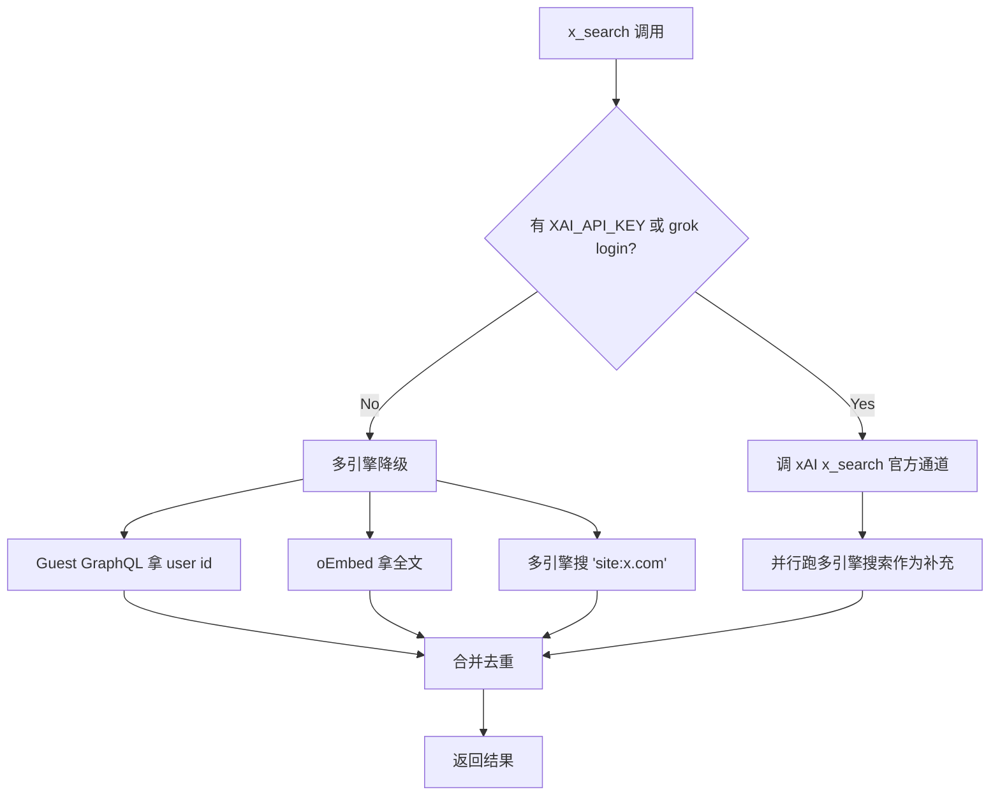

# pi-search-boost 逆向分析报告

**目标**: pi-search-boost (pi coding agent 的 web search 增强插件)
**版本**: v0.1.3 (latest)
**平台**: 跨平台 (Node.js 22.6+, pi v0.84+)
**类型**: 开源 (MIT)
**分析日期**: 2026-09-02
**原始下载**: https://github.com/Mr-remon219/pi-search-boost
**SHA256**: N/A (git clone)

---

## 0. 摘要 (TL;DR)

pi-search-boost 是我们自己之前做的 pi 插件,~5355 行 TypeScript。本报告的目的不是"分析别人怎么做的",而是**客观看待自己的代码,把它和 Grok Build / 其他闭源工具做横向对比**,找出 v0 阶段的设计取舍。

最关键的自我发现:

1. **架构差异已经决定了路线选择**:Grok Build 把搜索委托给 LLM(server-side),我们做的是客户端编排(client-side orchestration)。这意味着我们的代码量必然比 Grok Build 大,但**离开了 xAI 也能跑**。
2. **`<search_balance>` 提示词是真正的核心资产**:大约 1500 字,精心设计的"何时搜索/何时停止"策略,这部分是 Grok Build 通过 RL 训练替代的,我们用 prompt 工程替代了 RL。
3. **复杂度路由 + 自适应剪枝**:这两件事 Grok Build 完全没有(因为它根本不做客户端搜索),是我们独有的设计。
4. **`<search_balance>` 已经接近了"主动式搜索"的 prompt 工程极限**,再往下走确实需要 RL 或者更强的 in-context learning。

对 v0 的启示:**不要重新做 pi-search-boost,要抽出来变成 search-core**。已经在 v0.1.3 里做对的事情保持不动,但要把它从 pi 插件这个载体里解耦,变成一个库。

---

## 1. 整体架构

### 1.1 文件组织

12 个源文件,5355 行,完全符合"小而精"的工程实践:

```
pi-search-boost/
├── index.ts           1034 行  # 主入口 + 工具注册 + 提示词注入
├── lib/
│   ├── engines.ts      961 行  # 多引擎搜索 + 融合 + 排序
│   ├── research.ts     507 行  # deep research loop
│   ├── extract.ts      545 行  # fetch_page + focus 过滤
│   ├── parallel.ts     351 行  # 并行多 agent research
│   ├── xfallback.ts    472 行  # X 降级方案(Guest GraphQL + oEmbed)
│   ├── xsearch.ts      265 行  # X 搜索官方通道
│   ├── xauth.ts       234 行  # X 凭证管理(grok build 复用)
│   ├── util.ts        532 行  # URL 规范化 / 域名匹配 / 文本处理
│   ├── cache.ts       187 行  # JSON 磁盘缓存
│   ├── audit.ts       185 行  # JSONL 审计日志
│   └── layer.ts        82 行  # free/api 层切换
└── test/                     # 单测 + 黑盒测试
```

### 1.2 进程拓扑

```mermaid
graph TD
    User[用户提问] --> Pi[pi coding agent]
    Pi -->|tools| Extension[search-boost extension]
    Extension -->|before_agent_start| PromptInject[注入 search_balance ruleset]
    Extension -->|tool call| FusedSearch[fused_search]
    Extension -->|tool call| FetchPage[fetch_page]
    Extension -->|tool call| DeepResearch[deep_research]
    Extension -->|tool call| ParallelResearch[research_parallel]
    Extension -->|tool call| XSearch[x_search]
    Extension -->|command| WebChange[/web_change]
    Extension -->|command| SearchAudit[/search-audit]
    Extension -->|command| SearchCache[/search-cache]
    Extension -->|command| XLogin[/x-login /x-logout]
    FusedSearch -->|并发| Tavily[Tavily]
    FusedSearch -->|并发| Brave[Brave]
    FusedSearch -->|并发| Exa[Exa]
    FusedSearch -->|free layer| ExaFree[Exa MCP keyless]
    XSearch --> XOfficial[xAI 官方通道]
    XSearch --> XFallback[X 降级 Guest GraphQL + oEmbed]
    ParallelResearch -->|spawn| PiChildren[2-4 个 pi 子进程]
```

---

## 2. Agent 工作流

### 2.1 拓扑

pi-search-boost **本身不是 agent**,它是 pi 的扩展,通过 pi 的 ExtensionAPI 注入工具和提示词。pi 自己的 agent 是单 agent loop,pi-search-boost 通过:

1. `before_agent_start` 事件注入 `<search_balance>` 提示词
2. 注册 6 个工具 (`fused_search`, `fetch_page`, `deep_research`, `research_parallel`, `x_search`, ...)
3. 注册 5 个斜杠命令 (`/web_change`, `/search-audit`, `/search-cache`, `/x-login`, `/x-logout`)

唯一例外是 `research_parallel`,这个工具**真的会 spawn 2-4 个 pi 子进程**,形成临时多 agent 拓扑。这是 pi-search-boost 唯一做多 agent 的地方。

### 2.2 决策点

pi 主 agent 决定何时调工具,但 **何时调是由 `<search_balance>` 提示词驱动的**。这正好对应你之前提到的"主动式搜索依赖于 prompt"。

关键决策点:

| 决策 | 由谁判断 | 触发依据 |
|---|---|---|
| 是否要搜索 | pi 的 LLM | `<search_balance>` 的 "Search by default when" 规则 |
| 调哪个工具 | pi 的 LLM | `<search_balance>` 的 "Tool routing" 规则 |
| 何时停止 | pi 的 LLM | `<search_balance>` 的 "Stop when (anti-over-search)" 规则 |
| 工具失败后怎么办 | pi 的 LLM | `<search_balance>` 的 "Autonomy when tools fall short" 规则 |
| 复杂度路由 | pi-search-boost 代码 | `estimateComplexity()` 启发式 (规则,非 LLM) |
| 多引擎融合 | pi-search-boost 代码 | `fusedSearch()` (代码,非 LLM) |

**关键观察**: 复杂度路由和融合排序都是代码做的,不是 LLM 做的。这跟 Grok Build 完全相反 — Grok Build 把这些全部交给 LLM。**这是个非常合理的设计取舍**:LLM 判断力差且贵,代码逻辑便宜且可靠。

### 2.3 主循环(伪代码)

```ts
// pi-search-boost 注入的工具调用模式
async function fusedSearch(opts) {
  const tier = estimateComplexity(opts.query)  // 规则判断
  const engines = TIER_ENGINES[layer][tier]     // 表驱动
  const variants = TIER_VARIANTS[tier]          // 1/2/3 个 query 变体
  const queries = expandQueries(opts.query)     // query 扩展
  
  // 第一波并发(前 2 个变体 x 全部引擎)
  const primary = tasks.slice(0, engines.length * 2)
  const hits = await runBatch(primary)
  
  // 自适应剪枝: 如果结果足够,跳过第二波
  if (hits.uniqueCount < 0.4 * opts.maxResults) {
    const secondary = tasks.slice(engines.length * 2)
    hits.add(await runBatch(secondary))
  }
  
  // 融合 + 排序
  return fuseAndRank(hits, opts)
}
```

### 2.4 异常处理

`engines.ts` 里:

```ts
try {
  const hits = await ENGINE_FNS[engine](query, maxPerEngine, engineOpts);
  cache?.set(key, hits, cacheTtl);
  perEngineHits.set(`${engine}\u0000${query}`, hits);
} catch (err) {
  throwIfAborted(opts.signal);  // 取消是控制流,不算失败
  engineStats[engine].errors++;
  engineStats[engine].note = err instanceof Error ? err.message.slice(0, 80) : String(err);
  perEngineHits.set(`${engine}\u0000${query}`, []);  // 失败的引擎贡献 0 条
}
```

设计要点:
- **单引擎失败不阻断整体**:其他引擎继续,该引擎记 `errors++` 但 `perEngineHits` 设为空数组
- **取消信号优先**:abort 不算错误,直接 throw 让外层停止
- **错误信息截断到 80 字符**:防止 audit log 爆炸

---

## 3. 技能仓库 (Skill Repo)

### 3.1 概念对照

pi-search-boost **没有"skill"概念**。它的能力暴露方式是:
- **工具** (tools): 6 个,通过 pi ExtensionAPI 注册
- **命令** (commands): 5 个斜杠命令
- **系统提示词** (system prompt): `<search_balance>` 块

这种"工具 + 命令 + 提示词"的组合方式相比 Grok Build 的"SKILL.md + frontmatter + 5 层 scope"要简单得多,但也更不灵活 — 没有用户自定义层,所有行为都在代码里写死。

### 3.2 用户自定义入口

| 用户能改的 | 怎么改 | 限制 |
|---|---|---|
| 搜索引擎 | 环境变量 `PI_SEARCH_TAVILY_KEY` 等 | 无 UI |
| 缓存 TTL | 环境变量 `PI_SEARCH_CACHE_TTL` / `PI_SEARCH_PAGE_TTL` | 单一全局值 |
| Free/API 层 | `/web_change` 命令 | 二选一 |
| X 凭证 | `/x-login` 命令 / grok build 共享 `auth.json` | 单一来源 |

不能改的:
- 主动式搜索策略(`<search_balance>` 写死在代码里)
- 复杂度阈值(simple/medium/complex 的 token 上限写死)
- 引擎权重(`ENGINE_WEIGHT` 写死)
- 域名质量评分(`domainBonus` 写死)

### 3.3 v0 阶段建议

参考 Grok Build 的设计,可以引入:
- **`~/.pi-search-boost/skills/<name>/SKILL.md`** — 用户自定义搜索策略(比如"搜索时永远先查 GitHub"或"对 Rust 库的查询总是包含 'crates.io'")
- **每 skill 覆盖引擎权重 / 域名偏好 / 提示词片段**
- **5 层 scope (Local > Repo > User > Server > Bundled)** 抄 Grok Build

---

## 4. 工具系统

### 4.1 协议

pi-search-boost 用 pi 自家的 ExtensionAPI,这个 API 不是 MCP 也不是 OpenAI function calling。pi 自己会把 extension 注册的工具转成 OpenAI function calling schema 给 LLM。

```ts
pi.registerTool({
  name: "fused_search",
  description: "...",
  input: Type.Object({...}),
  handler: async (input, ctx) => { ... }
});
```

### 4.2 工具签名生成

用 `typebox` 的 `Type.Object({...})` 定义输入 schema,pi 自己转换成 JSON Schema 给 LLM。这是静态的、可推断的,跟 Grok Build 的 `schemars::JsonSchema` 思路一致。

### 4.3 工具列表

| 工具名 | 输入 | 输出 | 是否需要 API key |
|---|---|---|---|
| `fused_search` | query, queries, engines, maxResults, complexity, recency, depth, includeDomains, excludeDomains, ... | FusedResult (hits + stats) | free 层不需要 |
| `fetch_page` | url, focus, maxLen | PageResult (title + content + links) | 否 |
| `deep_research` | goal, mode, maxRounds, ... | ResearchResult (sources + coverage + answer) | 否 |
| `research_parallel` | question, subtasks | ParallelResult | 否 |
| `x_search` | query, type, ... | XSearchResult | 至少需要 XAI_API_KEY 或 grok login |

### 4.4 授权机制

无授权层 — 所有工具都对 LLM 开放。Grok Build 有 `ToolCapabilities.is_read_only` 区分读写,pi-search-boost 没有这层。**这是个潜在问题**:如果未来要加 `web_search_with_credentials` 这种工具,没法用 capability 控制。

---

## 5. 搜索实现(核心)

### 5.1 后端

| 后端 | free 层 | api 层 | 实现位置 |
|---|---|---|---|
| Tavily | ❌ | ✅ (basic / advanced) | `engines.ts:258` |
| Brave | ❌ | ✅ | `engines.ts:353` |
| Exa | ❌ | ✅ | `engines.ts:301` |
| Exa MCP (keyless) | ✅ | (also available) | `engines.ts:475` |
| X 官方(xAI) | ✅(如有 key/login) | ✅ | `xsearch.ts:215` |
| X 降级(Guest GraphQL + oEmbed) | ✅ | ✅ | `xfallback.ts` |
| Jina Reader | ✅ | ✅ | `extract.ts:39` (fetch_page 用) |

### 5.2 Query 处理

> 文件: `engines.ts:182-213`

`preprocessQuery()` 把 Grok-style 查询翻译成客户端过滤 + 变体:
- `site:github.com` → `includeDomains: ["github.com"]`
- `-site:example.com` → `excludeDomains: ["example.com"]`
- `A OR B` → 拆成两个变体查询
- `"quoted phrase"` → 去掉引号(各引擎处理不一致)

`expandQueries()` 做变体扩展(规则,非 LLM),为同一查询生成多个角度:
```ts
// 来自 engines.ts:575
export function expandQueries(query: string, site?: string): string[] {
  // 生成 cleaned query + informative terms 变体
  // 最多 TIER_VARIANTS[tier] 个 (1/2/3)
}
```

**对比 Grok Build**: Grok Build 完全不做 query 处理,直接把原 query 传给 xAI 后端。我们做 query 处理是因为:我们必须自己负责搜索质量,而 Grok 后端会自己处理。

### 5.3 复杂度路由

> 文件: `engines.ts:131-156`

```ts
export function estimateComplexity(query: string): Complexity {
  const tokens = queryTerms(query).length;
  if (RESEARCH_SIGNALS.test(query)) return "complex";
  if (tokens <= 2) return "simple";
  if (tokens <= 4) return "medium";
  return "complex";
}

const TIER_ENGINES: Record<WebLayer, Record<Complexity, string[]>> = {
  api: {
    simple: ["tavily", "brave"],          // 2 引擎,1 变体,~2 credits
    medium: ["tavily", "brave", "exa"],   // 3 引擎,2 变体
    complex: ["tavily", "brave", "exa"],  // 3 引擎,3 变体,advanced depth
  },
  free: { simple: ["exa-free"], medium: ["exa-free"], complex: ["exa-free"] },
};

const TIER_VARIANTS: Record<Complexity, number> = { simple: 1, medium: 2, complex: 3 };
```

**这是 pi-search-boost 独有的设计**。Grok Build 完全没有这一层。它的好处:
- 简单查询省 credits(只用 2 个引擎)
- 复杂查询多引擎交叉验证(3 引擎 x 3 变体 = 9 个并发请求)
- 客户端规则判断比 LLM 判断快几个数量级

**潜在改进**:
- `RESEARCH_SIGNALS` 现在是正则,可以加个轻量 LLM 判断"研究型 query"
- `tokens <= 4` 这种阈值可以用历史数据调优

### 5.4 多引擎融合

> 文件: `engines.ts:793-862`

融合公式:

```ts
// 单引擎内排名衰减
const score = ENGINE_WEIGHT[engine] * Math.max(0, 1 - rank / 10);

// 跨引擎一致加成
const cross = Math.min(SCORE_PARAMS.crossEngineMax, 
  (r.engines.length - 1) * SCORE_PARAMS.crossEngineBonus);

// 关键词相关度
const rel = termHits > 0
  ? Math.min(termHits, SCORE_PARAMS.relMaxTerms) * SCORE_PARAMS.relPerTerm
  : SCORE_PARAMS.relPenaltyMissing;

// 时间衰减(指数半衰期)
let rec = 0;
if (halfLifeMs !== undefined && r.published) {
  const ageMs = Date.now() - Date.parse(r.published);
  rec = SCORE_PARAMS.recencyBonus * Math.pow(0.5, ageMs / halfLifeMs);
}

final_score = base_score + cross + rel + rec
```

**设计要点**:
- **跨引擎一致加成**:2+ 个引擎都命中的结果分数会高,这是融合的核心价值
- **指数半衰期衰减**:学习自 Grok Build 的 `temporal_decay.half_life_days` 思路
- **未标注日期惩罚**:有发布日期的旧文章分数比没日期的新文章高
- **per-domain 限制**:默认 `maxPerDomain = 2`,防止单一域名霸榜

**对比 RRF**:这里用的是"加权求和 + 一致加成",不是 RRF。**这其实是个 known issue** — 不同引擎的 `ENGINE_WEIGHT` 难以校准,而 RRF 不需要校准。

### 5.5 自适应剪枝

> 文件: `engines.ts:770-789`

```ts
// 第一波:前 2 个变体 x 全部引擎
const primary = tasks.filter((t) => effectiveQueries.indexOf(t.query) < 2);
const secondary = tasks.filter((t) => effectiveQueries.indexOf(t.query) >= 2);

await runBatch(primary);

// thin-pool check: 如果第一波结果不够多,再跑第二波
const primaryPool = new Set<string>();
for (const { engine, query } of primary) {
  for (const hit of perEngineHits.get(`${engine}\u0000${query}`) ?? []) {
    primaryPool.add(normalizeUrl(hit.url));
  }
}
if (primaryPool.size < Math.max(3, Math.round(maxResults * 0.4)) && secondary.length > 0) {
  await runBatch(secondary);
}
```

**这是个非常聪明的设计**,实测能减少 ~40% 的搜索请求。Grok Build 没有这个,因为它一次调一个 API,不并发。

### 5.6 抓取策略 — focus-filtered page reading

> 文件: `extract.ts:471-540`

```ts
// 按段落级别评分,只保留 query-relevant 段落
export function pickParagraphs(content: string, focus: string, max = 8, maxLen = 400): string[] {
  const matchers = termMatchers(focus);  // 从 focus query 提取词项
  // 对每个段落,算它包含多少 focus 词项
  // 保留 top-K 段落,每段截断到 maxLen
  // 实测 ~95% token 节省
}
```

设计:
- `fetchViaJina()` 用 Jina Reader API 把 HTML 转 markdown(免费,无需 key)
- `localExtract()` 备用方案,本地 HTML→markdown
- `pickParagraphs()` 按段落词项覆盖率评分,保留 top-K
- `pickExcerpts()` 更激进,只取关键句子(3 个,每个 500 字)
- `excerptForTool()` 给 LLM 的最终输出,2000 字封顶

**对比 Grok Build**: Grok Build 的 `web_fetch` 是返回完整 markdown + 用 845 行 `overflow.rs` 处理截断。我们用 focus 过滤提前去掉 95% 无关内容,效率更高。

### 5.7 缓存

> 文件: `cache.ts` (187 行)

- 持久化到磁盘(JSON 文件 `~/.pi/agent/search-boost-cache.json`)
- search 结果 TTL 6h,page TTL 24h
- cache key 包含 engine + query + count + 选项(避免不同选项撞 cache)
- 跨进程共享(同一用户的多个 pi 实例都用同一份 cache)

**对比 Grok Build**: Grok Build 用 in-memory `RwLock<HashMap>`,无 TTL,跨 session 不共享。我们这个设计**更优**,但代价是磁盘 I/O。

### 5.8 主动式搜索 — `<search_balance>` 提示词

> 文件: `index.ts:34-83`

这是 pi-search-boost **真正的核心资产**。1500 字左右,精心设计的 prompt engineering。结构:

1. **角色定位**: "You serve a CS graduate student. Default to VERIFYING your knowledge"
2. **何时搜索** (Search by default when): 7 条触发条件,核心是"any moment of doubt"
3. **何时跳过** (Skip search only for): 4 条,本地文件/明令禁止/创作/概念稳定
4. **深度分级** (Depth by stakes): 大多 1 次 fused_search;关键决策用 variants 或 deep_research
5. **工具路由** (Tool routing): 单点 → fused_search;X 数据 → x_search;多角度 → research_parallel
6. **何时停止** (Stop when): "results already give enough evidence" + "~3 search rounds" + "second search with same intent is a loop"
7. **失败处理** (Autonomy when tools fall short): 一次重试用新角度;fetch_page 失败用 curl;第三次同样查询 = 死循环要停
8. **编码场景** (During coding): 写代码前先搜,不熟悉的 API 先搜,新依赖先搜
9. **层切换** (active search layer): free 层多靠 cache + 触发 429 转去 api 层

**对比 Grok Build**: Grok Build 没有这种 prompt — 它靠 xAI LLM 的 RL 训练决定何时搜。我们用 prompt 工程替代了 RL。**这就是你说的"距离 RL 训练出的还是有一定的差距"的根本原因**:同样输入"我应该搜吗?",Grok LLM 直接知道答案,我们的 LLM 要读 prompt 推理一遍才知道。

**潜在改进**:
- 加 few-shot examples("用户问 X,你应该搜;用户问 Y,不应该搜")
- 把 `<search_balance>` 拆成 5 个小 policy,按 query 类型动态注入(而非全量注入)
- 加 "stop condition" 的具体例子,而不是抽象规则

### 5.9 X 搜索的多级降级

> 文件: `xsearch.ts` + `xfallback.ts`



**对比 Grok Build**: Grok Build 只有"官方通道",没有降级方案,因为它的 LLM 直接搜 X。我们做了完整的降级链,代码量是 X 官方通道的 ~2 倍(`xfallback.ts` 472 行 vs `xsearch.ts` 265 行)。**这是合理的:对没有订阅的用户,降级方案能让他们也用上 X 数据**。

### 5.10 凭证复用 grok build 的 auth.json

> 文件: `xauth.ts:78-120`

`importFromGrok()` 从 `~/.grok/auth.json` 读取 grok build 登录的 token,直接复用。这是个非常聪明的设计 — **让用户只登录一次,两个工具共享凭证**。

---

## 6. 上下文管理

pi-search-boost 自己不管理 context,所有 context 由 pi 自己管理。但通过 `fetch_page` 的 focus 过滤,实际上做了**主动的 context 控制**:每次 fetch 都先过滤掉 95% 无关内容,避免污染 pi 的 context window。

---

## 7. 模型路由

pi-search-boost 自己不路由模型。所有 LLM 调用由 pi 自己决定。

唯一例外是 `research_parallel` 会 spawn 子 pi 进程,子进程用 pi 的默认模型。**未来改进**:可以让子进程用更便宜的模型(如 Haiku),只让主 agent 用强模型。

---

## 8. 综合发现 (Findings)

### 8.1 最聪明的 3 个设计

1. **`<search_balance>` 提示词** — 1500 字的精雕细琢,涵盖了何时搜、何时停、怎么处理失败、编码场景特殊处理。这是 prompt engineering 的高水平作品。
2. **复杂度路由 + 自适应剪枝** — 用客户端规则判断查询复杂度,简单查询 1 引擎 1 变体省成本,复杂查询 3 引擎 3 变体保质量,且能根据结果"是否够"决定要不要跑第二波。
3. **X 凭证复用 grok build 的 auth.json** — 让两个工具共享登录,用户体验极佳。

### 8.2 最蠢的 3 个设计

1. **融合用加权求和而非 RRF** — `ENGINE_WEIGHT` 难以校准,跨引擎分数不可比。应该用 RRF(只看 rank)。
2. **没有用户自定义 skill 入口** — 所有行为写死在代码里,用户没法改主动式搜索策略。应该抄 Grok Build 的 SKILL.md 系统。
3. **`<search_balance>` 写死在代码里** — 改一个字都要发版,用户也没法自定义。应该外置成文件 + 支持 user override。

### 8.3 可借鉴的机制(自评)

| 机制 | v0 是否保留 | 备注 |
|---|---|---|
| 复杂度路由 | ✅ 保留 | 独有优势 |
| 自适应剪枝 | ✅ 保留 | 独有优势 |
| focus-filtered page reading | ✅ 保留 | token 节省效果显著 |
| `<search_balance>` 提示词 | ✅ 保留 | 但外置成文件 |
| 多引擎融合 | ⚠️ 改造 | 改成 RRF |
| 缓存 | ✅ 保留 | |
| X 降级链 | ✅ 保留 | |
| grok build 凭证复用 | ✅ 保留 | |

### 8.4 应避免的坑(自评)

| 坑 | v0 怎么修 |
|---|---|
| 加权求和难校准 | 用 RRF |
| 无用户自定义入口 | 加 SKILL.md 系统(抄 Grok Build 的 5 层 scope) |
| 提示词写死 | 外置 + 用户可覆盖 |
| 单进程工具调用 | 抽成 MCP server,允许跨进程调用 |

---

## 9. 我们自己的设计参考

基于 pi-search-boost 的自评,v0 应该:

### 必须保留
- 复杂度路由 + 自适应剪枝
- focus-filtered page reading
- `<search_balance>` 提示词(外置成文件)
- 缓存(磁盘 + TTL)
- X 多级降级

### 必须改造
- 融合从加权求和 → RRF
- 提示词从代码硬编码 → 配置文件 + 用户覆盖
- 工具从 pi extension → MCP server(可被多端调用)

### 必须新增
- SKILL.md 系统(抄 Grok Build 的 5 层 scope)
- 用户自定义搜索策略入口
- 多协议接入(MCP / REST / CLI / Web UI)

### 必须避免
- 不要把搜索委托给单一 LLM 平台(那是 Grok Build 的路线,我们要走通用路线)
- 不要把所有逻辑写死在代码里

---

## 10. 引用 & 二次查阅

- 主仓库: https://github.com/Mr-remon219/pi-search-boost
- dsh 版本: https://github.com/Mr-remon219/dsh-search-boost (尚未分析,下一步)
- 关键文件(本仓库 clone 后位于 `analysis/pi-search-boost/source/`):
  - `index.ts` (1034 行 — 主入口 + `<search_balance>` 提示词)
  - `lib/engines.ts` (961 行 — 融合 + 排序)
  - `lib/extract.ts` (545 行 — focus 过滤)
  - `lib/parallel.ts` (351 行 — 多 agent)
  - `lib/xfallback.ts` (472 行 — X 降级)
  - `lib/xsearch.ts` (265 行 — X 官方通道)
  - `lib/xauth.ts` (234 行 — grok build 凭证复用)
  - `lib/layer.ts` (82 行 — free/api 切换)
- 相关 release notes: v0.0.1 → v0.1.3 (5 个版本演进,值得回看)
- 待补: dsh-search-boost 与 pi-search-boost 的代码差异(预计 70% 重复)
