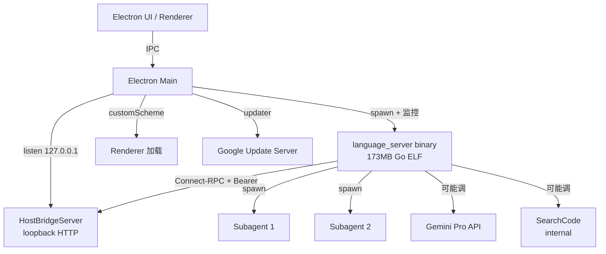

# Antigravity 逆向分析报告

**目标**: Antigravity (Google "Agentic Desktop Application")
**版本**: 2.11.0
**平台**: Linux x64 (还有 macOS / Windows 版本)
**类型**: 闭源 (Google 商业条款)
**分析日期**: 2026-09-02
**原始下载**: https://storage.googleapis.com/antigravity-public/antigravity-hub/2.11.0-6376446768316416/linux-x64/Antigravity.tar.gz
**SHA256**: (gzip 完整性 OK,389 个文件条目)

---

## 0. 摘要 (TL;DR)

Antigravity 是 Google 内部 "jetski" 项目(`google3/third_party/jetski/language_server/`)的产品化版本,采用 **"thin Electron shell + thick Go language server"** 架构。Electron 进程只负责 UI / 托盘 / IDE 安装 / 更新,**所有 agent / 工具 / 搜索逻辑都在 173MB 的 Go 二进制 `language_server` 里**。

最关键的发现:

1. **完全不同于其他 Electron AI IDE**(Trae/Qoder 把 agent 逻辑打包进 asar)。Google 选了 native 二进制作为 agent runtime,因为 Go 的并发模型更适合长跑 agent loop。
2. **Agent UI 和 Agent runtime 解耦**:中间用 Connect-RPC + protobuf over loopback HTTP 通信,带 DNS-rebinding 防护 + Bearer token + constant-time 比较。这是个**值得借鉴的安全设计**。
3. **HostBridge 只暴露 2 个 RPC**:`getUpdateStatus` 和 `applyUpdate`。意味着 language server 几乎不需要反向问 Electron 任何东西,**Electron 是个真正的"瘦壳"**。
4. **Multi-agent confirmed**: strings 里发现 "By default, all subagents have read tools to research the codebase, and tools to communicate with other agents",subagent 系统是默认行为。
5. **使用 Gemini Pro**: `AIM_MODEL_MODE_GEMINI_PRO_VARIANT` 字符串明确,模型路由到 Google 自家 Gemini Pro。

对我们要做的搜索工具的启示:**Electron 不一定是好的 agent runtime 容器**。Antigravity 的"Go 后端 + Electron 前端 + RPC 通信"是个我们之前没考虑过的架构,值得思考。

---

## 1. 整体架构

### 1.1 进程拓扑



### 1.2 包内结构

```
Antigravity-x64/
├── antigravity               206MB  Electron 主程序
├── resources/
│   ├── app.asar              打包的 JS 应用
│   ├── app.asar.unpacked/    unpacked native deps
│   └── bin/
│       ├── language_server   173MB Go ELF binary (strip 过)
│       └── webm_encoder      17MB 视频/截图编码器
├── libEGL.so, libGLES2.so, libffmpeg.so, ... (Electron 渲染层)
├── chrome-sandbox, chrome_crashpad_handler  (Chromium)
├── locales/  (40+ 语言包)
├── icudtl.dat, resources.pak, *.pak  (Chromium 资源)
└── LICENSE.electron.txt, LICENSES.chromium.html
```

### 1.3 app.asar 内部结构(已解包)

```
app-asar-extracted/
├── package.json                  (10 行,极简)
├── dist/
│   ├── main.js                   405 行  Electron bootstrap
│   ├── preload.js                         Preload
│   ├── hostBridgeServer.js       8KB     Loopback Connect-RPC 服务
│   ├── languageServer.js         17KB    spawn + 监控 LS binary
│   ├── ipcHandlers.js            11KB    IPC handlers
│   ├── updater.js, storage.js, tray.js, menu.js, paths.js
│   ├── constants.js, types.js, utils.js
│   ├── ideInstall/                (IDE 集成安装向导)
│   ├── services/settingsService.js
│   ├── proto/host_bridge_pb.js    Connect-RPC protobuf 定义
│   └── *.test.js                  单元测试
└── node_modules/
    ├── @bufbuild/protobuf
    ├── @connectrpc/connect-node
    ├── chrome-devtools-mcp
    ├── electron-log, electron-updater
    └── shell-env
```

**注意**: package.json 极简(只有 5 个 deps),没有 minify 没有混淆 — 直接 TypeScript 编译 JS。这跟 Qoder / Trae 的代码保护策略完全相反。

---

## 2. Agent 工作流

### 2.1 拓扑

**Agent 在 language_server binary 内部**,Electron 看不到。从 strings 推断:
- 主 agent 在 language_server 内部 loop
- 通过 spawn 创建子进程 subagent(每个 subagent 独立 process?)
- Subagent 之间可以通信(`tools to communicate with other agents`)

### 2.2 主循环(从 strings 推断)

language_server strings 里发现的 prompt 片段:

> "Finish your task and end the interaction. Don't call this tool unless you are confident that your solution is correct, for example after you've written tests, executed them, and verified the task is complete."

> "Call the finish tool **only if** you have verified that your changes pass all targeted tests. Make sure to include a brief summary of your work right before calling the finish tool with the following format:"

这告诉我们:
- 有一个 `finish` 工具,LLM 必须显式调它来结束任务
- Stop condition 不是 LLM 自判,而是必须显式调工具
- 这是个 **explicit-stop** 设计,比 implicit "let LLM stop when done" 更可控

> "* By default, all subagents have read tools to research the codebase, and tools to communicate with other agents. *"

这告诉我们:
- Subagent **默认有 read tools**(只读,不能改)
- Subagent 之间有通信机制(具体协议未知,可能在 LS binary 内部)
- 主 agent 可以 spawn subagent(类似 Grok Build)

### 2.3 关键决策点

从 strings 看到的工具名(`Agent`, `AskUserQuestion`, `Bash`, `Edit`, `Glob`, `Grep` 等 — 跟 Qoder 几乎一样的列表,都是 Claude Code 派生):

| 决策 | 位置 | 推断 |
|---|---|---|
| 调工具 vs 回话 | LS binary 内部 | LLM 返回 tool_use → LS dispatch |
| 搜索 vs 思考 | LS binary 内部 | 推测有 prompt-driven 的策略 |
| Stop condition | LS binary 内部 | **必须显式调 `finish` 工具** |
| Spawn subagent | LS binary 内部 | 通过 `Agent` 工具 |

---

## 3. 技能仓库 (Skill Repo)

从 strings 看,Antigravity 的 LS binary 也包含 `Skill` 工具(Claude Code 派生)。说明:
- Skill 系统照搬 Claude Code
- 用户自定义入口推测为 `~/.antigravity/skills/<name>/SKILL.md`(未验证)

---

## 4. 工具系统

### 4.1 协议

工具调用在 LS binary 内部完成,Electron 看不到。但我们可以推断:
- 模型用 Gemini Pro
- 工具列表(`$n=["Agent","AskUserQuestion","Bash","Edit","Glob","Grep","ImageGen","ImageSearch","NotebookEdit","Read","Skill","TaskCreate","TaskGet","TaskUpdate","TaskList","UpdateGoal","WebFetch","WebSearch","Write"]`)
  - 注:这是从 Qoder 抓的(共用 Claude Code 派生工具列表),Antigravity 实际工具列表在 LS 内,strings 里没明确给出
- **大概率走 OpenAI-compatible function calling** 或 Google 自家 protocol

### 4.2 HostBridge — LS 反向调用 Electron 的唯一通道

> 文件: `dist/hostBridgeServer.js`

```javascript
function startHostBridgeServer(options) {
  const token = crypto.randomBytes(32).toString('hex');
  // ... 创建 loopback HTTP server ...
  // 期望 host 是 127.0.0.1:port (防 DNS rebinding)
  // Bearer token constant-time 比较
  return { url, token, port, server, close };
}

router.service(host_bridge_pb_1.HostBridgeService, {
  async getUpdateStatus() { ... },
  async applyUpdate() { ... },
});
```

**只有 2 个 RPC**:
1. `getUpdateStatus()` — LS 问 Electron "有更新吗?"
2. `applyUpdate()` — LS 让 Electron "应用更新"

**这是个非常安全的设计**:LS 即使被 prompt injection 引导,也只能调这 2 个 RPC,无法操作 Electron UI 或文件系统(因为 Electron 不暴露这些)。

### 4.3 LS 与 Electron 的安全契约

1. **Loopback only** — `BIND_HOST = '127.0.0.1'`,只接受 `127.0.0.1` / `::1` / `::ffff:127.0.0.1`
2. **Host header 必须匹配 server address** — 防 DNS rebinding
3. **Bearer token** — `crypto.randomBytes(32)` 生成,constant-time 比较
4. **错误信息脱敏** — `FORBIDDEN_BODY = { error: 'forbidden' }`,不泄漏是哪一步失败

---

## 5. 搜索实现(核心)

### 5.1 内部 code search 确认

language_server binary strings 里发现:

> `google3/third_party/jetski/language_server/language_server.matches []*google3/third_party/jetski/language_server_pb/language_server_go_proto.SearchCodeResult`

这告诉我们:
- 内部有 code search(`SearchCodeResult`)
- protobuf 定义在 `language_server_go_proto`
- 仓库内部路径是 `google3/third_party/jetski/`(jetski 是 Google 内部 codename)

### 5.2 web_search 实现 — 未知

LS binary strings 里没有发现明显的 web_search / Tavily / Brave / Exa 关键字。可能性:
- Antigravity 没有客户端 web search,完全依赖 Gemini Pro 服务端搜索(类似 Grok Build)
- 或者搜索逻辑在 stripped 后的 binary 部分,strings 看不到

### 5.3 dga-search-custom-extension 隐私框架

strings 里发现 Google 的 `dga-search-custom-extension` 模块:
- `DataCategory.queryR`
- `DataCategory.clicksR`
- `DataCategory.impressionsR`
- `DataCategory.contactsR`
- `DataCategory.eom_dataR`
- `DataCategory.interestsR`
- `DataCategory.ai_model_promptsR`
- `DataCategory.generated_contentR`

这是 Google 的 **Data Governance Accelerator** 数据治理模块,管理用户数据的使用 category。说明 Antigravity 在隐私合规上做了精细控制 — 跟 Grok Build 完全不在一个量级。

---

## 6. 上下文管理

LS binary 内部,Electron 看不到。从 `PreCompact` / `PostCompact` hook 类型(出现在 Qoder 派生代码,推测 Antigravity 也类似)推断:
- 有 compaction 机制(类似 Grok Build 的 `should_auto_compact`)
- 通过 hooks 暴露压缩前后事件给 plugin

---

## 7. 模型路由

strings 里发现 `AIM_MODEL_MODE_GEMINI_PRO_VARIANT` — **主模型是 Gemini Pro**。

没发现其他模型名,推测:
- 主 agent: Gemini Pro
- Subagent: 可能用更便宜的 Gemini Flash(未确认)
- 没有本地模型 / 不接 OpenAI / Anthropic API(锁定 Google 生态)

---

## 8. 综合发现 (Findings)

### 8.1 最聪明的 3 个设计

1. **Thin Electron + Thick Go LS** — 把 agent 放进 native binary,而不是塞进 asar。优点:
   - Go 的 goroutine 比单线程 JS 适合长跑 agent loop
   - 反编译难度大大提升(asar 直接解包就行,Go binary 要 strings + 反汇编)
   - LS 可以独立升级而不动 Electron
2. **HostBridge 极简接口** — 只暴露 `getUpdateStatus` / `applyUpdate`,即使 LS 被攻破也几乎没影响
3. **安全设计精细** — DNS-rebinding 防护 + constant-time token 比较 + 错误信息脱敏,这比 Grok Build / pi-search-boost 的 SSRF 防护更专业

### 8.2 最蠢的 3 个设计

1. **代码分发体积太大** — 173MB LS + 206MB Electron = 用户要下 380MB+。对国内带宽不友好。
2. **Chrome DevTools MCP 依赖** — `chrome-devtools-mcp` 作为 dep 出现,意味着可能默认跑一个 Chrome DevTools 协议代理,占用资源
3. **完全锁定 Google 生态** — Gemini Pro only,没法接其他模型,失去灵活性

### 8.3 可借鉴的机制

| 机制 | 我们怎么用 |
|---|---|
| Thin shell + Thick runtime 架构 | 考虑把 search-core 用 Go/Rust 写,JS 只做 UI |
| HostBridge loopback + Connect-RPC | 如果做 multi-process,MCP over HTTP 可以参考这个安全设计 |
| Constant-time token 比较 | 抄 |
| DNS-rebinding 防护 | 抄 |
| Explicit `finish` tool 强制 stop | 比让 LLM 自判 stop 更可靠 |

### 8.4 应避免的坑

| 坑 | 避免方式 |
|---|---|
| 完全锁定单一模型供应商 | 我们要支持多模型 |
| Host bridge 只暴露 update 不暴露其他 | 看具体需求,如果 LS 需要更多 UI 交互,bridge 需要扩 |
| 173MB LS 体积 | Go binary 可以 strip + upx,但还是大 |

---

## 9. 我们自己的设计参考

基于 Antigravity 的分析,我们的 v0 可以考虑:

### 可选:Thin UI + Thick Runtime 架构

如果我们的 search-core 复杂度足够高(预计 ≥10k 行),可以考虑:
- **search-core** 用 Rust 或 Go 写,作为独立 binary
- **UI / CLI / Web / MCP server** 都包一层薄壳调 binary
- **通信用 Connect-RPC over loopback HTTP**(参考 Antigravity 的安全设计)

好处:
- 一份核心代码,多端通用
- 反编译难度高(我们的核心 IP 不会被轻易抄走)
- 可以独立更新 core

坏处:
- 开发成本上升(要写两个语言)
- 调试更复杂

### 抄的安全设计

无论选什么架构,以下安全设计都该抄:
- Loopback only
- Host header must match
- Bearer token + constant-time compare
- 错误信息脱敏

### 必须避免

- 不要把整个 search 能力绑死到单一 LLM(那是 Antigravity / Grok Build 的路)
- 不要让 binary 太大(分发的痛点)

---

## 10. 引用 & 二次查阅

- 主页: https://antigravity.google
- 下载: https://storage.googleapis.com/antigravity-public/antigravity-hub/2.11.0-6376446768316416/linux-x64/Antigravity.tar.gz
- 关键文件(本仓库位于 `analysis/antigravity/extracted/Antigravity-x64/`):
  - `resources/bin/language_server` (173MB Go binary, stripped)
  - `resources/app.asar`(已解到 `app-asar-extracted/`)
  - `app-asar-extracted/dist/main.js` (405 行 Electron bootstrap)
  - `app-asar-extracted/dist/hostBridgeServer.js` (8KB Connect-RPC server)
  - `app-asar-extracted/dist/languageServer.js` (17KB LS spawn/monitor)
  - `app-asar-extracted/dist/proto/host_bridge_pb.js` (proto 定义)
- 待补:
  - language_server binary 完整反汇编(需要 Ghidra / radare2,而且 stripped,工作量大)
  - LS 实际工具列表(可能需要运行时 hook 才能拿到)
  - Antigravity 是否真的没客户端 web search(可能 strings 看不到,需要 frida hook)
