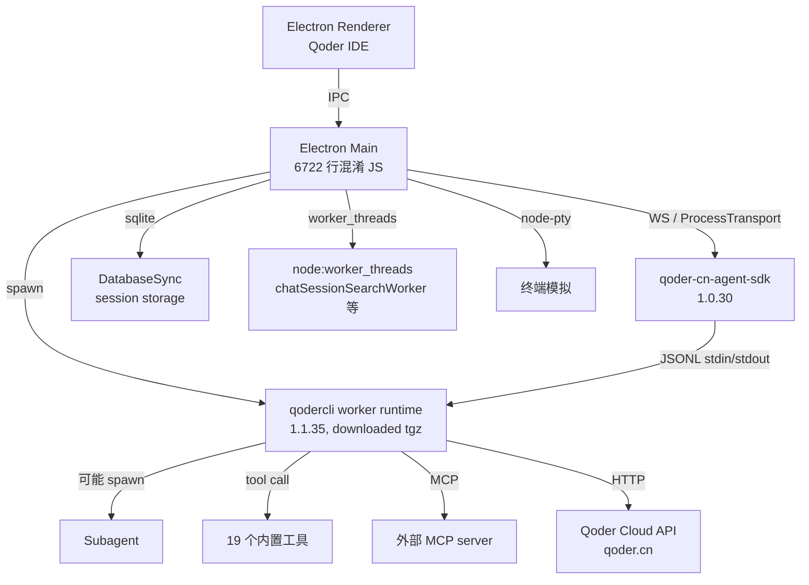

# Qoder 逆向分析报告

**目标**: Qoder CN (阿里通义千问旗下 AI Coding IDE,中国市场版本)
**版本**: latest (CN v1.1.35 worker runtime,SDK v1.0.30)
**平台**: Linux amd64 (deb package)
**类型**: 闭源 (阿里商业条款,有内部 SDK 暴露)
**分析日期**: 2026-09-02
**原始下载**: https://qoder-app.oss-cn-beijing.aliyuncs.com/qoder-app/releases/latest/Qoder-CN-linux-amd64.deb
**SHA256**: (完整 deb,206MB)

---

## 0. 摘要 (TL;DR)

Qoder 是阿里的 AI coding IDE,Electron + 高度混淆的 JS agent + MCP 协议。最关键的发现是**通过 npm 包 `@qoder-ai/qoder-cn-agent-sdk` 的 dist/index.js(尽管混淆)能逆向出完整的工具列表、hook 系统、权限模型、认证机制、skill 系统等**。

最重要的发现:

1. **直接继承 Claude Code 架构**:工具列表(`Agent/Bash/Edit/Glob/Grep/Skill/WebSearch/WebFetch/Write`)、hook 系统(`PreToolUse/PostToolUse/...` 18 种)、permission mode(`default/accept_edits/bypass_permissions/dont_ask/plan/auto`)几乎是 Claude Code 的翻版。
2. **独有的扩展**: `ImageGen` / `ImageSearch`(图像生成/搜索)、`TaskCreate/Get/Update/List` + `UpdateGoal`(任务管理 + 目标跟踪)、3 级 security scan(l1 静态/l2 轻量/l3 深度)。
3. **Dual brand 系统**:同一份代码支持 `cn` 和 global 两个品牌(`QODERCN_*` vs `QODER_*` env vars,`.qoder-cn` vs `.qoder` config dir),`Ao="cn"` 写死为 cn。
4. **4 种认证方式**:accessToken、qodercli(本地 CLI)、jobToken(server-issued)、serviceAccount。
5. **完整 MCP 集成**:支持 `mcp__<server>__<tool>` 命名约定,有 `mcp_list/mcp_get/mcp_call` 保留工具名,可动态配置 server + 工具权限(always_allow/ask/deny)。

对我们要做的搜索工具的启示:**Claude Code 的工具/hook 框架已经是事实标准**(Antigravity 也用、Qoder 也用、Grok Build 也用 SKILL.md)。我们 v0 应该把这个框架抄过去,而不是自己造。

---

## 1. 整体架构

### 1.1 进程拓扑



### 1.2 包内结构

```
/opt/Qoder CN/
├── qoder (shell launcher)
├── resources/
│   ├── app.asar           主应用,6722 行混淆 JS
│   ├── app.asar.unpacked/ unpacked native deps
│   └── dynamic-text/
│       └── qoder-cn.json  cn 版本动态文案
└── node_modules/ (asar 内部)
    ├── @qoder-ai/qoder-cn-agent-sdk/   1.0.30  ★ 核心 SDK
    ├── @modelcontextprotocol/client/   MCP client
    ├── @modelcontextprotocol/server/   MCP server
    ├── @modelcontextprotocol/node/     MCP node 适配
    ├── chrome-devtools-mcp/            同 Antigravity
    ├── node-pty/                       终端
    ├── electron-updater/
    ├── ws/                             WebSocket
    ├── croner/                         定时任务
    ├── yauzl/                          ZIP 解压
    └── ... (其他 deps)
```

### 1.3 `@qoder-ai/qoder-cn-agent-sdk` 结构

```
qoder-cn-agent-sdk/
├── package.json           双重身份: name "@ali/qodercn-agent-sdk-next",
│                          publishConfig registry anpm.alibaba-inc.com
├── LICENSE
├── scripts/postinstall.cjs
├── dist/
│   ├── index.js          35 行 (压缩)  ★ 主入口
│   ├── protocol/index.js 1 行(极简)   协议定义
│   └── runtime-manifest.json           worker runtime 元数据
└── README.md
```

**`runtime-manifest.json`** 是关键:

```json
{
  "version": 1,
  "brand": "cn",
  "sdkVersion": "1.0.30",
  "qoderCliVersion": "1.1.35",
  "defaultTransport": "worker",
  "workerRuntime": {
    "packaged": false,
    "delivery": "install",
    "source": "qodercli-worker-runtime",
    "urlTemplate": "https://static.qoder.com.cn/qoder-cli-cn/releases/1.1.35/qoderclicn-worker-runtime-{target}.tgz",
    "artifactNameTemplate": "qoderclicn-worker-runtime-{target}.tgz"
  }
}
```

**重要观察**:
- `packaged: false` — worker runtime 不打包,运行时下载
- `defaultTransport: "worker"` — 默认用 Node worker_threads 跑 agent
- `qoderCliVersion: "1.1.35"` — worker runtime 版本独立
- URL 是国内 CDN(`static.qoder.com.cn`)

---

## 2. Agent 工作流

### 2.1 拓扑

Qoder 的 agent 在 **qodercli worker runtime** 中跑(不是 Electron 主进程,也不是直接 node)。SDK 通过 ProcessTransport 或 WorkerTransport 与之通信。

```ts
// SDK 暴露的 transports
ProcessTransport     // child_process.spawn
WorkerTransport      // node:worker_threads
```

主 Electron 进程通过 SDK 调用 agent,agent 实际跑在 worker 里。

### 2.2 JSONL 流协议

> 文件: `@qoder-ai/qoder-cn-agent-sdk/dist/index.js`

```javascript
e.push("--print");
e.push("--output-format", "stream-json");
e.push("--input-format", "stream-json");
// ...
e.push("--include-partial-messages");  // 流式部分消息
```

**通信协议**:
- 输入/输出都是 JSON Lines (每行一个 JSON 对象)
- 16MB 单帧上限(`z=16*1024*1024`)
- 超过会抛 `FrameTooLargeError`
- 流式支持 partial messages

### 2.3 关键决策点

| 决策 | 实现 |
|---|---|
| 调工具 vs 回话 | worker runtime 内部 LLM 决策(具体未知) |
| Spawn subagent | 通过 `Agent` 工具(类似 Claude Code) |
| Permission 控制 | 6 种 permission mode + canUseTool 回调 + permission_prompt_tool |
| Stop condition | `--max-turns N` 硬限制 + LLM 自判 |
| Session 恢复 | `--resume <id>` / `--continue` / `--resume-session-at` / `--resume-drops-turn` |

### 2.4 主循环(从 SDK 调用模式推断)

```ts
// 主进程代码
const sdk = createSdkMcpServer({...config});
const transport = new ProcessTransport({auth, model, ...});
await transport.initialize();
transport.write(JSON.stringify({type: "user_msg", content: userQuery}));
// 然后读 stdout JSONL:
//   {type: "assistant_text", content: "..."}
//   {type: "tool_use", tool: "WebSearch", input: {...}}
//   {type: "tool_result", ...}
//   {type: "stop"}
```

---

## 3. 技能仓库 (Skill Repo)

### 3.1 Skill 工具确认

`Skill` 在工具列表里(`$n` 数组),说明 Qoder 有 skill 系统,且**完全照搬 Claude Code**。

### 3.2 `--disable-builtin-skills` 选项

SDK 支持启动时禁用内置 skill,只用用户自定义。这意味着:
- Qoder 有内置 skill(类似 Grok Build 的 `Bundled` scope)
- 用户可以禁用内置只用自己的
- 用户自定义入口可能是 `.qoder-cn/skills/<name>/SKILL.md`(Claude Code 同款)

### 3.3 Plugin 系统

```ts
// SDK API
validatePlugin(plugin)
// CLI 参数
--plugin-dir <path>
```

- Plugin 是 local 目录形式(类似 Grok Build 的 plugin marketplace 但更简单)
- 有 validation 步骤
- `pluginHostProtocol` chunk(8KB) 处理 plugin host 通信

---

## 4. 工具系统

### 4.1 协议

**双重协议**:
- LLM ↔ agent: OpenAI function calling(Gemini 模式,具体未验证)
- agent ↔ 外部: MCP(Model Context Protocol)

### 4.2 工具列表(完整,19 个)

> 文件: `@qoder-ai/qoder-cn-agent-sdk/dist/index.js:1`

```javascript
$n = [
  "Agent",          // spawn subagent
  "AskUserQuestion", // 主动问用户
  "Bash",           // 执行 shell
  "Edit",           // 编辑文件
  "Glob",           // 文件名 glob 匹配
  "Grep",           // 内容 grep
  "ImageGen",       // 生成图片(Qoder 独有)
  "ImageSearch",    // 搜图片(Qoder 独有)
  "NotebookEdit",   // Jupyter notebook 编辑
  "Read",           // 读文件
  "Skill",          // 调用 skill
  "TaskCreate",     // 创建任务(Qoder 独有)
  "TaskGet",        // 查任务
  "TaskUpdate",     // 改任务
  "TaskList",       // 列任务
  "UpdateGoal",     // 更新目标(Qoder 独有)
  "WebFetch",       // 抓 URL
  "WebSearch",      // web 搜索
  "Write",          // 写文件
];
```

**对比 Claude Code 工具**(基线): Claude Code 是 `Bash/Edit/Read/Write/Glob/Grep/Skill/WebSearch/WebFetch/Agent/AskUserQuestion/NotebookEdit/TodoWrite`(13 个)。

Qoder 多了:`ImageGen`, `ImageSearch`, `TaskCreate/Get/Update/List`, `UpdateGoal`。
Qoder 把 `TodoWrite` 改成了 4 个 `Task*` 工具 + `UpdateGoal`(任务系统升级)。

### 4.3 `QODER_FEATURE_TASKS` 特性开关

```javascript
const Co = "QODER_FEATURE_TASKS";
function Bn(env) {
  if (env[Co] !== "0" && env[Co] !== "false") return [...$n];  // tasks 开启
  const t = new Set(zn);  // zn = ["TaskCreate","TaskGet","TaskUpdate","TaskList"]
  return $n.flatMap(s => s === zn[0] ? ["TodoWrite"] : t.has(s) ? [] : [s]);
  // 关闭时:TaskCreate → TodoWrite,其他 Task* 移除
}
```

**这是个非常优雅的设计**:同一个 agent runtime,根据环境变量切换工具集 — tasks 开启时是 Qoder 增强版,tasks 关闭时退化成 Claude Code 兼容版。

### 4.4 MCP 集成

```javascript
const Mo = /^[A-Za-z0-9_-]{1,64}$/;
const Oo = new Set(["mcp_list", "mcp_get", "mcp_call"]);  // 保留名
// MCP 工具命名: mcp__<server>__<tool>
function Zo(server, tool) {
  if (tool.startsWith("mcp__")) return tool;
  const s = rs(server), t = tool === "*" ? "*" : rs(tool);
  return `mcp__${s}__${t}`;
}
```

**MCP 工具的策略**:
- `always_allow` — 永远允许
- `always_ask` — 永远问用户
- `always_deny` — 永远拒绝

通过 `setMcpServers()` 动态配置。

### 4.5 授权机制(6 种 permission mode)

```javascript
switch (permissionMode) {
  case "default":
  case "accept_edits":           // 自动接受文件编辑
  case "bypass_permissions":     // 跳过所有(危险)
  case "dont_ask":               // 不问用户
  case "plan":                   // 规划模式
  case "auto":                   // 自动
}
// 还有 "yolo" 作为 bypass_permissions 的别名
// --dangerously-skip-permissions 强制跳过(更危险)
```

权限粒度:
- 全局: `permissionMode`
- 工具级: `--allowed-tools`, `--disallowed-tools`
- MCP 工具级: tool policy
- 用户级回退: `canUseTool` 回调 / `--permission-prompt-tool stdio`

---

## 5. 搜索实现(核心)

### 5.1 `WebSearch` / `WebFetch` 工具

工具列表里有 `WebSearch` 和 `WebFetch`,但**实际实现在 worker runtime 里**(没解出来),SDK 层看不到。

### 5.2 `ImageSearch` 工具(独有)

Qoder 独有的图片搜索工具,推测调 Qoder Cloud API 实现图像搜索(可能是阿里自家通义万相)。

### 5.3 推测:web search 走 Qoder Cloud

从架构看:
- SDK 通过 `--proxy <url>` 可以指定 VPC endpoint
- env var `QODERCN_VPC_ENDPOINT` 配置 VPC
- 推测 WebSearch 实际请求发到 Qoder Cloud 的 search API

**跟 Grok Build 的相似性**:Grok Build 调 xAI Responses API,Qoder 调 Qoder Cloud API,都是把搜索委托给云端。

### 5.4 chatSessionSearch(本地会话搜索)

> 文件: `out/main/chunks/chatSessionSearchMainService-DaHTwE3y.js` 等 3 个文件

```javascript
import {r as OtA, ...} from "./chunks/chatSessionSearchProjection-BncdIIAy.js";
```

Qoder 内置了**会话内容搜索**(不是 web search),用 SQLite 存 session,然后做全文搜索。这是个 IDE 级特性,不是 agent 特性。

---

## 6. 上下文管理

### 6.1 Session 系统

- `--session-id <id>` — 指定 session ID
- `--session-mirror` — session 镜像到磁盘
- `--no-session-persistence` — 不持久化
- `--fork-session` — fork 一个 session
- `--resume <id>` — 恢复指定 session
- `--continue` — 继续最近的
- `--resume-session-at` / `--resume-drops-turn` — 恢复到特定 turn / drop 某些 turn

存储: SQLite via `node:sqlite DatabaseSync`

### 6.2 compaction

hook 列表里有 `PreCompact` / `PostCompact`,说明 Qoder 有 compaction 机制(类似 Grok Build)。

### 6.3 Frame size 限制

16MB 单帧上限,防止 context 溢出:

```javascript
class FrameTooLargeError extends Error {
  constructor(direction, limit) {
    super(`${direction} exceeded the ${limit}-byte frame limit`);
    this.direction = direction;
    this.limit = limit;
  }
}
```

---

## 7. 模型路由

### 7.1 `--model` 参数

`--model <name>` 启动时指定模型。SDK 层不强制,模型路由在 worker runtime 里。

### 7.2 推测:Qoder 用阿里通义千问

CN 版本几乎可以确定用通义千问(qwen-max / qwen-coder),但 worker runtime 没解出来无法验证。Global 版本可能用其他模型。

---

## 8. 综合发现 (Findings)

### 8.1 最聪明的 3 个设计

1. **`QODER_FEATURE_TASKS` 特性开关** — 同一个 binary 通过 env var 切换工具集,既兼容 Claude Code 又提供增强功能。这种设计避免了维护两个 binary。
2. **Dual brand 系统** — `Ao="cn"` 一个常量控制 env var 前缀、config 目录、命令名、package name、API endpoint。CN 和 Global 共享 99% 代码。
3. **MCP tool 三态权限** — `always_allow / always_ask / always_deny` 配合 `mcp__<server>__<tool>` 命名,管理大量 MCP 工具时清晰可控。

### 8.2 最蠢的 3 个设计

1. **worker runtime 运行时下载** — `packaged: false` + 从 CDN 下载,首次启动慢且依赖网络。如果 CDN 挂了就用不了。
2. **`--dangerously-skip-permissions` + `--yolo` 双重危险选项** — 已经够危险了,还提供两种触发方式,容易误用。
3. **混淆了但 SDK 暴露了所有内部细节** — `dist/index.js` 虽然 minify,但所有 hook 类型、工具列表、permission mode 都明文。混淆只增加阅读难度,不防逆向。

### 8.3 可借鉴的机制

| 机制 | 我们怎么用 |
|---|---|
| `FEATURE_TASKS` 环境变量切换工具集 | v0 可以用类似机制,实验性功能用 env var 开关 |
| Dual brand 系统 | 如果我们的工具要发布多地区版本,抄这个 |
| MCP tool 三态权限 | 抄 |
| Session forking + resume-drops-turn | 抄,会话恢复更灵活 |
| Frame size 限制 | 抄,16MB 是合理上限 |
| `validatePlugin` 在加载前验证 | 抄,避免 plugin 加载就崩 |
| ImageGen / ImageSearch 作为工具 | 考虑加入我们的工具列表 |

### 8.4 应避免的坑

| 坑 | 避免方式 |
|---|---|
| Worker runtime 运行时下载 | 把 runtime 打包进去,首次启动不依赖网络 |
| `--dangerously-skip-permissions` 设计 | 我们不要这种选项,危险操作走显式确认 |
| 混淆但不防逆向 | 不必混淆,但安全敏感部分要放服务端 |
| 19 个工具太多,LLM 选择困难 | 工具应该按 query 类型动态注入(类似 `FEATURE_TASKS` 的思路) |

---

## 9. 我们自己的设计参考

基于 Qoder 的分析,我们的 v0 应该:

### 必须复制
- **Claude Code 工具/hook 框架**(已经是事实标准,不抄会被边缘化)
- **MCP 三态权限**(`always_allow / always_ask / always_deny`)
- **`mcp__<server>__<tool>` 命名约定**
- **Frame size 限制**(防 context 溢出)
- **Session resume / fork 机制**(用户期望)

### 必须改造
- **工具列表动态化**:不是 19 个全暴露,按 query 类型决定注入哪些
- **worker runtime 打包进客户端**,不要运行时下载

### 必须新增
- **多搜索引擎路由**(Qoder 只走自家 cloud,我们要多引擎)
- **per-skill 模型路由**(Qoder 没有,但有用)

### 必须避免
- 不要靠混淆保护 IP(没用)
- 不要做 `--dangerously-skip-permissions` 这种危险选项

---

## 10. 引用 & 二次查阅

- 主页(CN): https://qoder.cn
- 主页(Global): https://qoder.ai
- SDK 文档: https://docs.qoder.cn/cli
- 内部 SDK npm registry: https://registry.anpm.alibaba-inc.com (阿里内网)
- Worker runtime 下载: https://static.qoder.com.cn/qoder-cli-cn/releases/1.1.35/qoderclicn-worker-runtime-{target}.tgz
- 关键文件(本仓库位于 `analysis/qoder/extracted/opt/Qoder CN/resources/app-asar-extracted/`):
  - `out/main/index.js` (6722 行 Electron main, minified)
  - `node_modules/@qoder-ai/qoder-cn-agent-sdk/dist/index.js` (35 行 SDK, minified)
  - `node_modules/@qoder-ai/qoder-cn-agent-sdk/dist/runtime-manifest.json`
  - `out/main/chunks/chatSessionSearchProjection-*.js`
  - `out/main/chunks/chatSessionSubagentTranscript-*.js`
  - `out/main/chunks/pluginHostProtocol-*.js`
  - `out/main/chunks/protocol-*.js`
- 待补:
  - qoderclicn worker runtime 反编译(从 CDN 下载 tgz 后解)
  - agent 主循环实际代码(在 worker runtime 里)
  - WebSearch / WebFetch / ImageGen / ImageSearch 实际实现
  - Qoder Cloud API endpoint 抓包
