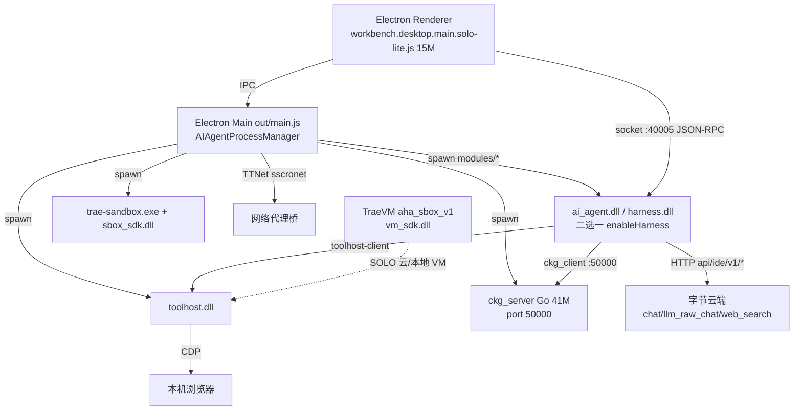

# Trae Work CN 逆向分析报告

**目标**: Trae Work CN (产品名 TRAE SOLO CN, 字节跳动, win32NameVersion "TraeWork CN")
**版本**: 2.3.79533 (tronBuildVersion) / AppVersion 0.1.61 / VS Code fork 1.107.1
**平台**: Windows x64 (Inno Setup 安装包, 非 asar, 目录形式)
**类型**: 闭源 (Electron UI 明文 minify + Rust 原生 agent 仅有 strings)
**分析日期**: 2026-09-02
**解包位置**: `analysis/trae-work-cn/extracted/code$GetDestDir/resources/app/`

---

## 0. 摘要 (TL;DR)

Trae Work 与 Qoder(报告 04) 同为 VS Code fork, 但架构路线完全不同: **agent 运行时不在 JS 里, 而是一整套 Rust/C++ 原生二进制** (ai_agent.dll 275M + harness.dll 183M + toolhost.dll 84M), 通过本地 socket 40005 以 JSON-RPC 挂进 Electron。最重要的发现:

1. **checkpoint.sh 上下文保真机制**: 一个 305 字节的 shell 脚本, 输出一句"自问自答:上下文里还有没有 RFC 全文?"——把上下文完整性检查做成 agent 必须重复执行的脚本, 对抗长任务中的压缩丢失。
2. **完整工具枚举泄露**: ai_agent.dll 里同时存有内部 snake_case 工具名和 LLM 面向的 Claude-Code 兼容 PascalCase 名 (Bash/Read/Edit/Grep/Glob/LS/TodoWrite/TaskCreate...), 还有一整套 30+ Browser* 工具与 V8 Code Mode。
3. **搜索双轨**: 云端 `api/ide/v1/web_search`(两步: 搜引用→批量抓正文) + 本地 ckg 知识图谱(sqlite-vec embedding + rerank + ripgrep)。

---

## 1. 整体架构

### 1.1 进程拓扑



证据: `modules/ai-agent/meta.json` 声明 `connections: [{socket: {port: 40005}}]`; `modules/ckg/meta.json` 声明 50000。out/main.js 里有 `AIAgentProcessManager selected artifact {implementation, enableHarness, product: "solo-lite"|"desktop"}` 与 `"implementation:"harness"":{"fileName:"harness.dll"...}:{fileName:"ai_agent.dll"..."}` — **两代 agent 运行时二选一**, 由设置 `iCubeApp.aiChat.enableHarness` 切换。

### 1.2 原生模块分工 (推测+证据)

| 模块 | 体积 | 角色 | 证据 |
|---|---|---|---|
| ai_agent.dll | 275M | 现役 agent 运行时 (Rust, 内部名 icube_server_rs) | 全部 `apps\icube_server_rs\modules\ai-agent\src\domain\*` 符号; 77 个 domain 服务 |
| harness.dll | 183M | 下一代 agent "harness" (Rust) | `harness\core\src\runner\agent\async_child.rs`、`harness\storage-db\migration\`(独立 agent_run 表)、`harness\toolhost-client\`、"Deep research harness" |
| toolhost.dll | 84M | 工具执行宿主 | `toolhost\browser\browser-use\`、`toolhost\runtime\command-execution\sandbox\`、`toolhost\runtime\job-executor\`(shell_snapshot)、`toolhost\services\toolhost-builtin-skills\`、env `TOOLHOST_BIND_HOST/PORT/RG_PATH` |
| vm_sdk.dll | 2M | SOLO VM SDK (C++) | PDB 路径 `aha_sbox_v1\src\TraeVM\VMSDK\vm_sdk_*.cpp`; main.js 校验 `ai-agent/vm/tools.json` |
| sscronet.dll | 9M | 字节 TTNet (cronet fork) 网络栈 | ai_agent 侧 `crates\net-bridge`, UA `TraeClient/TTNet`, Electron 侧 `SANDBOX_TO_MAIN_FETCH_BY_TTNET` 桥 |
| ckg_server | 41M (Go) | 代码知识图谱服务 | gorm/sqlite + `vec_items_v2(embedding, entity_type...)`、`embedding_recall`、`rerank` |
| trae-sandbox.exe | - | 命令沙箱 | "install trae-sandbox in PATH"、"seccomp filter blocks"、"TRAE Sandbox Error: process crashed" |

数据落地: `start.sh` 导出 `DB_PATH=$ICUBE_MODULAR_DATA_DIR/ai-agent/database.db`、`FILE_BASE_DIR=.../ai-agent/snapshot`、`RG_PATH=.../@vscode/ripgrep/bin/rg`(指向上游 VS Code 自带的 ripgrep)。

---

## 2. Agent 工作流

### 2.1 拓扑: 单主循环 + agent_run 树 + Ralph Loop

主循环在 Rust 侧: `SimpleStartLoop::inner_start_loop begin loop`, 配合 `force_tool_call` 注入机制 ("[inner_start_loop] force_tool_call tool '...'", "take_force_tool_calls")。多 agent 通过 **agent_run 父子树** 实现: strings 里成对出现 `root_agent_run_id / parent_agent_run_id / child_agent_run_id / hand_over_agent_run_id`, 事件 `AgentIdle / AgentWakeup / AgentResume / SubAgentFinish`; 工具 `run_agent` 负责派生子 agent, `get_custom_agent_infos` 从云端拉自定义 agent 树 (team_agent CRUD API)。**不是 Codex 式的固定多角色编排, 而是"主 agent 可按需 spawn 自定义子 agent"**。

SOLO 模式叠加 **Ralph Loop**(Geoffrey Huntley 命名的"循环到做完"模式): `[RalphLoopStopHook] continuing: round=`、`exit: spec_dir_name=`、`RalphLoopContext`、`aggregated products` — stop hook 决定是否继续下一轮, feature flag `ralph_loop_context_cache`。也就是说 SOLO 的"接管电脑替你干活"并非单轮 mega-prompt, 而是"规格文档(RFC) + Ralph 轮次 + 每 plan_item reviewer 验收"的三层结构, checkpoint.sh 正是给这个结构配套的保真装置——循环轮数越多, 上下文失真风险越大, 所以保真检查必须高频执行。

计划执行: `SimplePlanServiceV2` 维护 plan_item, 每个 plan_item 执行后走 **reviewer 决策** ("reviewer routed decision, plan_item_id="), 文件操作有确认中断 ("[FileOp][confirm] decision interrupt scope"); 工具面有 `EnterPlanMode/ExitPlanMode/UpdatePlan`。plan_item 还带独立 SSE 事件 ("sent plan_item termination SSE") 与 `PlanItemCoreMemorySnapshot` — 计划条目在内存记忆里也有快照, 中断/恢复后计划状态可完整重建。另有 goal 三件套 `create_goal/update_goal/get_goal` + GoalService(goal_loop flag)。降本方面有 V8 Code Mode (`ai-agent-code-mode` crate: v8_engine、execution cell、超时终止、`server_name: "integrated_code_mode"`) — Code Mode 让模型写 JS 一次性编排多个工具, 中间结果不进上下文 (与 09-codex 结论互相印证: 两大厂商都在收敛到这个方案), 且以 MCP server 形态注册, 说明内部统一到 MCP 工具面。停止条件除 finish/agent_finish 工具与 RalphStopHook 外, 还有轮次与 token 双重约束痕迹 (`max_turn`、`last_turn_total_tokens` 字段)。

插话与交互走 InteractionFlow (`request_user_input/AskUserQuestion`), 用户回答经 message_queue 回注; `domain\chat` 与 `domain\general_chat` 分离, 闲聊(不走工具循环)与任务态是两套循环配置。

### 2.2 checkpoint 机制完整还原 (重点)

`modules/ai-agent/checkpoint.sh` 全文 (305 字节):

```bash
#!/bin/bash

echo "自问自答：当前我的上下文里还有没有 RFC 全文（完整原版，而不是压缩摘要、截断等）？如果没有，请重新阅读原 RFC。并且下次调用任意工具（如 Grep、LS、Write 等）之前，都需要重新执行这个脚本 ./checkpoint.sh。"
```

这个设计的精髓在于它**不是代码, 是给模型本身的协议**: 脚本输出一段指令, 要求 agent (a) 每次工具调用前重跑脚本, (b) 在 stdout 里自检"源文档(RFC)是否仍逐字在上下文里", (c) 丢了就重读原文。它把"上下文保真"从一次性 system prompt 变成**每次工具调用都会重新注入的可执行提醒**, 专治 SOLO 长任务里摘要/压缩把规格书悄悄吃掉的问题。它是随产品发布的通用脚本 (与 meta.json/start.sh 同批打包), 推测由 SOLO 规格驱动工作流复制进项目根目录。配套的恢复面还有: `SnapshotRevertParam`(toolhost)、`snapshot_v2/snapshot_compaction` feature flags、`contextReadScope: "restore_1to1_minimal"`(设计稿 1:1 恢复场景的最小读域)。

### 2.3 关键决策点

| 决策 | 依据 |
|---|---|
| 继续循环/停止 | LLM 自判 (finish/agent_finish 工具) + RalphLoopStopHook + reviewer |
| 工具失败恢复 | force_tool_call 重注入; stream_retry_policy feature flag |
| 权限 | `RequestAuthorization`/`request_user_input` 工具 + `permission_profile_id` + plan 级 mcp_whitelist + `tool_auto_approve`/auto_accept flags |

---

## 3. 技能仓库

### 3.1 规则加载 (workbench 侧明文)

- `.trae/rules/*.md` 目录, 其中 `user_rules.md` 与 `project_rules.md` 两个保留名; prompt 侧以 `<user_rules description="...">` XML 注入 (`RawMetaForPromptRules{user_rules, project_rules}`)。
- **AGENTS.md / CLAUDE.md / CLAUDE.local.md 全兼容**: glob `**/AGENTS.md`、`**/CLAUDE.md`、`**/CLAUDE.local.md`, 带 `ruleBrand: Agents|Claude` 归因, 设置项 `IMPORT_AGENTS_MD`(默认 true) "Include AGENTS.md in context."。优先级描述: "user instructions > AGENTS.md > existing tests in the same directory > defaults"。
- `.trae/commands/` 用户 slash 命令、`.trae/skills/<name>/` 用户技能 (`.trae-cn/` 为 CN 数据目录变体, 两者都监听)。

### 3.2 内置技能: CDN 分发包

builtin-skills crate (downloader/updater/atomic_swap/frontmatter_snapshot/parser/builtin_v2) 从 `p11-market.byteimg.com/tos-cn-i-.../skills/1/trae_agent::<scene>::<build>::<name>/<ver>/package.zip` 拉取, 场景分 `default` 与 `solo_work`:

- default: `TRAE-doctor`、`TRAE-product-knowledge`(即"你是谁"类问题查 `https://docs.trae.cn/llms.txt` 的那个技能)、`feedback`、`TRAE-computer-use-ptc`(Windows 计算机操作 PTC 指南)
- solo_work: `docx/pdf/pptx/xlsx`、`doc-writing-guide`、`html-deck`、`html-report`、`research-guide`

另有大段技能/工作流**直接编译进 ai_agent.dll**(design-library 生成、restore_1to1 页面恢复、digital avatar 等, 含校验脚本与 forbiddenReads 清单) — 技能不只是 markdown, 是带运行时契约的包。

### 3.3 内置 MCP 扩展

`extensions/byted-solo.builtin-mcp` ("Solo Builtin MCP for iCube"): computer-use (跨平台桌面控制: 截图/鼠标键盘/窗口/无障碍, `@byted-solo/computer-use-mcp`, macOS TCC 权限管理 + always-allow app 名单)、record-replay (录制回放插件)、connectors (mail/calendar/contacts/notes/reminders, Apple 系)、chronicle + skill-materializer (技能物化)。`byted-solo.integrations-extended` = "Trae: Integrations"(捆绑 lark-cli 飞书)。MCP 深链导入: `trae-cn://trae.ai-ide/mcp-import?type=stdio&name=...&config=...`。toolhost 侧把 MCP 包装成"command-level abstractions"(如 supabase_*/stripe_get_config/ByteDoc/ByteRDS/ByteRedis 客户端函数), 每个 agent 可按 `mcp_server_agent_relation.disabled_tools` 裁剪。

---

## 4. 工具系统

### 4.1 工具清单 (ai_agent.dll 内部枚举, 节选还原)

> 来源: `analysis/trae-work-cn/notes/ai_agent.strings.txt` (toolcall 枚举 blob, L150920/L280320), 断字复原:

```text
# LLM 面向 (PascalCase, 与 Claude Code 兼容):
ExitPlanMode EnterPlanMode Bash ShellMonitor WebFetch Glob LS Grep Read
Edit MultiEdit NotebookEdit GetDiagnostics Write Compact FakeCheck
CommandStatus RunWorkflow WorkflowWebSearch RunCommand OpenPreview
SearchCodebase StopCommand TodoWrite Schedule DeleteFile ApplyPatch
SearchReplace TaskCreate TaskGet TaskList TaskUpdate Skill SkillRecommend
Knowledge AskUserQuestion GenerateImage GenerateVideo
# 内部 snake_case (前一层): write_to_file edit_file_fast_apply apply_patch
#   search_by_keyword search_by_regex file_search search_codebase todo_write
#   run_mcp run_custom_tool run_agent condense_shallow_memento manage_core_memory
#   web_search response_to_user update_plan ...
# Browser 系列 30+: browser_navigate/snapshot/click/fill_form/evaluate/
#   network_requests/record_start ... browser_setup_builtin
```

三套并存: LLM 面向名 → 内部 snake_case → agent_v3 的 `*V3` 后缀变体 (WebSearchV3/SearchCodebaseV3...), 说明工具层经历过至少两次重构, 兼容层没删。

### 4.2 执行与沙箱

LLM tool_call → ai_agent (`execute_tool_call` 注入 agent_run_id) → toolhost 执行: job-executor 管命令 (native_runner 带 shell_kind/shell_startup_mode、env_store、dir_pool、recovery、**shell_snapshot** 预热/重试), command-execution 走 trae-sandbox (seccomp); 浏览器工具走 CDP 直连 (`toolhost\src\icube\browser\browser_use\session.rs`)。SOLO 模式下工具经 `run_mcp ... Transformed data path for VM` 透传进 TraeVM。MCP 图片结果有专门处理 (base64 过大自动上传换 URL)。

---

## 5. 搜索实现 (核心)

### 5.1 Web 搜索: 云端两步走

SearchService 在 `apps\icube_server_rs\modules\ai-agent\src\domain\web_search\service.rs`, 流程从日志串可完整还原:

```text
[SearchService search_by_keywords] step1 request_search_references completed  # 云端搜索 api/ide/v1/web_search → references
[SearchService search_by_keywords] step2 crawler targets: count=             # 选出待抓取 URL
[SearchService request_batch_fetch_content] strategy=                        # 批量抓正文
[resolve_web_fetch_strategy] No strategy configured, using default: Auto     # web_fetch_strategy: Auto/...
[SearchService] URL blocked by web_fetch_blocked_domains: ...                # 域名黑名单
```

即: **搜索智能在云端** (`api/ide/v1/web_search` 返回结构化 references, 带引擎痕迹如 `ReferenceItem{You, Toutiao, Volcengine, Doubao, Brave}` 枚举), 客户端负责第二步批量抓取正文 + 黑名单 + 策略路由。没有本地多引擎 fallback、没有 RRF 融合 — 与 Grok Build/Qoder 同流派。相关 API: `api/ide/v1/web_fetch`、`web_fetch_blocked_domains`、`web_fetch_ppe_env`(灰度环境)。web_fetch 内部还有小模型参与 ("Small model returned empty response", tools\web_fetch.rs:412) — 推测用于正文抽取/清洗的廉价预处理。

面向模型的引用块有模板痕迹: `<web_search_result no="{{ loop.index }}">` — 搜索结果带序号注入, 便于引用编号。同时 QueryItem 枚举把 `web_search/web_page` 与 `file/symbol/folder/feishu_doc/figma/lint_error/slash_command...` 并列, 说明搜索结果在 Trae 的上下文协议里只是一等公民引用类型之一, 与 mention/attachment 走同一渲染管线 — 这对我们也很有参考价值: 搜索结果不应自成协议, 而应挂进统一的上下文引用体系。上下文选择还有独立的云端小服务 `api/ide/v1/context_select`(给定候选决定带哪些)与 `query_rewrite` — "查什么/带什么"都先经一个廉价模型预决策。

### 5.2 代码搜索: ckg 知识图谱 + ripgrep 双轨

- **ckg_server** (Go, port 50000): sqlite + gorm 存实体图 (`ide/ckg/codekg/model.EntityType`, alias 表), **sqlite-vec 式向量表** `vec_items_v2(embedding, embeddingId, entity_type, rel_folder_path, ext)`, embedding 远程批量计算 (`ckg_retrieve_embedding_remote_step`, 校验返回长度), 带 **rerank** (`recall_req_rerank_err_code`), 索引流水线 (`CollectFilesAndRemoteEmbeddingStep`/`GetDocumentsIndexStatus`/`CancelIndex`), token 计数用 langchain 口径。ai_agent 侧 `domain/understanding/ckg/adapter/ckg_client.rs` 有 1200+ 行适配。
- **ripgrep 精确搜索**: `domain/workspace/ripgrep.rs` (131/433/473/504 行多处), 读 `RG_PATH`, 有 "Child process killed due to output size limit" 输出限额; toolhost 另有独立 `TOOLHOST_RG_PATH`。模型侧暴露 `SearchByKeyword/SearchByRegex/FileSearch` 三档 + `SearchCodebase`(语义), 精确/语义分工具暴露, 不做混合路由。
- 会话级 `GlobalSearchService` 搜历史 (rows_fetched/parse_iso8601), 属 IDE 特性; `global_search_mode` flag 控制开关。
- 索引基建完善: 分批 embedding + 进度/取消 API (`GetDocumentsIndexStatus/CancelIndex`) + 耗时遥测 (`remote_embedding_retrieve_all_cost`), 语义索引按"项目级后台任务"工程化, 不是查询时现场算。

值得注意的空档: strings 里完全没有 tavily/serpapi/searxng/ddg 等第三方搜索服务痕迹 — Trae 的 web 搜索是纯字节自建(或采购包壳), 引擎选择、融合、重排全部服务端黑盒。与 09-codex 的 hosted web_search、01-grok-build 的 xAI 托管搜索共同印证: 闭源 IDE 的搜索链路对客户端完全不可见, 我们自研工具的差异化空间恰在客户端可观测、可编排的这一层。

### 5.3 对比小结

| 维度 | Trae Work | 我们 v0 的机会 |
|---|---|---|
| web 搜索 | 云端黑盒 API + 客户端抓正文 | 多引擎自持编排 (01/09/10 报告同判) |
| 抓取 | 批量 fetch + Auto 策略 + 域名黑名单 | 黑名单/输出限额值得抄 |
| 代码搜索 | embedding+rerank 知识图谱 + rg 双轨 | ckg 的 sqlite-vec 本地向量方案可平替重型索引 |

---

## 6. 上下文管理

- **持久化**: 单 sqlite `database.db` (chat_session/chat_turn/chat_message/toolcall/todo_list/history_v2/memento 各表), 文件快照在 `FILE_BASE_DIR=snapshot/`。crates\snapshot: staging → snapshot → snapshot_file 三段 (先暂存再落盘), 支持 v2 adapter 与 `snapshot_compaction`。
- **压缩**: `Compact` 是暴露给模型的**工具**; SummaryService + `agentic_summary_config`; 记忆双仓 — `manage_core_memory`(用户/项目级规则记忆, ManageAction: user_add/user_update/user_delete/project_add...) 与 `condense_shallow_memento`(浅纪念品压缩, `shallow_memento_string_limit` 限长), env 强开开关 `TRAE_FORCE_ENABLE_CORE_MEMORY / TRAE_FORCE_ENABLE_SHALLOW_MEMENTO`。
- **prompt 组装**: ChatPromptBuilder + resolver 流水线 (LarkDoc/FileDiff/ArtifactMention/SlashCommand/CodeSelection/web_search resolver 逐个 "Injected ..."), system_reminder 类消息 (`system_reminder_session_initialized/current_file`); 上下文用量有 `context_usage_chunk` 与 `context_window_tokens` 每模型配置。
- **checkpoint.sh**: 见 §2.2, 是压缩之外的保真保险 — 两者互补: 压缩管 token 预算, checkpoint 管"关键文档不得失真"。配套 `restore_1to1` 场景还有 `contextReadScope: "restore_1to1_minimal"`(恢复任务只读最小证据集)与 forbiddenReads 清单(禁止重读全量文件), 说明上下文管理已细到"按任务类型定义允许读什么"的粒度 — 从"预算控制"进化到"读域权限"。
- 会话复活: `ChatSessionResurrectionService` + `remote_agent/mcp_restore` — 换机/重开后恢复会话连 MCP 配置一起还原; handoff up/down 支持 agent 间交接时搬运上下文。
- 快照可逆: toolhost `SnapshotRevertParam` + main.js 的 `RESET_DATABASE_AND_RESTART_AI_AGENT_PROCESS` — 最坏情况下整套 agent 状态(含 DB)可重置重建, 与文件快照回滚是两层独立保险。

---

## 7. 模型路由

- **模型清单** (能力表 hardcode 在 ai_agent.dll, 值为多模态标记): `Doubao-Seed-2.0-Code(-auto)`、`Doubao-Seed-2.1-Pro/Turbo(-auto)`、`Doubao-Seed-Code`、`Doubao-Seed-Evolving`、`Doubao_1_6`; `DeepSeek-V4-Flash/Pro(+-Official)`(non_multimodal); `gemini-3-flash-solo`、`gemini-3.1-pro`; `glm-5/5.1/5.2/5.3/5.3-flash`(non_multimodal)、`glm-5-turbo`、`glm-5v-turbo`; `gpt-5.2/5.4/5.5/5.6-luna/sol/terra` 等; 生图 `seedream_5`、生视频 `seedance2-fast`。
- **协议**: llm-client crate 同时有 OpenAI* 与 Anthropic* 结构 (`OpenAIRequest/NativeAnthropicLLMResponse/AnthropicModelListResponse`), 支持 openrouter 与 pass_back_reasoning, 还链接了 AWS `bedrockruntime 1.92.0`; reasoning_effort 有 legacy/modern 双字段兼容与 hard/medium 档位。
- **路由**: `agentic_auto_model_config` + 遥测 `icube_ai_agent_auto_model_selection_fetch_remote` — Auto 模式由远端策略选模型; 小模型任务独立 (query_rewrite/intent_detect/context_select/生成会话标题/图标/worktree 分支名/PR 描述各有 prompt_template); 用户自定义模型走 `add_custom_model/update_custom_model/api/agent/v3/custom_model_connectivity_check` + custom-model-proxy-client crate; 模型列表从 `api/ide/v1/model_list`/`get_model_list` 拉取。API 面走 `x-ide-token` 头 + tenant=cn, 业务域名由登录配置注入 (workbench 侧 `id.iCubeApi/id.ugApi` 命名端点), 未硬编码。

---

## 8. 设计取舍 + 对我们搜索工具的启发

### 8.1 最聪明的 3 个设计

1. **checkpoint.sh** — 把上下文保真变成"工具调用前必跑的脚本", 用 stdout 重新注入指令, 零代码对抗压缩失真; 比任何 prompt 里写"不要忘记"都可靠。
2. **agent 运行时原生化的彻底性** — 工具循环/上下文/压缩全部进 Rust, Electron 只做 UI 与进程管理; toolhost 单独拆出使工具执行可以放 VM/远端 (`plugin_remote`/`desktop_ssh` 环境), 换来 SOLO 级长任务的稳定性。
3. **Compact 是工具、记忆是工具** (Compact/condense_shallow_memento/manage_core_memory) — 压缩与记忆由模型自主发起, 而非阈值触发的黑盒; 加上 checkpoint.sh 的"读域权限"粒度, Trae 把上下文工程拆成预算(压缩)、保真(checkpoint)、权限(读域)、记忆(core_memory)四个正交机制, 各自可独立开关与测试 — 这个四分法值得直接搬进我们的设计文档。

### 8.2 最蠢的 3 个设计

1. **275MB 单体 DLL** — domain 服务、嵌入式技能、甚至 pptx 处理脚本全编进一个二进制, 更新/安全修补粒度极差; strings 一拉全部内部工具名与端点泄露。
2. **工具清单三套并存** (snake_case → PascalCase → V3 后缀), 兼容债直接暴露在提示词空间, 浪费注意力。
3. **搜索完全托管云端** — 客户端连引擎名都只是枚举痕迹 (Brave/头条/豆包), 无本地降级路径; 云端挂掉则 web 搜索全灭。

### 8.3 对我们搜索工具的直接启发

| 抄 | 改 | 避 |
|---|---|---|
| checkpoint 脚本思想: 在我们搜索 agent 的长任务里, 关键源文档 URL+抓取时间戳落盘, 每轮工具调用前自检"全文还在上下文吗" | web_search 两步走改成本地: 自持引擎编排 (对照 10-dsh 四路并行), step2 批量抓正文 + 域名黑名单 + 输出限额直接可抄 | 不要把上下文管理藏在黑盒: 暴露 compact/memory 为显式操作 |
| QueryItem 统一引用体系: 搜索结果作为一等公民引用类型进上下文管线, 与文件/符号/文档同构 | context_select + query_rewrite 前置小模型预决策, 我们可用本地规则+小模型混合实现 | 不要硬编码三套工具名 — 表面协议一次定稿并冻结 |
| ckg 的 sqlite-vec 本地向量 + entity alias + rerank 组合, 是无外部依赖代码语义搜索的完整蓝本 | reviewer-per-plan-item 的轻量自检可改造成搜索结果的 self-verify 步骤 | 不要 15M minified JS + 275M DLL 这种不可观测架构 — 我们的工具全程可日志化 |
| `<user_rules>`/AGENTS.md 多品牌兼容注入格式 (已是事实标准) | Auto 策略路由 (web_fetch_strategy) 可推广为搜索 profile 参数化 (对照 12-perplexica SearchProfile) | 不要把唯一搜索路径押在单一云端 API |

### 8.4 与其他报告的交叉印证

- **搜索上云是闭源 IDE 的共识**: Qoder(04)/Trae(本篇)的 web 搜索全部服务端化, Codex(09)用 Responses hosted web_search — 客户端可抄的只有抓取纪律(黑名单/限额/策略路由)与编排层。
- **Code Mode 收敛**: Codex 的 V8 code_mode_only 与 Trae 的 ai-agent-code-mode(V8 engine + cell + MCP 形态注册)独立趋同, 验证"用代码编排替代多轮工具往返"是正确方向。
- **Claude Code 兼容层是事实标准**: Trae 的 LLM 工具面(Bash/Read/Edit/MultiEdit/Glob/Grep/LS/TodoWrite/Task*/WebFetch/AskUserQuestion)与 AGENTS.md/CLAUDE.md 双支持, 再次确认 04 报告判断: 我们的 v0 应直接采用这套表面协议。
- **独特样本**: 四份闭源报告里, Trae 是唯一"Rust 原生 agent + 本地语义索引(ckg) + 可执行上下文保真脚本"三者齐备的目标; 其 ckg 方案(远程 embedding + 本地 sqlite-vec + rerank)是目前看到的最完整可平替的本地代码搜索蓝本。

### 8.5 待补 (后续任务)

- harness.dll 与 ai_agent.dll 的 RPC 面差异 (需 IDA/Ghidra)
- 云端 web_search 返回 schema (需抓包)
- ckg embedding 请求的目标服务与模型 (TLS 内)
- SOLO VM 内工具执行细节 (vm_sdk 动态行为)

---

## 9. 引用 & 二次查阅

- 官方: https://www.trae.cn/ , TraeWork https://www.trae.cn/work , 文档索引 https://docs.trae.cn/llms.txt (内置技能即以此为主知识源)
- 技能 CDN: `https://p11-market.byteimg.com/tos-cn-i-17oceyzymr/skills/1/trae_agent::<scene>::<build>::<name>/<ver>/package.zip`
- 关键文件 (本仓库 `analysis/trae-work-cn/extracted/code$GetDestDir/resources/app/`):
  - `modules/ai-agent/{meta.json,start.sh,checkpoint.sh}` — socket 40005 / DB_PATH / 上下文保真脚本
  - `modules/ckg/meta.json` + `modules/ckg/binary/libckg.dll` — 知识图谱服务 (port 50000)
  - `extensions/byted-solo.builtin-mcp/` — computer-use/record-replay/connectors MCP
  - `out/main.js` — AIAgentProcessManager / harness 选择 / TTNet fetch 桥
  - `out/vs/workbench/workbench.desktop.main.solo-lite.js` — rules/AGENTS.md/soloMode 前端
- strings 摘取: `analysis/trae-work-cn/notes/{ai_agent,harness,toolhost,vm_sdk,sscronet}.strings.txt`
- 内部源码树 (从符号还原): `apps/icube_server_rs/{modules/ai-agent/src/domain/*, crates/{llm-client,ai-agent-code-mode,builtin-skills,snapshot,net-bridge,...}}`, `harness/{core,tools,browseruse,storage-db,toolhost-client}`, `toolhost/{browser,runtime,services,snapshot-bridge}`
