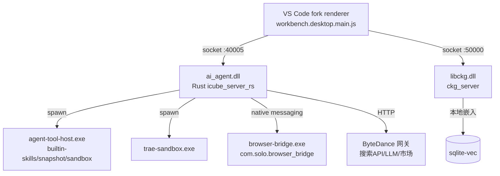

# Trae Code CN 逆向分析报告

**目标**: Trae Code CN（字节跳动 AI Code Editor，VS Code 1.107.1 fork）
**版本**: 2.3.78542（product.json version 1.107.1 / traeVersionCode 20250325 / commit d0178010）
**平台**: Windows（Inno Setup 包，win32 分支 release_desktop_yoma_win32_cn）
**类型**: 闭源
**分析日期**: 2026-09-02
**解包位置**: `analysis/trae-code-cn/extracted/code$GetDestDir/resources/app/`
**strings 产物**: `analysis/trae-code-cn/notes/{ai_agent,agent-tool-host,ctx-cli,libckg}-strings.txt`

> ⚠️ 并行任务 05-trae-work.md 撰写时尚未落盘，本报告无法对照其内容去重；Trae Work 侧的对比数据（product.json、模块目录、DLL strings）由本任务直接从 `analysis/trae-work-cn/` 独立提取，结论已交叉验证。两产品的 agent 引擎 DLL（ai_agent.dll，约 275MB）逐字符串比对几乎一致，**Trae Work 特有内容本报告只在"差异"维度覆盖，完整 Work 分析以 05 为准**。

---

## 0. 摘要 (TL;DR)

Trae Code（内部代号 **icube/MarsCode**，源码路径 `apps/icube_server_rs/modules/ai-agent`）与 Trae Work 共用同一套 Rust agent 引擎：TS 渲染层只做 UI/配置，全部 agent 逻辑（提示词模板、工具执行、上下文压缩、记忆、MCP、甚至一个内置 deep-research 多阶段研究工作流）都在本地 Rust 侧 `ai_agent.dll`（监听 40005 端口）内。Trae Code = "IDE 模式"（完整 VS Code + 110 扩展），Trae Work = "SOLO 模式"（solo-lite 裁剪壳 + harness/vm_sdk）。

最值得学的三个机制：①**web_search 两段式**（服务端搜索 API 返回 reference 卡片 → 客户端批量爬全文，失败回退 snippet）+ 引擎枚举 `You/Toutiao/Volcengine/Doubao/Brave`；②**动态工作流引擎**：内置 `deep-research.js`（5 角度并行搜索 → URL 去重预算 → 15 源断言抽取 → 3 票对抗验证 → 综合），JS 脚本沙箱内调用 `agent()/pipeline()/parallel()` 原语；③**代码搜索五件套**（keyword/regex/definition/reference/semantic）+ CKG 本地 bge_m3+sqlite-vec。

---

## 1. 整体架构与两产品差异

### 1.1 差异总表（本报告核心）

| 维度 | Trae Code CN | Trae Work CN |
|---|---|---|
| product name / applicationName | `Trae CN` / `trae-cn` | `TRAE SOLO CN` / `trae-solo-cn` |
| product.json runMode | **无此字段**（IDE 模式） | `"solo-lite"`（驱动 VM/aha 分支） |
| 独有字段 | `traeVersionCode: 20250325` | `enableVmTerminalPanel: true` |
| package.json branch | `release_desktop_yoma_win32_cn` | `release_solo_win32_cn` |
| workbench 主文件 | `workbench.desktop.main.js`（18.6MB，单文件） | `workbench.desktop.main.solo-lite{,-slim}.js`（15.6/11.3MB） |
| extensions/ | **110 个**（全量语言支持 + byted-icube 助手 + remote-ssh） | **9 个**（git/git-base/theme/solo-lite/builtin-mcp 等） |
| modules/ai-agent 内容 | ai_agent.dll + `bin/agent-tool-host.exe`(87MB) + ctx-cli.exe | ai_agent.dll + **harness.dll(183MB)** + **toolhost.dll(84MB)** + **vm_sdk.dll** |
| 二者共有 | modules/{ckg, sandbox, browser-bridge}、byted-solo.builtin-mcp、sscronet.dll | 同左 |

关键结论：**引擎同源，壳不同**。Work 把 toolhost 拆成 DLL 并带 vm_sdk（Windows Aha VM、`windowsDisableVmSdk` 配置、`lite/vsock_connector` VM 桥）；Code 把 toolhost 打成独立 exe（`toolhost/services/toolhost-builtin-skills`、`snapshot`、`net-bridge`、sandbox FFI），无 VM 相关件。workbench JS 中 `i.runMode==="solo-lite"` 的分支在 Code 里永远为 false。

### 1.2 进程拓扑



- agent 数据落盘 `~/.icube/ai-agent/database.db`（sqlx/SQLite）+ `snapshot/`；CKG 索引 `~/.icube/ckg_server`。
- `start.sh` 泄露运行模式枚举：`AI_NATIVE_ENV = desktop | plugin_remote | desktop_ssh`（source: `modules/ai-agent/start.sh`），SSH 远程时 agent 仍本地起（desktop_ssh）。
- `RG_PATH` 指向 `@vscode/ripgrep/bin/rg`——ripgrep 是 agent 的一等依赖。

---

## 2. Agent 工作流

### 2.1 角色体系（agent_process_v3）

渲染层 `getBuiltInToolList(agentType)` 按 agent 类型下发工具集（source: `out/vs/workbench/workbench.desktop.main.js`）：

```js
async getBuiltInToolList(e){
  switch(e){
    case"chat": return[wQt,YCs,yQt];                      // Read, Preview, WebSearch
    case"code_reviewer": case"code_review_summary": return[wQt,yQt];
    default: return[wQt,xRr,kRr,YCs,yQt]                   // +Edit, Terminal
  }
}
```

工具枚举 i18n（nls.messages.json 9847-9857）：Read/Edit/Terminal/WebSearch("Search for web content related to user tasks")/Preview，以及 `search` 子代理定义：`{agent_id:"search", type:"builtin_sub_agent", description:"Built-in callable agent that retrieves and inspects files."}`——**IDE 版把"检索"做成一个可被主 agent 调度的内置子代理**。

Rust 侧提示词键揭示完整角色矩阵：`master_agent / search_agent / document_agent / project_preparation_agent / web_development_agent / custom_sub_agent`，且按产品分套（`prompt_template_solo_builder_*`、`prompt_template_solo_coder_*`、`prompt_template_chat_*`），同一 DLL 携带全部产品套件，按 product/agent 路由（source: strings 行 765661 提示词键清单）。自定义 agent 是**服务端 DSL agent**（`service:"agent",method:"create"`，字段含 prompt/model/built_in_tool_list/mcp_list/can_be_sub_agent），SOLO Team/Assistant 亦为 DSL agent（`agent_static_dsl_name:"solo_team"/"ide_assistant"`）。

### 2.2 Ralph Loop（循环自治）

`domain/ralph_loop/{service,aggregation,restore,interrupt_snapshot}` + `hooks/ralph_loop_stop_hook`：stop hook 决定 `ralph_loop_continue`，每轮聚合产物（`ralph_loop_products`），退出时落 `is_loop_done` 并生成 RalphLoopReport，支持中断快照恢复。即把 "Ralph 循环跑到完成为止" 产品化进主循环。

### 2.3 动态工作流（最重要发现）

`crates/dynamic_workflow`（script_parser/state/registry/resume/host）：**JS 脚本工作流在 Rust 宿主内执行**，脚本带 `export const meta`（含 name/whenToUse/phases），禁用 `Date.now/Math.random/函数调用` 等不安全表达式；运行 ID `wf_*`，journal.jsonl 支持断点恢复。内置一份完整的 deep-research 工作流（source: `ai_agent.dll` strings，`workflows/builtin/deep-research.js`，节选）：

```js
export const meta = {
  name: 'deep-research',
  description: 'Deep research harness
 fan-out web searches, fetch sources, adversarially verify claims, ...',
  whenToUse: '...BEFORE invoking, check if the question is specific enough ...',
  phases: [ /* Scope→Search→Fetch→Verify→Synthesize */ ] }
const VOTES_PER_CLAIM = 3
const REFUTATIONS_REQUIRED = 2
const MAX_FETCH = 15
const MAX_VERIFY_CLAIMS = 25
// Phase 0 Scope: LLM 拆 3-6 个互补搜索角度（broad/academic/news/contrarian/practitioner）
// pipeline(angles, angle => agent(SEARCH_PROMPT(angle), {schema})) —— Search 阶段无栅栏流水线
// 每条结果: 规范化 URL 去重 + fetchSlots 预算（低相关度先被丢弃）
// Fetch: parallel 提取 2-5 条"可证伪断言"+ sourceQuality 分级 + 原文引用
// Verify: 每断言 3 票对抗（"Be SKEPTICAL. Try to REFUTE"），弃权票不算存活
// Synthesize: 合并语义重复 → 按 confidence 分级 → caveats + openQuestions
```

调度原语只有五个：`agent(prompt,{label,phase,schema}) / pipeline / parallel / phase / log`——结构化输出 schema 由工作流自带。

---

## 3. 技能仓库（rules / skills / commands）

| 机制 | 路径 | 证据（workbench.desktop.main.js） |
|---|---|---|
| 项目规则 | `.trae/rules/*.md`（嵌套扫描深度 3、超时 5s；单文件模式 `project_rules.md`） | `isProjectRuleFile: t.includes("/.trae/rules/")&&t.endsWith(".md")` |
| 全局规则 | `user_rules/` 目录（旧版单文件 `user_rules.md`） | `this.userRulesDirPath="user_rules"` |
| 跨格式兼容 | 同时识别 `AGENTS.md / CLAUDE.md / CLAUDE.local.md / .claude/CLAUDE.md` 并 watch 变更 | git-change 处理分支 |
| Skills | `.claude/skills/*/SKILL.md`（工作区 + 用户 home 双扫描，`findClaudeSkillsInWorkspace/UserHome`）；安装目标：全局 userData/skills 或项目 `.trae/skills` | SKILL.md 定位函数族 |
| 技能市场 | collection zip 解包安装（`ExtractCollectionZipRequest`），市场 CDN `p11-market.byteimg.com/.../skills/.../trae_agent` | dist 日志 "found N skills" |
| 斜杠命令 | `.trae/commands/`，slashCommandService | 编辑器路径特判 |
| 内置技能 | toolhost `crates/builtin-skills`（在 agent-tool-host.exe 内运行，非 DLL 侧） | `toolhost-builtin-skills/src/lib.rs` |

`.trae` 下任何文件都是 agent 可写区，但 `.trae/mcp.json` 被标记 `SECURITY_RISK_FILE_SUFFIX`（写它需要额外确认）。规则经 `prompt_template_custom_user_rules` 模板注入提示词，另有 `misc_command_generate_project_rules`（让 agent 自动生成项目规则）。

---

## 4. 工具系统（内置工具 + MCP）

DLL 内工具注册表完整泄露（source: strings 行 816983 / 814603，两行相邻的 CamelCase 显示名与 snake_case 内部名）：

- **文件类**：Read/Write/Edit/MultiEdit/EditFastApply/EditReplaceBlocks/SearchReplace/ApplyPatch/NotebookEdit/Delete/Glob/Grep/LS/ViewFile(s)/ViewFolder/OpenProject
- **命令类**：RunCommand/WriteStdin/CheckCommandStatus/StopCommand/Monitor/Exec(exec_command)/Shell/InitEnv
- **搜索类**：见 §5
- **浏览器 30+**：BrowserNavigate/Snapshot/Click/Type/Evaluate/Drag/UploadFile/Record(录制回放)/Fill/FillForm/GetBoundingBox/IsVisible…（真 Chrome 由 browser-bridge native messaging 接入，扩展 ID `nbmnklcgnddbjafigmlhfjhefcfcgggn`）
- **子代理/记忆**：run_agent（子代理派发）、run_mcp、run_custom_tool（MCP/自定义工具经元工具收口）、TaskCreate/Task/GetTaskList/TaskUpdate、Skill、SkillRecommend、Knowledge、AskUserQuestion/RequestAuthorization/NotifyUser
- **记忆/上下文**：condense_shallow_memento、update_shallow_memento、manage_core_memory
- **交付类**：GenerateImage/GenerateVideo/DeployToRemote/Supabase*(3)/StripeGetConfig/GetPreviewConsoleLogs/Workflow/RunWorkflow/ExitPlanMode/EnterPlanMode/Goal(create/get/update)

MCP：项目级 `.trae/mcp.json` + 全局配置；autoRun 策略分 IDE/SOLO 两套（默认 `mcpAutoRun: ALWAYS_ASK, commandMode: WHITELIST`）；MCP server 配置 schema 完整（command/args/env/cwd、Streamable HTTP/SSE、OAuth 动态注册）；`mcp_name_resolver` 处理命名。工具标注 `defer_loading_group_name`（**分组延迟加载**，非首屏工具不占上下文）。

---

## 5. 搜索实现（重点）

Trae 的搜索是**五级阶梯**，代码搜索全部本地、web 搜索半服务端：

### 5.1 代码搜索五件套（ai_agent.dll 工具表）

| 工具 | 后端 | 说明 |
|---|---|---|
| `search_by_keyword` | ripgrep 字面量 | `workspace/ripgrep.rs`（args 全走日志） |
| `search_by_regex` | ripgrep 正则 | 同上 |
| `search_by_definition` / `search_by_reference` | CKG 图查询 | `retrieve_entity / retrieve_relation / SearchCallerEntity / SearchCalleeEntity`（libckg strings） |
| `search_codebase` | CKG 语义 | `[SearchCodebase] ckg_data_references → after_crop → after_chunk_crop → after_merge`（先检索后裁剪合并的引用漏斗）+ "rerun with query without target_directories" 自降级重试 |
| `file_search` | 模糊文件名 | 走 toolhost 网关 |

CKG（Code Knowledge Graph）技术栈实测：**bge_m3 本地嵌入 + sqlite-vec 向量库 + chunk 重叠切分 + cosine/L2 + AST 编码器**（`-local_embedding -embedding_storage_type=sqlite_vec -limit_cpu=1`，source: `modules/ckg/start.sh`）。CKG 还兼作文档 RAG：`retrieve_ckg_docset_rag`，内置 docset 语料含 nuxt.com/shadcn/tailwind/nextjs/vuejs/svelte/astro 等（web_development_agent 的知识库）+ `docs.trae.cn/llms.txt`（吃自己的 llms.txt）。

### 5.2 Web 搜索两段式（与 Codex 的 hosted tool 模式完全不同）

`domain/web_search/{service,strategy}.rs`，日志还原流水线：

```
[SearchService search_by_keywords] step1 request_search_references completed   ← 服务端搜索 API
[SearchService search_by_keywords] step2 crawler targets: count=N              ← 客户端批量爬取
[SearchService search_by_keywords] step2 crawler failed, falling back to search snippets  ← 降级
[SearchService search_by_keywords] search API responded: logid=                ← 字节网关 logid
```

- step1 返回 `WebSearchReference`（favicon/snippet/链接卡片），step2 `request_batch_fetch_content` 补全文；结果经 `prompt_template_relevant_web_search_contents` 渲染进上下文。
- **引擎枚举内嵌于 DLL**：`You / Toutiao / Volcengine / Doubao / Brave`（CamelCase 连串 "YouToutiaoVolcengineDoubaoBrave"）——即字节自研搜索栈（头条/火山/豆包）+ You.com + Brave，无 Google/Bing/Tavily。
- 支持域名过滤（`WebSearchDomainFilter`）；搜索 API 域名不在 DLL 内（服务端下发）。
- `WebFetch`：URL 缓存 → 抓取 → **小模型按需抽取**（"small model request/first token/filter decision"，失败 fallback 原文）→ 输出。
- 有 `prompt_template_query_rewrite`（workspace query rewrite 开关 `enable_workspace_query_rewrite`）——用户输入先重写再进 agent。

---

## 6. 上下文管理

- **三层记忆**：①`manage_core_memory` 核心（`core_memory_block_rough_max_token` 限长）；②**shallow memento**（浅记事本：`update_shallow_memento` / `condense_shallow_memento` 工具化压缩）+ `PROJECT_MEMENTO.md` 项目级持久记忆；③`summary` 服务压缩历史（`prompt_template_summary_*`、`compact_prompt` 键族）。
- `ContextWindowTokens / ContextMeta / context_window_sizes / token_limit_ratio`（v3 键族）——按模型上下文窗口算比例触发。
- 环境探针/调试开关成体系：`TRAE_FORCE_ENABLE_CORE_MEMORY / TRAE_FORCE_ENABLE_SHALLOW_MEMENTO / TRAE_ENABLE_VIEW_FILE_AUTO_EXPAND / TRAE_VIEW_FILE_MAX_FILE_SIZE / TRAE_ENABLE_EDIT_LINTER_ERROR` 等（source: strings 连串常量），view_file 默认带截断 + 溢出提示。
- `context_resolver/{context_collector,context_enricher,context_meta}`：@提及（QueryItem 类型：file/symbol/folder/terminal/workspace/web_search/web_page/feishu_doc/figma/lint_error/rule/problem_item…）统一解析成 context_meta，再由 `relevant_contexts` 模板渲染；工具结果有 `ToolOutputAlignmentConfig`（edit/read 输出最小化、grep 默认 head limit）。

---

## 7. 模型路由

- 多 provider 内建适配器：`deepseek /v1/chat/completions`、`anthropic /v1/messages`、openai、openrouter（source: strings "/models/chat/completionsdeepseek/v1/models/v1/messagesanthropicopenrouteropenai/foundation-models/openai/v1/chat/completions"）；CN 默认走字节网关（`encrypted_model_params` 加密下发模型参数）。
- **按场景 × 模型的能力映射表**（DLL 内 JSON）：场景键 `chat/code/...`，值如 `"Doubao-Seed-2.1-Pro":"default"`、`"DeepSeek-V4-Pro":"non_multimodal"`、`"kimi-k2.6":"hebe"`、`"gpt-5.6-luna/terra/sol"`、`"custom_model_1M"`——映射目标不是"是否支持"而是**history adapter 套件代号**（default/non_multimodal/iphigenia/hebe/iris），即按模型家族切换历史渲染格式（`history_adapter_strategy / is_gpt5 / disable_history_adapter`）。
- 细分任务各配模型：commit message（`git_deepseek_v3 / git_qwen32 / git_seed_m8_generate_commit_message` 三套）、标题/图标/项目名生成、image_ocr、web_search 小模型过滤、fast_apply。`v3_optimize_tool_choice_strategy`、`v3_glob_enable_ripgrep` 等按模型 flag 化。

---

## 8. Findings

### 8.1 最聪明的 3 个设计
1. **工作流即代码**：deep-research 用 ~300 行沙箱 JS 表达整个研究管线，宿主只实现 5 个原语；phase/label 全程可观测，断点恢复走 journal.jsonl。
2. **搜索"参考卡片 + 本地爬取"分层**：服务端 API 只出 reference（标题/摘要/favicon），全文抓取在客户端按预算执行并留好 snippet 降级——比纯 hosted search 省 token，比纯本地聚合稳定。
3. **defer_loading 工具分组 + per-agent 工具集**：工具太多时按组延迟暴露，agent 类型决定工具白名单，双保险控制上下文占用。

### 8.2 最蠢/最怪的 3 个设计
1. `checkpoint.sh` 用中文 prompt 让 agent"自问自答是否还记得 RFC"——把上下文丢失当脚本问题打补丁，是 memento 机制不信任的补丁式 workaround。
2. 城中村式配置面：`use_v2_process/use_v3_agent/enable_*` 15+ 个布尔回购在同一 ConfigExtraConfig 里，产品线复用的技术债裸奔。
3. 同一工具在 CamelCase/snake_case/工具表三处重复（SearchCodebase/search_codebase/`toolcall_search_codebase_*` i18n 键），三份事实源极易漂移。

### 8.3 可借鉴 / 8.4 应避免
借鉴：URL 规范化去重 + 相关度预算池（novel/high 优先占 fetch slot）；断言级 3 票对抗验证含"弃权≠存活"的细节；`whenToUse` 式工作流元数据；五级代码搜索阶梯。
避免：引擎枚举写死在二进制里（应配置化）；`or` 式降级补丁（见 checkpoint.sh）；提示词键 300+ 无版本治理（好在有 prompt_key/prompt_version 字段雏形）。

---

## 9. 对我们搜索工具的启发（仅新增，不重复 09/10/11/12 结论）

1. **"reference 先行、抓取后置"是免费午餐里的最优解**：在 dsh 四路并行（10 号报告）之上，可以把"搜索结果元数据"与"全文抓取"拆成两个独立预算池——元数据便宜可多拿，全文贵要按相关度抢 slot。deep-research 的 `fetchSlots + relRank` 丢预算逻辑（低相关度先丢、dupes/budgetDropped 进统计）直接可抄。
2. **对抗验证要"计票规则"而非"多数决"**：`valid.length >= 2 && refuted < 2` 把弃权与反驳区分开，杜绝全弃权假阳性；我们的 verify 阶段应内建 abstain 语义。
3. **工作流脚本化 > 硬编码编排**：给搜索工具留一个受限 JS/DSL 工作流层（禁 Date.now/网络），`agent()/parallel()/pipeline()` 五原语 + schema 结构化输出，用户可以自带研究管线（Perplexica 的固定 pipeline 和 o3dr 的 LangGraph 都不如这个可扩展）。
4. **搜索子代理化**：Trae 把 search 做成 `builtin_sub_agent`（"retrieves and inspects files"），主 agent 只见结果不见过程——我们 v0 的 web_search 工具应包成一个子代理边界，内部多轮、对外单结果，避免污染主上下文（与 09 号"hosted search"殊途同归，但这是客户端版本）。
5. **小模型过滤器是 web_fetch 的标配**：Trae 的 WebFetch 用小模型做相关性过滤失败才回退原文；配合 11 号的 60s 降级与 12 号的 embedding 阈值，可以做成三级漏斗（embedding 剪枝 → 小模型抽取 → 原文兜底）。
6. **本地代码语义搜索的现实配置**：bge_m3 + sqlite-vec + 单核限制即够 IDE 场景；definition/reference 走图、semantic 走向量、regex/keyword 走 rg 的五级路由比"全矢量"便宜得多。

---

## 10. 引用 & 二次查阅

- 解包目录：`analysis/trae-code-cn/extracted/code$GetDestDir/resources/app/`（product.json、package.json、modules/ai-agent/{start.sh,meta.json,checkpoint.sh}、modules/ckg/start.sh）
- strings 证据（均已存 `analysis/trae-code-cn/notes/`）：工具注册表 ai_agent-strings.txt:816983、814603；提示词键清单 :765661；deep-research 工作流 :1064193-1064480；模型映射 :935493±；搜索引擎枚举 :818092、:789932；workbench 侧 getBuiltInToolList / 规则路径 / `.trae/mcp.json` 安全位见 workbench.desktop.main.js
- nls.messages.json：9847-9875（工具枚举与内置 agent 名）、10106±（MCP 配置文案）
- Trae Work 对照：`analysis/trae-work-cn/notes-ai_agent-strings.txt`（本任务抽取）、product.json、extensions 清单（9 个）、workbench solo-lite 双文件
