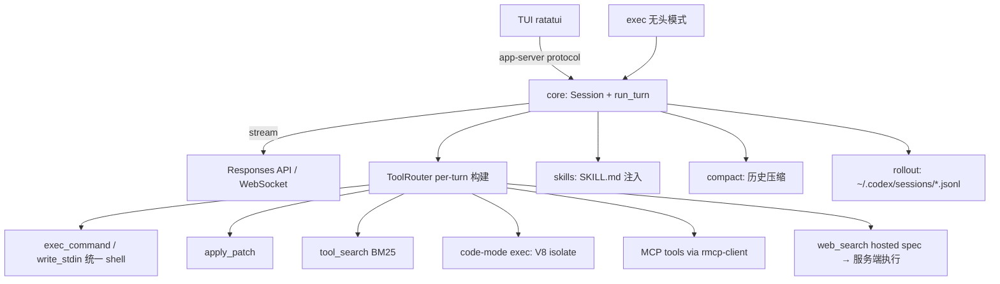

# OpenAI Codex CLI 逆向分析报告

**目标**: OpenAI Codex CLI (`codex` 终端 agent)
**版本**: main 快照 2026-09-02 (commit `eb10d91e`)
**平台**: 跨平台 (macOS / Linux / Windows), Rust 实现
**类型**: 开源 (Apache 2.0)
**分析日期**: 2026-09-02
**原始下载**: https://github.com/openai/codex
**SHA256**: N/A (git clone, 浅克隆 depth=50)

---

## 0. 摘要 (TL;DR)

Codex CLI 是 OpenAI 官方终端 coding agent, Rust workspace 约 100 个 crate。最值得学的 3 个机制:

1. **工具暴露分四档 (Direct / Deferred / CodeMode / Hidden)** — 工具太多时不直接塞 prompt,而是暴露一个 BM25 的 `tool_search` 工具让模型按需"搜工具";最新模型甚至整体切到 **Code Mode**:模型写 JS 在 V8 沙箱里编排工具调用,工具结果不进 context,只有 return 值进。
2. **web_search 是纯 hosted tool** — 客户端只拼一个 `{type:"web_search"}` spec 丢给 Responses API,搜索/打开网页/页内查找全在 OpenAI 服务端跑,本地只有 ~30 行 UI 格式化代码。与 Grok Build 同构:搜索智能都在 LLM 端。
3. **上下文用"硬触发 + 中途压缩"管理** — token 到达 `auto_compact_token_limit + fallback_buffer` 或 context window 百分比上限时,turn 中途就地用固定 checkpoint prompt 总结历史并重注入初始上下文,然后 continue,不打断 turn。

---

## 1. 整体架构

### 1.1 进程拓扑

单进程 Rust 二进制为主,按需 spawn 子进程:MCP server 子进程、code-mode 的 V8 isolate(进程内)、linux/windows sandbox 助手进程。UI 与核心用内部 protocol 解耦:`tui`(ratatui 终端 UI)、`exec`(无 UI 一次性执行)、`app-server`(给 IDE/SDK 的 JSON-RPC 服务,sdk/typescript 消费)都只是 core 之上的不同前端。



### 1.2 关键 crate

| 类别 | crate | 说明 |
|---|---|---|
| agent 核心 | `core` | run_turn 主循环、compact、审批、sandbox 决策 |
| 工具协议 | `tools` / `protocol` | ToolSpec/JsonSchema/ToolPayload 定义 |
| 工具执行 | `core/src/tools/*` | registry/router/orchestrator/handlers |
| MCP | `rmcp-client` / `mcp-server` / `codex-mcp` | 客户端 + Codex 自身作为 MCP server 暴露 |
| Code Mode | `code-mode-runtime` (V8) / `code-mode-protocol` | JS 编排工具 |
| 指令/技能 | `skills` + `ext/skills` / `prompts` / `models-manager` | SKILL.md、base instructions |
| 上下文 | `context-fragments` / `rollout` / `history` / `memories` | 历史持久化与长期记忆 |
| 安全 | `sandboxing` / `linux-sandbox` / `windows-sandbox-rs` / `execpolicy` / `network-proxy` | 沙箱与网络管控 |
| 模型 | `models-manager` / `model-provider-info` / `client` | 模型目录与传输层 |

---

## 2. Agent 工作流

### 2.1 拓扑选择

单 agent 主循环 + 可选多 agent 工具(spawn_agent/send_message/wait_agent,分 v1/v2 两代,经 `collaboration` namespace,参数可加密)。没有 planner-executor 拆分;Plan 是一个 **mode**(ModeKind::Plan)而不是独立 agent——Plan mode 下模型只能读,主循环不变。

### 2.2 主循环代码级结构

真正的 loop 有两层。外层 `run_turn`(每用户消息一次),内层 `run_sampling_request`(一次"采样 + 工具执行"批次,含流重试)。

> 文件: `codex-rs/core/src/session/turn.rs:155-611` (结构摘录)

```rust
pub(crate) async fn run_turn(...) -> CodexResult<Option<String>> {
    run_pre_sampling_compact(...).await?;          // turn 开始前先检查是否要压缩
    let mut next_step_context = Some(first_step_context);
    loop {
        let pending_input = sess.input_queue       // 用户中途插话(steering)
            .get_pending_input(&sess.active_turn).await.0;
        let step_context = /* 捕获本步的上下文快照 */;
        let result = run_sampling_request(...).await?;  // 内层: 一次 LLM 流 + 工具
        let needs_follow_up = model_needs_follow_up || has_pending_input;
        let token_limit_reached = token_status.token_limit_reached;
        if needs_follow_up && (new_window_requested || token_limit_reached) {
            run_auto_compact(..., CompactionReason::ContextLimit,
                             CompactionPhase::MidTurn).await?;  // 中途压缩后 continue
            continue;
        }
        if !needs_follow_up {
            let stop_outcome = run_turn_stop_hooks(...).await;   // Stop hook 可拦截
            if stop_outcome.should_block { /* 注入 hook 续跑消息 */ continue; }
            if stop_outcome.should_stop { break; }
            break;   // 唯一正常出口: 模型不再调工具且无排队输入
        }
        continue;
    }
    Ok(last_agent_message)
}
```

内层 `try_run_sampling_request`(`turn.rs:2228-2828`)是流式消费器:`ResponseEvent::OutputItemDone` 里对每个 item 调 `handle_output_item_done`,遇到 `FunctionCall`/`CustomToolCall` 就把 tool future 推进 `FuturesOrdered<in_flight>` 并置 `needs_follow_up = true`;流结束后 `drain_in_flight` 等所有工具完成,结果写回 history。

**"调工具 vs 回复用户"的判定完全由 LLM 决定**(返回的是 tool call item 还是 message item),客户端没有任何规则路由——纯 prompt-driven。

### 2.3 关键决策点

| 决策 | 位置 | 判断依据 |
|---|---|---|
| 调工具 vs 回话 | `turn.rs:2435` `handle_output_item_done` | LLM 输出 item 类型 |
| 继续 vs 停止 | `turn.rs:434` `needs_follow_up = model_needs_follow_up \|\| has_pending_input` | 有工具调用或有插话就 continue;模型自由决定轮次上限 |
| 中途压缩 | `turn.rs:481` `should_roll_over` | `session/context_window.rs` 里 buffered limit / window% 双触发 |
| Stop hook 拦截 | `turn.rs:513-556` | hook 返回 continuation prompt 则强制续跑(防死循环: MemoryConsolidation 会话直接报错) |
| patch 是否免批 | `core/src/safety.rs:27` `assess_patch_safety` | 写路径全在 writable roots + 平台沙箱可用 → AutoApprove |

### 2.4 异常处理

- **流错误**: `responses_retry.rs` 指数退避重试,`stream_max_retries` 由 provider 配置;`ContextWindowExceeded` 会把 total tokens 打满触发压缩。
- **工具失败**: `FunctionCallError` 分 `RespondToModel`(错误文本作为 tool output 回给模型,让它自行纠正)与 `Fatal`(终止 turn)。
- **用户中断**: `CancellationToken` 贯穿全链路,取消即 `TurnAborted`,已产生的工具输出和输入仍被记录到 rollout。
- **审批/沙箱**: `tools/orchestrator.rs` 模块注释就是完整语义: "approval → select sandbox → attempt → retry with an escalated sandbox strategy on denial (no re-approval thanks to caching)"。审批枚举 `AskForApproval` = untrusted / on-request(默认) / granular / never;沙箱 = read-only(默认) / workspace-write / danger-full-access,另有 execpolicy 规则引擎与 network proxy 域名级管控。

### 2.5 update_plan 机制

`update_plan` 是普通 function tool(非 mode),schema 为 `{explanation, plan:[{step, status: pending|in_progress|completed}]}`(`tools/handlers/plan_spec.rs:12`),执行端只是把参数作为 `EventMsg::PlanUpdate` 发给 UI 并回 "Plan updated"。有趣的细节:**Plan mode 下显式禁止调用 update_plan**(`plan.rs:78`,报错 "update_plan is a TODO/checklist tool and is not allowed in Plan mode")——plan mode 是受控只读规划,update_plan 是执行期 checklist,两者刻意互斥。

---

## 3. 技能/指令仓库

### 3.1 AGENTS.md 加载机制

> 文件: `codex-rs/core/src/agents_md.rs:1-15` (模块文档)

```text
1. 从 cwd 向上找 project_root_markers(默认 [".git"])确定项目根;
2. 收集从项目根到 cwd 路径上的每一个 AGENTS.md,按根→cwd 顺序拼接;
3. 不越过项目根。
```

要点:
- **AGENTS.override.md 优先于 AGENTS.md**(`LOCAL_AGENTS_MD_FILENAME`),同一目录命中即停。
- 总量预算 `project_doc_max_bytes`,超预算**逐文件截断**并 warn(`read_agents_md`)。
- 与用户级 `~/.codex/AGENTS.md` 用 `\n\n--- project-doc ---\n\n` 分隔拼接。
- 多环境(远程/本地 workspace)分别加载,共享同一预算。
- prompt 内嵌了 AGENTS.md 语义规范(就近覆盖、直接指令 > AGENTS.md),见 `models-manager/prompt.md` "# AGENTS.md spec" 节。

### 3.2 Skills(有完整 SKILL.md 概念)

- 定义: `SKILL.md` + frontmatter(name/description/interface/policy/dependencies),`SkillScope = User | Repo | System | Admin`(`protocol/src/protocol.rs:3780`)。
- 发现: `ext/skills/src/loader/discovery.rs` 按 root 递归扫描(MAX_SCAN_DEPTH,每 root 上限 20000 entry),支持 host 文件系统、executor 包、plugin 包三种来源。
- 注入: 每轮把**技能目录**(name + description + source locator)渲染进 prompt(`ext/skills/src/catalog_prompt.rs`),配大段使用说明:用户以 `$SkillName` 或明文提到、或任务匹配 description 时必须使用;**渐进式披露**——先用目录选技能,再完整读 SKILL.md,再按其引用读 references/,不许委托给 subagent 解读。
- 显式提及的技能在本轮把 SKILL.md 全文注入 turn input(`turn.rs:782` `build_skills_and_plugins`);`policy.allow_implicit_invocation` 允许时还支持隐式触发(`detect_implicit_skill_invocation`)。
- 技能可声明 **MCP 依赖**,首次使用时弹安装流程(`mcp_skill_dependencies.rs`)。
- 插件(plugin)= skills + MCP servers + 工具的打包体,有 marketplace(官方源)与 `tool_suggest` 推荐安装工具链。

### 3.3 主 system prompt

默认 base instructions 是 `codex-rs/models-manager/prompt.md`(20.9KB,`include_str!` 编译期嵌入,`model_info.rs:17`)。结构:能力声明 → # How you work(Personality/Responsiveness/Planning/Task execution/Validating/Sharing progress/Final answer)→ # Tool Guidelines(Shell commands、update_plan、web search 等)。另有 5 个模型专属 prompt 文件(`core/gpt_5_2_prompt.md`、`gpt-5.2-codex_prompt.md` 等 7.5-24KB)随模型元数据下发覆盖。`core/src/context/update_plan_instructions.rs` 还实现了**从自定义指令里手术式删除 update_plan 段落**的函数,防止用户 prompt 与内置工具指引打架——prompt 也当数据裁剪,这个思路少见。

---

## 4. 工具系统

### 4.1 协议

OpenAI Responses API 原生 tool 类型,不走自定义协议。`ToolSpec` 枚举(`codex-rs/tools/src/tool_spec.rs:22-56`):`Function`(JSON Schema)、`Namespace`(工具分组)、`ToolSearch`、`WebSearch`(hosted)、`Freeform`(lark 语法定义输入文法,给 code mode 用)。

### 4.2 工具注册与暴露分档

每 turn 由 `spec_plan.rs::build_tool_router` 现建 ToolRouter。核心注册逻辑在 `add_core_tool_sources`(`spec_plan.rs:973-1031`):shell 工具(exec_command/write_stdin)受 Feature 开关 + 模型 `shell_type` 双控;apply_patch 受 `model_info.apply_patch_tool_type` 控制——**工具清单是模型元数据 × feature flags × 沙箱配置的叉积**,不是硬编码列表。

暴露档位(`spec_plan.rs:254-266`):

```rust
tool.exposure = match (direct, deferred, code_mode) {
    (false, false, false) => ToolExposure::Hidden,
    (false, false, true)  => ToolExposure::CodeModeOnly,
    (true,  false, false) => ToolExposure::DirectModelOnly,
    (true,  false, true)  => ToolExposure::Direct,
    (false, true,  false) => ToolExposure::DeferredModelOnly,
    (false, true,  true)  => ToolExposure::Deferred,
    (true,  true, _)      => unreachable!("direct and deferred exposure are mutually exclusive"),
};
```

- **Direct**: schema 直接进本轮 tools 列表。
- **Deferred**: 只登记元数据,模型用 `tool_search` 找到后才动态加载——MCP 工具多时避免 schema 撑爆 context。
- **CodeModeOnly**: 只在 code mode 的 `tools.*` 全局对象里可见。

### 4.3 工具清单(节选)

| 工具名 | 类型 | 输出 | 需确认? |
|---|---|---|---|
| exec_command / write_stdin | Function(统一持久 shell) | 截断后的 stdout/stderr | 沙箱策略判定 |
| apply_patch | Function | diff 应用结果 | `assess_patch_safety` |
| view_image | Function | 图片入 context | 否 |
| update_plan | Function | "Plan updated" | 否 |
| tool_search | Function | 匹配工具 spec 列表 | 否 |
| exec (code mode) | Freeform/lark | JS return 值 | 继承各嵌套工具 |
| web_search | **Hosted** | 服务端执行 | 否(本地无执行) |
| request_user_input | Function | 用户答复 | 打断等待用户 |
| get_context_remaining / new_context_window | Function | token 余量/开新窗口 | 否 |
| spawn_agent 等 5+ | Namespace `collaboration` | 子 agent 结果 | 否 |
| list/read_mcp_resources 等 3 | Function | MCP 资源 | 否 |

### 4.4 MCP 实现

- 配置: `config.toml` 的 `[mcp_servers.<name>]`,transport 支持 stdio 子进程与 streamable HTTP(`rmcp-client/src/rmcp_client.rs:61-87`),带 OAuth(EMA)、`startup_timeout_sec`、`tool_timeout_sec`、`required`、`supports_parallel_tool_calls`、`omit_tools_from`(按暴露面隐藏)等字段(`config/src/mcp_types.rs:197-237`)。
- MCP 工具与内置工具统一进 ToolRegistry,共享审批/hook/遥测管线;超过阈值自动转 Deferred(配合 tool_search)。
- Codex 自身也能作为 MCP server 被别的 agent 调(`mcp-server` crate),实现双向。
-elicitation(MCP 服务器向用户征询)有专门仲裁管线。

### 4.5 Code Mode(V8 编排,最新模型默认)

`tool_mode=code_mode_only` 的模型(models.json 里 gpt-5.6 全系)只暴露一个 `exec` 工具:模型写 JS,在 V8 isolate 里跑,工具变成 `await tools.exec_command(...)`。官方描述(`code-mode-protocol/src/description.rs:26-40`):"Evaluates the provided JavaScript code in a fresh V8 isolate... Nested tools return either an object or a string... Runs raw JavaScript -- no Node, no file system, no network access"。提供 `store/load`(跨 cell 存取)、`ALL_TOOLS`(工具元数据)、`yield_control`(边跑边回流输出)、`wait`(轮询长任务 cell)。**本质是把"多轮工具往返"变成"单轮代码内循环",中间结果不占 context。**

### 4.6 工具结果回填

`ToolOutput::to_response_item()` 产出 `FunctionCallOutputPayload`(文本 + success 标志),经 `AnyToolResult::into_response()`(`registry.rs:194-210`)包上元数据写进 history。输出按模型 `truncation_policy` 截断——models.json 默认 `{mode:"tokens", limit:10000}`,截断保留头尾、去掉中段(`utils/string/src/truncate.rs`)。PostToolUse hook 可改写模型可见输出。

---

## 5. 搜索实现(重点)

### 5.1 后端

| 后端 | 是否使用 | 证据 |
|---|---|---|
| 自家 search API | ✅ hosted web_search(OpenAI 服务端) | `tools/src/tool_spec.rs:39-53` |
| Brave/Tavily/Exa/DDG/SearXNG | ❌ 无任何本地搜索后端 | 全仓无命中 |

web_search 启用与档位(`core/src/tools/hosted_spec.rs:14-46`):

```rust
let (external_web_access, indexed_web_access) = match options.web_search_mode {
    Some(WebSearchMode::Cached)  => (false, None),   // 只允许已索引页面
    Some(WebSearchMode::Indexed) => (true, Some(true)),
    Some(WebSearchMode::Live)    => (true, None),    // 完全开放
    Some(WebSearchMode::Disabled) | None => return None,
};
Some(ToolSpec::WebSearch { external_web_access, indexed_web_access,
    filters, user_location, search_context_size, search_content_types })
```

`web_search_mode` 来源:config.toml `web_search = "live"` 或 feature flags `WebSearchCached`/`WebSearchRequest`(`core/src/config/mod.rs:2618-2629`)。可配 `filters`(域名白名单/黑名单)、`user_location`、`search_context_size`。模式分级(Cached/Indexed/Live)是比"开/关"细得多的权限设计,值得抄。

**客户端执行代码为零**:`core/src/web_search.rs` 只有 30 行,把服务端回传的 `WebSearchCall.action`(`Search{query,queries}` / `OpenPage{url}` / `FindInPage{url,pattern}`)格式化成 UI 进度文案。这说明服务端跑的是一个 search→open_page→find_in_page 的小 agent,但编排完全在 API 内,客户端只收事件流。这个结论与 01-grok-build 报告完全一致:**两家都是把搜索 agent 藏在 LLM 服务端**。

### 5.2 代码搜索

没有专用 code search 工具。由 **system prompt 指令 + 模型自主跑 shell** 实现:`models-manager/prompt.md:264` "When searching for text or files, prefer using `rg` or `rg --files` respectively because `rg` is much faster than alternatives like `grep`."——ripgrep 是"建议"而非集成。

### 5.3 file-search crate(不是模型工具)

`codex-rs/file-search` 用 `nucleo`(helix 的模糊匹配器)+ `ignore`(ripgrep 的目录遍历器)做文件名模糊搜索,只服务 TUI 的 `@` 文件提及弹窗(`tui/src/file_search.rs`),模型不直接调用。

### 5.4 tool_search(BM25 工具发现)

最值得研究的"搜索"其实是它:`core/src/tools/handlers/tool_search.rs:70-76` 用 `bm25` crate 把所有 Deferred 工具的 `search_text`(name+description+schema 文本)建索引,模型以 `query`+`limit` 检索:

```rust
let documents: Vec<Document<usize>> = search_infos.iter()
    .map(|info| info.entry.search_text.clone()).enumerate()
    .map(|(idx, search_text)| Document::new(idx, search_text)).collect();
let search_engine = SearchEngineBuilder::<usize>::with_documents(
    Language::English, documents).build();
```

命中后工具 spec 动态加载进会话。索引随 registry 变化惰性重建(`ToolSearchHandlerCache::get_or_build`,用 `Weak` 指针比对工具实例避免重建)。

### 5.5 Query 处理 / 抓取 / 融合 / 缓存

全部 N/A——都在服务端。本地唯一相关的是网络代理(`network-proxy` crate)对 fetch 域名做审批与拦截。

---

## 6. 上下文管理

### 6.1 token 统计与窗口策略

- 真实用量取服务端返回的 usage(TokenUsage),估算用 `approx_token_count = bytes/4`(`utils/string/src/truncate.rs:71-74`)。
- 双限制(`session/context_window.rs:93-118`):**auto-compact 软限**(`auto_compact_token_limit + token_budget.fallback_buffer_tokens`)触发中途压缩;**硬限** = `context_window × effective_context_window_percent`(models.json 里 gpt-5.6 272k 起步,max 872k)。压缩范围还分 `Total`(全历史)与 `BodyAfterPrefix`(只数 prefix 之后的新增,保护缓存命中前缀)两种 scope。

### 6.2 压缩机制(compact)

三种实现并存:`compact.rs`(本地 inline)、`compact_remote*.rs`(服务端 compaction v1/v2,支持图像预算)。核心 prompt 极简(`prompts/templates/compact/prompt.md`):

```text
You are performing a CONTEXT CHECKPOINT COMPACTION. Create a handoff summary
for another LLM that will resume the task.
Include:
- Current progress and key decisions made
- Important context, constraints, or user preferences
- What remains to be done (clear next steps)
- Any critical data, examples, or references needed to continue
```

关键细节:**中途压缩后必须保持"压缩摘要是 history 最后一项"的模型训练假设**,所以初始上下文(user instructions、environment context、world state)用 `InitialContextInjection::BeforeLastUserMessage` 重注入到最后一条真实用户消息之前(`compact.rs:67-72` 注释)。压缩失败还会**换模型重试**(`compact_model_fallback.rs:10-22`)。模型中途切换(comp_hash 变化)也会先 inline 压缩再继续(`turn.rs:1121` `maybe_run_previous_model_inline_compact`)。

### 6.3 长期记忆与持久化

- **memories**: `~/.codex/memories/memory_summary.md` 摘要截断后注入 developer instructions,另有 memory 工具组(list/read/search/ad_hoc_note);后台用独立 `extract_model`/`consolidation_model` 做记忆固化(`config/src/types.rs:318-320`)。
- **会话持久化**: `rollout` crate 把每个 item 追加到 `~/.codex/sessions/YYYY/MM/DD/rollout-<ts>-<thread_id>.jsonl`,支持 resume/回滚/截断。
- 每轮还有 current-time reminder、rollout budget reminder、world state diff(只在变化时重发)等"轻注入"保持模型状态感知。

---

## 7. 模型路由

### 7.1 默认模型与目录

模型目录 `models-manager/models.json`(快照含 gpt-5.6-sol/terra/luna、gpt-5.5、gpt-5.2、codex-auto-review 等 10 个)。默认模型来自服务端下发 preset 列表里 `is_default` 的那个,否则取第一个(`models-manager/src/manager.rs:597-604`),并支持远程目录 ETag 刷新。config.toml `model = "..."` 覆盖;模型名支持最长前缀匹配与 `namespace/model` 后缀匹配找元数据(`manager.rs:620-640`)。

### 7.2 任务到模型的映射

| 任务 | 模型 | 位置 |
|---|---|---|
| 主对话 | `model` 配置(默认 preset) | manager.rs |
| auto review | `codex-auto-review`(models.json 内置) + `auto_review_model_override` | models.json |
| 记忆抽取/固化 | `extract_model` / `consolidation_model` | config/types.rs:318-320 |
| compact 失败重试 | 当前 turn 模型 | compact_model_fallback.rs |

### 7.3 reasoning effort 与传输

- effort 档位 per-model 定义(如 gpt-5.6: low/medium/high/xhigh,默认 low),config `model_reasoning_effort` 覆盖,随请求透传(`turn.rs:2285-2294`)。
- 内置 provider:`openai`、`amazon-bedrock`(runtime)、`ollama`、`lmstudio`(`model-provider-info/src/lib.rs:511-534`),后两者走 Responses wire API;用户在 config.toml 加 `model_providers` 自定义。
- 传输:支持 Responses over WebSocket(`prefer_websockets` 的模型粘性路由,client session 缓存 WS 连接,`turn.rs:304-305` 注释),HTTP SSE 兜底;`request_max_retries`/`stream_max_retries` 可配(有硬上限)。

---

## 8. 综合发现 (Findings)

### 8.1 最聪明的 3 个设计

1. **工具暴露分档 + BM25 tool_search + Code Mode 三级演进**——MCP 工具少时直接暴露(Direct),多时转 Deferred 用 BM25 搜,最多时(code_mode_only)模型直接写 JS 在 V8 里编排,工具中间结果完全不占 context。这是"工具数量 vs context 预算"矛盾目前见到的最完整答案。
2. **中途压缩不打断 turn**——`should_roll_over → run_auto_compact(MidTurn) → continue`,配合 `BeforeLastUserMessage` 重注入保持训练分布一致,还把压缩范围做成 `BodyAfterPrefix` 保护 prompt cache。压缩是常规控制流而不是降级路径。
3. **web_search 分级授权**(Cached/Indexed/Live + 域名 filters + user_location)——同一个 hosted 工具,给企业部署留出"只许看缓存的已索引页面"这种精细档位。

### 8.2 最蠢的 3 个设计

1. **单 crate 膨胀失控**——`core` crate 里塞了 agent loop、压缩、审批、沙箱、hooks、realtime 通话、guardian……`session/turn.rs` 2843 行、`mcp_tool_call.rs` 2394 行。100 个 crate 的拆分反而让 core 成了垃圾场。
2. **代码里散落大量 feature flag 组合逻辑**——一个工具能不能出现要过 Feature::ShellTool、Feature::UnifiedExec、model_info.shell_type、environment_mode、session_source 五道门(`spec_plan.rs:973-1031`),可测性靠海量 *_tests 文件硬扛。
3. **v1/v2 双代多 agent 工具并存**(`multi_agents.rs` 与 `multi_agents_v2.rs` 一起注册,代码注释自己写着 "todo: remove before stabilizing multi-agent v2")——协议演进直接把历史包袱留在线上。

### 8.3 可借鉴的机制

| 机制 | 我们怎么用 |
|---|---|
| Deferred 工具 + BM25 tool_search | 我们的搜索工具如果工具多(多引擎+抓取+重写),先只暴露 tool_search,按需加载 |
| 工具输出 token 截断(默认 10k,头尾保留) | 直接抄数值与策略 |
| web_search mode 三档 + filters | 我们的多引擎搜索可做 cached/live 档位与域名白名单 |
| 压缩 prompt 的"handoff to another LLM"定位 + 初始上下文重注入 | 抄 prompt 文本与 BeforeLastUserMessage 机制 |
| AGENTS.md 根→cwd 逐级拼接 + override 文件 + 字节预算 | 抄分层合并与预算截断 |
| Skill 目录注入(只给 name+description) | 渐进式披露,别把技能全文塞 prompt |
| hook 可改写工具输入/输出(PreToolUse rewrite) | 给我们的搜索工具留 query 改写/结果过滤的用户钩子 |

### 8.4 应避免的坑

- 不要学 core crate 的"什么都往里塞";工具执行与 agent loop 至少分 crate。
- 不要把工具可见性做成五层 flag 叉积,先设计好默认值。
- hosted 搜索绑死 API 的风险(见 §5)——离了 OpenAI 服务端 Codex 就没有 web 搜索能力,我们必须自持后端。

---

## 9. 我们自己的设计参考

基于 Codex 分析,我们的搜索工具 v0 应该:

### 必须复制
- **搜索编排不走 LLM 客户端**的教训反推:编排逻辑(查询拆分、多引擎 fan-out、结果合并)必须在我们自己的服务/本地层实现,客户端只做 dispatch 与展示——Codex 把它放在服务端是因为 OpenAI 有那个 API,我们没有,所以要自己写,而且**要像 `orchestrator.rs` 那样把"审批→执行→升级重试"收敛到一个模块**。
- **tool_search 的 BM25 索引模式**(`bm25` crate,惰性重建,Weak 指针缓存):我们的引擎注册表、抓取策略库都用得上。
- **输出预算三件套**:per-tool token 截断(头尾保留)+ turn 级 token 状态机(软限压缩/硬限截断)+ `get_context_remaining` 暴露给模型自查。
- **AGENTS.md 式分层指令合并**(根→cwd 拼接、override、字节预算)用于用户自定义搜索偏好(如"优先官方文档域名")。

### 必须避免
- 搜索能力寄生在单一 LLM API 的 hosted tool 上(供应商锁定)。
- 工具 schema 全量直出:超过 ~20 个工具就该走 deferred + 检索加载。
- 把压缩当成罕见路径——Codex 证明中途压缩 + continue 可以是主循环一等公民。

### 可选改进
- Codex 的 code mode 给了启发:对我们而言"编排脚本化"可以降级为**多步搜索 pipeline 的 DSL**(声明式 fan-out + merge),不必上 V8。
- `WebSearchAction`(Search/OpenPage/FindInPage)三动作模型值得作为我们搜索 agent 的最小动作集参考。

---

## 10. 引用 & 二次查阅

- 主仓库: https://github.com/openai/codex (commit `eb10d91e48cc`, 2026-09-02)
- 关键文件(本地 clone 位于 `analysis/codex/source/`):
  - `codex-rs/core/src/session/turn.rs`(主循环,2843 行)
  - `codex-rs/core/src/tools/spec_plan.rs`(工具注册/暴露,1537 行)
  - `codex-rs/core/src/tools/handlers/tool_search.rs`(BM25)
  - `codex-rs/core/src/tools/hosted_spec.rs`(web_search spec)
  - `codex-rs/core/src/agents_md.rs`(指令合并)
  - `codex-rs/ext/skills/src/catalog_prompt.rs`(skill 目录 prompt)
  - `codex-rs/core/src/session/context_window.rs` + `core/src/compact.rs`(压缩)
  - `codex-rs/models-manager/prompt.md`(默认 system prompt)+ `models.json`
  - `codex-rs/code-mode-protocol/src/description.rs`(code mode 工具描述)
- 官方文档入口: `docs/skills.md`、`docs/sandbox.md`(均外链 developers.openai.com/codex)
- 待补: `client.rs`(2733 行)的 WebSocket 细节、`guardian`(安全审查子系统)、`network-proxy` 域名策略引擎未深挖。
