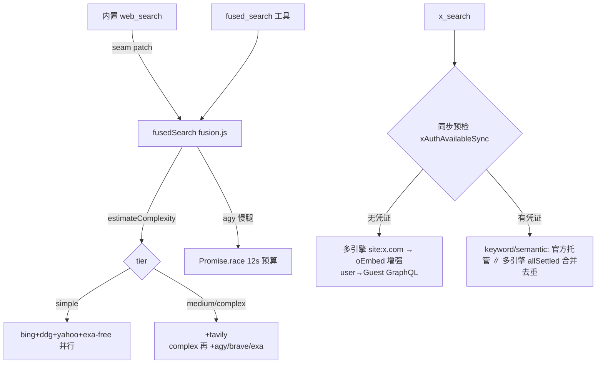

# dsh-search-boost 逆向分析报告

**目标**: dsh-search-boost (DeepSeek Harness 的搜索增强 bundle 插件，作者同 pi-search-boost)
**版本**: v0.1.3
**平台**: 跨平台 (Node.js ≥22.13，零 npm 依赖)
**类型**: 开源 (MIT)
**分析日期**: 2026-09-02
**原始下载**: https://github.com/Mr-remon219/dsh-search-boost
**源码位置**: `analysis/dsh-search-boost/source/`（实际位于 `/home/z/my-project/analysis/`，非 search-tool-rnd 子目录）

> 本报告与 reports/02-pi-search-boost.md 配对阅读。同一作者的第三代实现（第一代 pi 扩展 → 第二代 plugin-host.js 会话插件 → 本版 bundle），**只写差异与新机制，重复部分略**。

---

## 0. 摘要 (TL;DR)

dsh-search-boost 是 pi-search-boost 的 DeepSeek Harness (DSH) 移植重构版，5531 行纯 JS、零依赖。四个质变：①接入方式从 pi ExtensionAPI 换成 DSH 的 Cordis bundle patch，**劫持内置 `web_search`/`web_fetch` 的 provider seam**，原生引用卡片保留；②免费层从"只有 exa-free"扩成 **Bing+DDG+Yahoo+Exa-MCP 四路无 key 并行**，另加 Antigravity CLI (`agy`) 当引擎；③`deep_research` 从"插件内跑完的 auto 循环"改成 **step 模式——循环控制权上交给主 agent 模型**；④补齐了 pi 版完全缺失的 SSRF 防护层。被动安全姿态也变了：grok 凭证从"自动复用"改为"必须显式 /x-login 导入"。

---

## 1. 插件架构：Cordis bundle vs pi ExtensionAPI

DSH（deepseek-ai/deepseek-harness）的插件体系基于 **Cordis**（ctx/apply/inject 服务注入模型）。本插件有**两种接入形态**，这是 pi 版没有的概念：

1. **Bundle 插件（推荐，本仓库主体）**：npm 包内 `package.json` 声明 `"dsh": {"bundle": {"patch": "./cordis.patch.yml"}}`，用 `dsh plugin --profile web add dsh-search-boost` 安装。`--profile web` 是 DSH 的 **web-UI 配置档**（`dsh --profile web` 启动），每个 profile 有独立 bundle 列表；`dsh plugin` 命令用 pnpm 解析包并自动接线 patch 层。patch 内容只有 11 行（`cordis.patch.yml`）：

```yaml
- id: web
  config:
    searchProvider: dsh-search-boost
    fetchProvider: dsh-search-boost

- insert:
    - id: dsh-search-boost
      name: dsh-search-boost
```

   两行 config 把 DSH 内建 `web` seam 的 search/fetch provider **替换**成本插件（`index.js:268` `ctx.web.registerSearchProvider`），于是内置 `web_search` 工具的后端跑本插件的引擎链，但保留 DSH 原生的引用卡片 UI——**"升级内核、不换外壳"**，pi 版做不到（pi 只能新增平行工具）。

2. **Session 级动态插件（`plugin-host.js`，1415 行遗留原型）**：在 DSH 会话内 `cordis_define → cordis_run` 挂载。它跑在沙箱里，HTTP 要借 `ctx.shell.run` 执行 curl；bundle 版则直接跑在**宿主进程**里用 Node fetch。这个文件是 lib/ 的前身（fusion/research 都注明 "Ported from the session-level plugin"）。

其他架构差异：

- **事件注入 → section 注入**：pi 版靠 `before_agent_start` 事件 hack 注入提示词；dsh 版用正规 `ctx.systemPrompt.section()`（`policy.js` order 115），另注册一个**动态 status section**（order 116，`index.js:253`），每次 prompt 组装时实时渲染当前 layer 和 x_search 通道——模型不用调工具就知道该不该建议 `/web_change`。
- **注册即常驻**：`index.js:85-91` 注释了踩坑记录——把手 disposer 交给 `ctx.effect` 会在 entry fiber 提交后立刻反注册，所以"故意不还 disposer"。
- **UI 深度集成**：工具注册带 `presentCall`/`presentResult`/`presentationMeta`（`index.js:340-403`），把结果投影回 DSH 原生 web 引用卡片。pi 版没有这层。
- 工程形态差异：**TypeScript+测试齐全 → 纯 JS 零依赖**；cache/audit 从磁盘 JSON（`~/.pi/agent/`）改成**纯内存 LRU**（`fusion.js:412`，200 条上限），不跨进程共享——为发布友好牺牲了持久化。
- 生态位：README 显示作者还有第三代 `search-boost`（MCP 版，服务 Cursor/Codex/Claude/Grok/Antigravity）——同一引擎核心三次发行，**"核心与载体解耦"已是既成事实**。

---

## 2. 搜索编排



### 2.1 复杂度路由：从"API 档位表"到"双层双表"

`estimateComplexity` 逻辑不变（research-signal 正则→complex；词数 ≤2/≤4→simple/medium），但正则**加了中文信号词**（最新|综述|对比|选型…），`queryTerms` 加了 **CJK bigram** 切词，`parseDate` 认识"2024年5月"——pi 版是纯英文假设。tier 表变成 free/api 双份（`lib/fusion.js:18-27`）：

```js
export const TIER_ENGINES = {
  simple: ['bing', 'ddg', 'yahoo', 'exa-free'],
  medium: ['bing', 'ddg', 'yahoo', 'exa-free', 'tavily'],
  complex: ['bing', 'ddg', 'yahoo', 'exa-free', 'antigravity', 'tavily', 'brave', 'exa'],
}
export const TIER_ENGINES_FREE = {
  simple: ['bing', 'ddg', 'yahoo', 'exa-free'],   // medium/complex 同
}
```

### 2.2 串行→并行的两个落点

- **内置 web_search**：v0.0.1 release note 明说，DSH 原生搜索 provider 是**串行 failover**（第一个引擎失败才试下一个），插件把它换成**按复杂度档位的多引擎并行 fan-out**，共享 fused_search 的 6h 缓存（`engines.js:444` 残留的 `runChain` 顺序尝试函数已成死代码，正是旧串行模式的化石，见 AUDIT.md）。
- **x_search keyword/semantic**：官方托管工具与多引擎域内搜索 **`Promise.allSettled` 并行**再按 id/url 去重合并（`index.js:672-712`）；user/thread 保持串行主路径。无凭证时**同步预检**（`xAuthAvailableSync()` 零网络检查，`index.js:660`）直接走 fallback，不傻等主路径超时；再加 per-kind TTL 缓存（5/10/15min）和 **single-flight**（并发同 key 调用共享一次执行）。

### 2.3 与 pi 版编排的两处反差

1. **pi 的自适应剪枝（thin-pool 二波触发，engines.ts:818）在 dsh 版被删除**：`fusion.js:273` 所有 variant×engine 任务一次性 `Promise.all`。替代物是 `SECONDARY_VARIANTS`（额外变体只跑廉价引擎池）+ `SLOW_ENGINES` 预算竞速（`fusion.js:278-283`，agy 用 `Promise.race` 限 12s，防止 45s CLI 拖死整批——这是作者审计清单 P1-13 的修复）。代价是 api 层 complex 档的第 2/3 变体**无条件**烧 tavily credit，省钱的剪枝逻辑没有保留。
2. **融合打分引入 xai-org/x-algorithm 借来的软衰减**（`fusion.js:356-375`，Apache-2.0）：同域第 2 条结果 ×0.7（替代 pi 的硬性 per-domain=2 截断——截断仍在但先衰减），单引擎命中 ×0.9。比 pi 的加权求和多了两个可解释的多样性因子，但仍不是 RRF。

---

## 3. 多引擎路由

| 引擎 | 层 | 实现 | 备注 |
|---|---|---|---|
| Bing HTML | free | 正则解析 + base64 重定向解码（`engines.js:226`） | 100% 成功率 |
| DDG HTML | free | 解析 `uddg=` 重定向 | 100% |
| Yahoo HTML | free | `RU=` 解码，v0.1.2 新增 | 100% |
| Exa MCP (exa-free) | free | 手写 MCP 客户端：initialize→initialized→tools/call（`exa-free.js:104`） | 唯一语义引擎，~4.2s |
| **Antigravity CLI** | api (medium+) | `agy -p <prompt> --dangerously-skip-permissions --output-format json --json-schema …`（`engines.js:124`），用 JSON schema 强约束输出 | **新物种：把 Google Antigravity IDE 的 CLI 当搜索引擎**，~27s/92% |
| Tavily/Brave/Exa | api | keyed API | 有 key 才入扇出 |

- `/web_change free|api|show`：层状态持久化到 `~/.dsh-search-boost-layer.json`（`layer.js`，原子写+写队列）。与 pi 的本质差异：**dsh 免费层是四引擎并行的完整能力**（实测 5 hits/1.3–3.0s），pi 免费层只有 exa-free 一条腿。作者的 live benchmark（README）还淘汰了 brave-html/mojeek/searx（0%——429/封锁）。
- 降级链：free 层引擎全灭 → 强制回落 `exa-free` 并输出 warning（`fusion.js:240-243`）；429 时 exa-free "fail loudly"，提示切 `/web_change api`，由提示词政策承接。
- Windows 适配：undici 默认 IPv6-first 导致搜索主机超时，所有 HTML 抓取强制 IPv4 DNS（`engines.js:64`）。这类真实环境脏活 pi 版也有但没成体系。

---

## 4. Focus Fetch

`lib/fetch.js` 仅 135 行（pi extract.ts 545 行）。链路：Jina Reader（curl UA，`r.jina.ai`）→ 内容 <80 字符或失败时本地 HTML 提取（过 SSRF 守卫）→ focus 过滤 → 8000 字符封顶。关键差异：

- **缓存存原文、focus 在读取时过滤**（`fetch.js:96` 先查缓存再 `pageResult` 内过滤）——同一页面可用不同 focus 复用，pi 版缓存键含 focus 换角度即重抓（后来作者自己的审计也把这条列为 P1-4）。
- 过滤算法从 pi 的"段落按词项覆盖率评分取 top-K"**简化为"命中段落 + 前后各一段邻接上下文"**（`fetch.js:31-47` `focusFilter`），不再排序。省 token 效果从 pi 宣称 ~95% 降为 ~90%，换来实现简单与可预期（不会因评分抖动漏掉相邻上下文）。
- **SSRF 守卫是 dsh 独有**（pi 版完全裸奔）：`lib/ssrf.js` 182 行，BlockList 拦回环/RFC1918/链路本地/ULA/组播/云 metadata，`guardedFetch` 手动逐跳跟随重定向**每跳重新校验**（防 DNS rebinding），500KB 字节上限。最妙的是 **Clash/mihomo TUN fake-ip 豁免**（`ssrf.js:68-75`）：TUN 代理把所有 DNS 答成 198.18/15，一刀切会弄死真页面；守卫识别"全部答案都是 fake-ip"视为经 TUN 出网放行，字面量 198.18 IP 仍拦，可用 `DSH_SEARCH_ALLOW_TUN_FAKEIP=0` 关闭。这是从作者真实代理环境里长出来的工程细节。

---

## 5. X 搜索（v0.0.x 引入，v0.1 强化）

四种模式沿袭 pi：keyword（X 高级语法）/ semantic（自然语言）/ user（账号）/ thread（按 post_id）。

- **官方路径**（`xsearch.js`）：对齐 Grok Build 的 Responses API——grok-session 走 `cli-chat-proxy.grok.com`（OIDC，近过期自动 refresh，401 自愈重试），API key 走 `api.x.ai`；用 JSON prompt 驱动托管 `x_search` 工具并要求回纯 JSON，配 kind-aware 的 **JSON salvage**（括号配平扫描 + user/post 形状判别）。**凭证模型反转**：pi 自动读 `~/.grok/auth.json`；dsh **绝不自动消费**，必须 `/x-login` 显式导入到自有文件（`xauth.js:1-7` 注释写明是 v0.0.3 的 explicit opt-in 决策），刷新后的 token 还会回写 grok 的 auth.json 保持双向同步。
- **无凭证降级**（`xfallback.js`，实测 ~2s）：
  - keyword/semantic → 注入的 `domainSearch`（四免费引擎 + site:x.com 前缀，绕过融合器的 per-domain cap，`index.js:183`）→ 对 top 1-2 status URL 做 **oEmbed 全文增强**；
  - user → **Guest GraphQL**（x.com 匿名 web bearer + guest token 磁盘缓存 2h）：UserByScreenName 结构化档案 + UserTweets 最近时间线；
  - thread → oEmbed 单帖全文。
  - 自愈三件套：404 时从 x.com JS bundle **重提取轮换的 GraphQL queryId**（`xfallback.js:182`）、guest token 401/403 重铸、HTML 实体全量解码。
- 与 pi 相比新增：并行即时通道（官方∥多引擎）、同步预检、single-flight、per-kind 缓存、`/x-login status`。收窄：pi 版官方路径成功后仍无条件并行跑多引擎补充，dsh 版该行为仅限 keyword/semantic（user/thread 纯串行）。

---

## 6. 与 pi 版差异表

| 维度 | pi-search-boost v0.1.3 | dsh-search-boost v0.1.3 |
|---|---|---|
| 载体 | pi ExtensionAPI（工具+命令+事件 hack） | Cordis bundle patch，**劫持内置 web_search/web_fetch seam** |
| 语言/依赖 | TS 5355 行 | JS 5531 行，**零依赖** |
| 免费层 | 仅 exa-free | **Bing+DDG+Yahoo+Exa-MCP 四路并行** |
| 独有引擎 | — | Antigravity CLI（agy，Gemini 后端，慢腿限 12s） |
| 复杂度路由 | 1 张 tier 表 | free/api 双表 + SECONDARY_VARIANTS |
| 自适应剪枝 | ✅ thin-pool 二波 | ❌ 删除，改一次性全并行 |
| 融合打分 | 加权+cross+rel+rec+硬 per-domain cap | 同骨架 + **x-algorithm 软衰减（0.7x/0.9x）** |
| deep_research | 插件内 auto 循环跑完（含 answer） | **step 模式：插件只跑一轮，主 agent 模型驱动多轮至 gaps 空** |
| research_parallel | spawn 2-4 个 pi 子进程 | **DSH 原生 subagents 服务**（每子代理独立上下文，预算 300s，禁递归） |
| 抓取 | Readability 式评分 top-K，~95% | 命中段+邻接段，~90%；缓存原文读时过滤 |
| SSRF | ❌ 无 | ✅ 182 行守卫 + TUN fake-ip 豁免 |
| 缓存 | 磁盘 JSON 跨进程 | 内存 LRU（不持久） |
| 提示词 | 英文 `<search_balance>` 事件注入 | **中文政策 + 硬性规则**（疑问即搜/搜过才能说不知道/先搜后答自检/**防注入底线**）section 注入 + 动态 status section |
| X 凭证 | 自动复用 grok auth.json | **显式 /x-login opt-in** + OIDC 双向回写 |
| 审计 | JSONL audit 文件 | 内存 stats + `search_stats` 工具（模型可自查） |

---

## 7. 弱点分析

1. **作者自述（docs/AUDIT.md + pi 版同源问题）**：无 Brave/Tavily/Exa key 时质量取决于 HTML 抓取腿——Bing/DDG/Yahoo 正则解析天然脆弱（结构一改即全灭，作者自己也只给了"100% 成功（今天）"的快照数据）；主动式搜索完全依赖中文提示词政策，无 RL/少样本兜底。HTML 抓取还有 ToS/反爬的合规灰区。
2. **剪枝回退**：删掉 thin-pool 自适应后，api 层 complex 档每个 extra variant 都烧一次 tavily credit，比 pi 更费钱。
3. **缓存降级**：内存 LRU 意味着重启即冷、多会话不共享，与 pi 的磁盘缓存相比是明确退步（工程上换取零依赖）。
4. **agy 依赖本机登录态**：把另一个 IDE 的 CLI 当引擎，模型名硬编码 `gemini-3.6-flash-low`、成功率 92%、延迟 27s——只能当 complex 档的锦上添花，且随时会被上游破坏。
5. **焦点过滤可能空手**：focus 全不命中时返回空内容（focusMiss 标志未进输出 schema），模型拿到空串只能重试。
6. **Guest GraphQL 合规脆弱**：匿名 bearer 是 x.com 前端公开值，X 改版即断（作者已备自愈，但本质上在与平台对抗）。

---

## 8. 对我们的启发（自研搜索工具基线）

**保留（比 pi 版更成熟的基线）**：
- **免费层四路并行**作为零配置默认——这是 dsh 相对 pi 最大的实用提升，"无 key 也能完整工作"应是我们 v0 的第一验收标准。
- **SSRF 守卫模块整体照搬**（含逐跳重定向校验、字节上限、TUN 豁免思路）——pi 版裸奔是不可接受的。
- **x-algorithm 软衰减**（同域 0.7x、单引擎 0.9x）替换硬截断；RRF 仍是我们目标，但这两个因子可叠加。
- **provider seam 劫持**思想：我们的搜索工具若以插件形态发布，优先升级宿主内置搜索而非新增平行工具。
- **政策 section + 动态 status section**：让模型每轮都知道自己处于什么搜索配置。
- X 无凭证降级链（multi-engine site: → oEmbed 增强 → guest GraphQL）与同步预检、single-flight。

**重写**：
- **deep_research 的 step 化保留，但 gap 分析太弱**（只是"词项被 <2 源覆盖"），应换成 LLM 评估覆盖面/冲突证据；
- 融合打分应按既定结论改 **RRF**，去掉难以校准的 ENGINE_WEIGHT；
- 缓存回磁盘（或 SQLite），层级 LRU 不该是终态；
- 剪枝恢复 pi 的 thin-pool 二波逻辑（保留 dsh 的慢腿预算竞速）。

**避免**：
- 不要把另一家 IDE 的 CLI 当引擎腿（agy 模式：脆弱、慢、合规边界模糊）；
- 不要让凭证文件被静默自动消费（dsh 的 opt-in 是对的，pi 的 auto-consume 是错的）；
- 提示词政策写中文硬规则可以，但"疑问即搜"需要配 stop 规则防过度搜索（dsh 有界浏览段已有，保持）。

---

## 9. 引用 & 二次查阅

- 仓库: https://github.com/Mr-remon219/dsh-search-boost （v0.1.3，MIT）
- 作者审计文档: `analysis/dsh-search-boost/source/docs/AUDIT.md`（P0/P1 修复清单，SSRF/URL 大小写/慢腿拖死等一手证据）
- Release notes: v0.0.1–v0.0.4（仓库内）；v0.1.x 见 README benchmark（2026-08 Windows 实测）
- 关键文件: `index.js`(1185) / `plugin-host.js`(1415, 前代原型) / `lib/fusion.js`(436) / `lib/engines.js`(456) / `lib/ssrf.js`(182) / `lib/xfallback.js`(519) / `lib/policy.js`(64)
- 配对报告: reports/02-pi-search-boost.md；姊妹项目 search-boost（MCP 版）待后续分析
