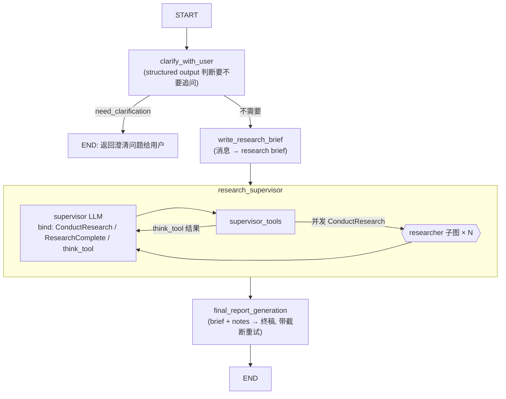
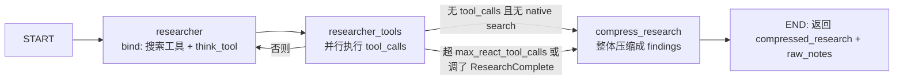

# Open Deep Research 逆向分析报告

**目标**: LangChain Open Deep Research (`langchain-ai/open_deep_research`)
**版本**: v0.0.16 (commit `1b7d2e8`, 2026-08-10 snapshot)
**平台**: Python 3.10+ / LangGraph Server (langgraph.json 单图入口)
**类型**: 开源 (MIT)
**分析日期**: 2026-09-02
**原始下载**: https://github.com/langchain-ai/open_deep_research (git clone --depth 1)
**SHA256**: N/A (git clone)

---

## 0. 摘要 (TL;DR)

LangChain 官方开源的 deep research agent,曾以 0.4344 RACE 分登上 Deep Research Bench 榜第 6。全仓库核心只有 **4 个 Python 文件**(deep_researcher.py 719 行 / utils.py 926 行 / prompts.py 368 行 / configuration.py 252 行),却完整实现了"澄清 → research brief → supervisor-researcher 双层循环 → 压缩 → 终稿"流水线。最值得学的两个机制:

1. **把"停止条件"做成 tool calling** — supervisor 和 researcher 都通过调用 `ResearchComplete` 工具来表态"可以收工了",配合硬性迭代上限兜底,这是它循环控制稳定的关键。
2. **三层结果压缩漏斗** — 搜索工具内先按 URL 去重并逐网页 LLM 摘要(50k 字符截断),researcher 结束后整体压缩成带引用的 findings,supervisor 只把压缩版塞回 ToolMessage,终稿阶段的 token 开销被压到极低。

它没有"ConcisenessRunner"这个类(任务清单里提到的这个名字在本仓库不存在),对应功能由 `compress_research` 节点 + `summarize_webpage` 函数承担,下文按实际代码展开。

---

## 1. 整体架构

### 1.1 进程拓扑

单进程 Python 服务:LangGraph Server 暴露 HTTP API,内部是 3 层嵌套的 StateGraph(主图 → supervisor 子图 → researcher 子图)。researcher 子图被 supervisor 用 `asyncio.gather` 并发多次调用,是唯一真正"多实例"的部分。无向量库、无外部缓存,状态全靠 LangGraph checkpointer。

### 1.2 两套实现:新版 multi-agent vs legacy workflow

仓库同时保留三代实现,演进路径本身就有参考价值(bitter_lesson 博客的原话是"简单的东西赢了"):

| | 新版 `src/open_deep_research/deep_researcher.py` | legacy multi_agent (`src/legacy/multi_agent.py`) | legacy workflow (`src/legacy/graph.py`) |
|---|---|---|---|
| 拓扑 | supervisor-researcher 双层 agent | supervisor-researcher(单层平铺) | plan-and-execute 工作流 |
| 规划方式 | research brief(一段文字) | supervisor 生成 Sections 列表 | 先搜索再 planner 生成大纲 + `interrupt()` 人工审批 |
| 并行 | `asyncio.gather` 并发 researcher 子图 | `Send()` API 按 section 分发 | `Send()` 并发写 section |
| 停止信号 | `ResearchComplete` tool + 迭代上限 | `FinishResearch`/`FinishReport` tool | 反思打分 pass/fail + `max_search_depth` |
| 产出 | 一个连续大报告 | intro/sections/conclusion 拼接 | 按 plan 顺序拼接 section |
| 搜索后端 | tavily + openai/anthropic native + MCP | tavily/duckduckgo + MCP | 9 种(perplexity/exa/arxiv/pubmed/linkup/ddg/google/azure/tavily) |

legacy workflow 最有趣的是 **quality-gate 循环**:`write_section` 写完后由 planner 模型打分(pass/fail),fail 则把 grader 生成的 `follow_up_queries` 回灌给 `search_web` 重搜(`src/legacy/graph.py:342-354`),相当于用反思代替了新版里交给模型自觉的 think_tool。新版砍掉了这个显式 grader,换来更简单的图和更好的 benchmark 成绩——**说明"每轮反思"用 prompt 内化比外置打分节点更划算**。

### 1.3 主图结构



researcher 子图(`deep_researcher.py:587-605`):



---

## 2. Agent 工作流

### 2.1 拓扑选择

- [x] 多 agent:1 个 supervisor + 最多 N 个并发 researcher(N = `max_concurrent_research_units`,默认 5,上限 20)
- 通信方式:researcher 是**子图调用**而非消息传递——supervisor 的 `ConductResearch` tool call 的参数 `research_topic` 直接作为 researcher 的 HumanMessage,返回值 `compressed_research` 作为 ToolMessage 内容回填。**researcher 之间完全隔离,互相看不到对方的工作**(prompt 里明确要求 supervisor 给每个 researcher 写"完整独立的指令")。

### 2.2 主循环伪代码

```
# 顶层(deep_researcher.py)
clarify_with_user():          # 需要澄清 → END 等用户回复;不需要 → 带 verification 消息继续
write_research_brief():       # 全部消息压缩成一段 research brief
notes = []
for iter in 1..max_researcher_iterations:     # supervisor 层
    resp = LLM(brief + supervisor_messages, tools=[ConductResearch, ResearchComplete, think_tool])
    if resp 调了 ResearchComplete 或 没有 tool_calls: break
    并行执行所有 ConductResearch → 每个 researcher 子图返回 compressed_research
    notes += 各 researcher 的 raw_notes
    ToolMessage(压缩结果) 回填, 继续
final_report = LLM(brief + 原始消息 + notes 合并的 findings)
```

### 2.3 关键决策点

| 决策 | 位置 | 判断依据 |
|---|---|---|
| 要不要问用户 | `src/open_deep_research/deep_researcher.py:104` | `ClarifyWithUser.need_clarification` 结构化输出;prompt 规定"已问过一次就几乎不再问",防止澄清死循环 |
| supervisor 继续/结束 | `deep_researcher.py:247-262` | 三选一:迭代数 > `max_researcher_iterations` / 最近消息无 tool_calls / 调了 `ResearchComplete` → END |
| researcher 继续/结束 | `deep_researcher.py:456-503` | 早退:无 tool_calls 且 openai/anthropic native websearch 未触发;晚退:`tool_call_iterations >= max_react_tool_calls` 或调了 `ResearchComplete` |
| native search 也要计入 | `utils.py:607-658` | `openai_websearch_called`/`anthropic_websearch_called` 检查 response metadata 里的 `web_search_requests`/`web_search_call`,否则 native 模式下模型会永远"无 tool_calls"而早退 |

**stop condition 的精髓**:三层保险——LLM 主动调用 `ResearchComplete`(显式信号)、无 tool_calls(隐式信号)、硬性迭代上限(兜底)。且 supervisor 层和 researcher 层各自独立计数,互不挤占。

### 2.4 异常处理

- 所有工具执行包在 `execute_tool_safely`(`deep_researcher.py:427-432`)里,异常变成 `"Error executing tool: ..."` 字符串返回给 LLM 继续。
- `supervisor_tools` 里的并行研究整体 try/except,失败就直接 END 并把已有 notes 带走(`deep_researcher.py:332-342`)。注意第 334 行写的是 `if is_token_limit_exceeded(e, ...) or True:` ——**作者故意把所有异常都当终止处理,token 判断实际失效**,这是个值得警醒的偷懒痕迹。
- 澄清后用户回复会重新进入图( LangGraph thread 机制),`clarify_with_user` 靠消息历史识别"已经问过"来避免反复追问。

---

## 3. 查询生成与 Brief 机制(本工具无 skill repo,此节对应任务里的"查询生成")

### 3.1 research brief(研究简报)

`write_research_brief`(`deep_researcher.py:118-175`)用 `ResearchQuestion` 结构化输出把全部用户消息转成一段 brief。prompt(`prompts.py:44-77`)有五条硬规则,最值得抄的两条:

- **Fill in Unstated But Necessary Dimensions as Open-Ended** / **Avoid Unwarranted Assumptions**:用户没说的维度,写明"开放",不许编造。
- **Sources 偏好注入**:商品/旅行类优先官网,学术类优先原始论文,人物类优先 LinkedIn,非英语 query 优先同语言来源。

brief 同时是 supervisor 的 system 上下文和终稿阶段的对照物,一份文本两处复用。

### 3.2 query 改写

**没有独立的 query 改写模块**。查询全部由 LLM 在 tool-calling 中即时生成:`tavily_search` 的 schema 接受 `queries: List[str]`(一次调用可带多个 query,并行执行),`research_system_prompt`(`prompts.py:164-174`)用预算约束行为:"简单 query 最多 2-3 次搜索,复杂最多 5 次,连续 2 次搜到相似信息就停"。

### 3.3 clarification 机制

- 配置开关 `allow_clarification`(默认开)。
- `ClarifyWithUser` 三字段:`need_clarification` / `question` / `verification`——**不澄清时也强制模型输出一段"我理解了,将开始研究 XX"的确认消息**,把模糊请求显式复述一遍再进循环,这是低成本高收益的设计。

---

## 4. 工具系统

### 4.1 协议

- [x] LangChain tool calling(OpenAI function calling 兼容格式)
- [x] MCP(streamable_http 传输,`langchain_mcp_adapters.MultiServerMCPClient`,单 server,代码留 TODO 等多 server 支持)
- [x] Anthropic/OpenAI **native server-side search**(以 dict 形式直接 bind,不走客户端执行)

### 4.2 工具组装

`get_all_tools`(`utils.py:569-597`)每次调用都重新组装:`[ResearchComplete, think_tool]` + 搜索工具 + MCP 工具。MCP 工具加载时:与现有工具**重名的直接跳过并 warning**;不在 `mcp_config.tools` 白名单里的过滤掉;每个工具包一层 `wrap_mcp_authenticate_tool`(`utils.py:385-447`)拦截 MCP 错误码 `-32003`(需要用户交互/登录),把原始异常翻译成带 URL 的人类可读 `ToolException`。

### 4.3 工具列表(researcher 层)

| 工具 | 输入 | 输出 | 备注 |
|---|---|---|---|
| `tavily_search` | `queries: List[str]` + 注入参数 | 格式化的搜索结果文本 | 唯一的客户端搜索实现 |
| `web_search`(native) | 模型自动决定 | server 端执行 | anthropic `web_search_20250305, max_uses=5` / openai `web_search_preview` |
| `think_tool` | `reflection: str` | 原样回显 "Reflection recorded: ..." | **no-op 工具**,纯 prompt 工程手段 |
| `ResearchComplete` | 无参数 | — | 结束信号 |
| MCP tools | server 定义的 schema | server 返回值 | 经认证包装 |

**think_tool 是全仓库最便宜的"聪明设计"**:一个不做任何事的工具,通过 prompt 强制模型"每次搜索后必须单独调用 think_tool 反思,且不许与其他工具并行",在消息流里人为插入停顿点,显著提高下一轮搜索决策质量。零成本复刻。

---

## 5. 搜索实现(重点)

### 5.1 后端

| 后端 | 新版 | legacy workflow | 配置方式 |
|---|---|---|---|
| Tavily | ✅ 默认 | ✅ | `search_api=tavily`,key 从 env 或 config(`GET_API_KEYS_FROM_CONFIG=true` 时按用户下发,多租户设计) |
| OpenAI native | ✅ | ✗ | `search_api=openai` |
| Anthropic native | ✅ | ✗ | `search_api=anthropic` |
| DuckDuckGo | ✗ | ✅ | env `DUCKDUCKGO_...` |
| Exa / Perplexity / arXiv / PubMed / Linkup / Google / Azure AI | ✗ | ✅ | `legacy/utils.py:1501-1539` 的 `select_and_execute_search` 分发 |

新版刻意收敛到 3 个后端:搜索逻辑全部内嵌在 `tavily_search` 工具里(去重+摘要),其他后端要复用这套逻辑得自己接;MCP 则作为"任意搜索后端"的逃生舱。**支持矩阵越大,压缩管线越难统一——这是它砍掉 6 个后端的真实原因。**

### 5.2 Query 处理与抓取

- 多 query 并发:`tavily_search_async`(`utils.py:138-173`)对 `queries` 列表逐个建 task,`asyncio.gather` 并发,`include_raw_content=True` 拿全文。一次 tool call 多 query 的设计让模型可以用一轮调用覆盖一个子主题的不同关键词组合,减少往返次数。
- 抓取策略:用 Tavily 的 raw_content(服务端已抽正文),客户端不做 Readability;单页截断到 `max_content_length`(默认 50000 字符)。
- query 改写完全交给 LLM 即时生成,没有独立的 query planner 节点;legacy 版有专门的 `query_writer_instructions` 生成 2 条/轮的精准 query,新版用 research_system_prompt 里的行为约束替代,换来的是 researcher 自主决定"先广后窄"的搜索节奏(prompt 明确指导:先宽泛搜索,反思后补窄查询)。

### 5.3 去重与压缩(核心)

三段式压缩管线:

**第 1 层:URL 去重**(`utils.py:70-77`)——多 query 的结果合并进 dict,key 是 URL,`keep_first` 策略保留首次出现的 query 归属。

**第 2 层:逐页摘要**(`utils.py:100-110`)——每页用便宜的 `gpt-4.1-mini` + `Summary{summary, key_excerpts}` 结构化输出并行摘要,60 秒超时或失败都降级返回原文(`utils.py:193-213`),最终格式 `<summary>...</summary><key_excerpts>...</key_excerpts>`,每页控制在原文 25-30% 长度。

**第 3 层:researcher 级整体压缩**(`compress_research`,`deep_researcher.py:511-585`)——把该 researcher 全部消息(含 AI 反思)交给 `compression_model`,prompt 要求"逐字保留所有相关信息,只删明显无关/重复的,禁止概括",并强制输出 `List of Queries and Tool Calls Made / Fully Comprehensive Findings / Sources` 三段结构。超 token 时重试最多 3 次,每次用 `remove_up_to_last_ai_message` 砍掉最近一轮上下文(`utils.py:848-866`)。

```python
# src/open_deep_research/utils.py:70-77  — URL 去重,keep_first
unique_results = {}
for response in search_results:
    for result in response['results']:
        url = result['url']
        if url not in unique_results:
            unique_results[url] = {**result, "query": response['query']}
```

**第 4 层(legacy 独有,值得知道)**:`split_and_rerank_search_results`(`legacy/utils.py:1573-1593`)——网页切块(1500 字符,overlap 200)→ 内存向量库(默认 text-embedding-3-small)→ 按 query 召回 top chunks → `stitch_documents_by_url` 按 URL 重拼并用 sha256 对 snippet 去重。这是"摘要"之外的另一条路:**embedding rerank 比 LLM 摘要便宜且不丢细节,但实现复杂度高一个量级**,新版权衡后放弃了它。

### 5.4 融合排序与缓存

- 无跨引擎融合(一次只用一个后端),排序完全交给搜索 API 的原始顺序 + LLM 自行取舍,无 RRF。
- **无任何缓存**——同一 URL 在不同 researcher 之间、不同迭代之间会重复搜索重复摘要,这是明显浪费点(5 个并发 researcher 搜同一主题时 URL 撞车率不低)。

---

## 6. 上下文管理

### 6.1 层间隔离是第一原则

- 主图只保留:messages(用户对话)、research_brief、notes(raw_notes 列表)、final_report。supervisor 的完整消息历史**不会**进入终稿 prompt,终稿只看 brief + findings。
- researcher 子图状态独立,输入只有一个 `research_topic` HumanMessage,输出经 `ResearcherOutputState` 白名单过滤(`state.py:92-96`),只暴露 `compressed_research` 和 `raw_notes`——**子图输出 schema 显式裁剪,防止内部消息泄漏到父图**。
- 自定义 `override_reducer`(`state.py:55-60`):写入 `{"type":"override","value":[...]}` 可整体替换字段,否则 `operator.add` 追加。`write_research_brief` 用它硬性重置 supervisor_messages,防止多轮对话残留污染。

### 6.2 token 预算

- 无统一 token 记账,靠四处局部手段:`max_content_length`(单页字符上限)、`compression_model_max_tokens`/`final_report_model_max_tokens`(输出上限)、`remove_up_to_last_ai_message`(压缩重试时丢历史)、终稿阶段的**渐进截断**(`deep_researcher.py:663-683`):超限时按 `MODEL_TOKEN_LIMITS` 表(`utils.py:788-829`,硬编码 30+ 模型)取上下文长度 ×4 作为字符数上限,每次重试再砍 10%。
- `is_token_limit_exceeded`(`utils.py:665-701`)按 provider 分发匹配错误字符串/异常类名(openai: `context_length_exceeded`;anthropic: "prompt is too long";gemini: `ResourceExhausted`)。字符串匹配很脆,但作为跨 provider 的兜底够用。

### 6.3 长期记忆

无。`raw_notes` 累进式保存原始素材用于终稿(实际上终稿只用 `notes`,即 ToolMessage 内容;raw_notes 是给上层应用/评测用的),跨会话不持久。

### 6.4 报告生成:聚合与引用机制

终稿聚合 (`final_report_generation`, `deep_researcher.py:607-697`) 是**单次大模型调用**,不做 map-reduce:

- **输入三件套**:research_brief(锚定任务)+ 全部用户消息历史 + `findings = "\n".join(notes)`(所有 researcher 的压缩产出按序拼接)。supervisor 的过程消息(它调了哪些工具、做了什么反思)被完全丢弃,写作模型只看素材不看过程。
- **聚合前清场**:notes 用 override_reducer 硬性清空(`cleared_state`),终稿写完即释放,长会话不会累积 stale findings。
- **聚合靠压缩保证质量**:每个 researcher 的 findings 已含独立的 Sources 清单和逐字保留的素材,终稿 prompt 只要求组织而非补充,有效缓解多源合并时的信息蒸发。
- **引用机制全在 prompt 层**,分两级:压缩层要求每个 URL 独占一个编号、`### Sources` 结尾、编号连续无空洞(`prompts.py:212-219`);终稿层要求正文用 `[Title](URL)` 行内引用 + 末尾 `[1] Source Title: URL` 编号列表(`prompts.py:298-307`)。**没有任何代码层校验**——编号由 LLM 自由重排,多个 researcher 的 Sources 合并后靠写作模型重新编号,这是引用断链/错号的真实风险点,也是它压缩 prompt 里用 6 条 Guidelines 反复强调"不许丢 source"的原因。
- **输出语言跟随用户**:终稿 prompt 用 CRITICAL 强调报告语言必须与用户消息一致(中文提问产出中文报告),brief/研究过程可以是英文——国际化研究场景的实用细节。
- **失败路径**:超限重试 3 次(截断 findings 至 token_limit×4 字符起步,每次 -10%),非超限错误直接返回错误字符串给上层 UI。

---

## 7. 模型路由

### 7.1 四角色四模型

| 角色 | 默认模型 | max_tokens | 理由 |
|---|---|---|---|
| summarization | `openai:gpt-4.1-mini` | 8192 | 高频×低难度,压成本 |
| research(supervisor+researcher 共用) | `openai:gpt-4.1` | 10000 | 主力,需强 tool calling |
| compression | `openai:gpt-4.1` | 8192 | 保真压缩,不能丢信息 |
| final_report | `openai:gpt-4.1` | 10000 | 长文写作 |

### 7.2 实现机制

全局一个 `init_chat_model(configurable_fields=("model","max_tokens","api_key"))`(`deep_researcher.py:56-58`),每个节点用 `.with_config({...})` 注入角色模型——同一 Runnable 换脸,配置支持 env 大写变量覆盖(`configuration.py:236-247`,如 `RESEARCH_MODEL=anthropic:claude-sonnet-4`)。README 评测表显示 research 换 GPT-5 可从 0.4309 提到 0.4943,而 summarization 保持 4.1-mini 不动——**路由收益集中在"主力模型"上,摘要模型用小模型几乎无损**。

无 fallback 链;structured output 统一 `.with_retry(stop_after_attempt=3)`。

### 7.3 Configuration 类关键参数总表

全部参数集中在 `configuration.py` 的 pydantic `Configuration`(每字段带 `x_oap_ui_config` 元数据,供 LangGraph Studio/OAP UI 自动渲染滑块/下拉框,这个"配置即 UI"的做法本身值得学),优先级:环境变量大写名 > configurable > 默认值(`configuration.py:236-247`):

| 参数 | 默认 | 含义 | 对应维度 |
|---|---|---|---|
| `max_concurrent_research_units` | 5 (1-20) | 单轮并发 researcher 数(**广度**) | §2.3 |
| `max_researcher_iterations` | 6 (1-10) | supervisor 最大迭代数(**深度**) | §2.3 |
| `max_react_tool_calls` | 10 (1-30) | 单 researcher 最大 tool-calling 轮数 | §2.3 |
| `allow_clarification` | true | 研究前是否允许追问用户 | §3.3 |
| `max_structured_output_retries` | 3 (1-10) | 结构化输出/工具重试次数 | §2.4 |
| `search_api` | tavily | anthropic/openai/tavily/none 四选一 | §5.1 |
| `max_content_length` | 50000 (1000-200000) | 单网页进入摘要前的字符截断 | §5.3 |
| `summarization_model`(+max_tokens) | gpt-4.1-mini / 8192 | 逐页摘要模型 | §7.1 |
| `research_model`(+max_tokens) | gpt-4.1 / 10000 | supervisor+researcher 共用 | §7.1 |
| `compression_model`(+max_tokens) | gpt-4.1 / 8192 | researcher 产出压缩 | §5.3 |
| `final_report_model`(+max_tokens) | gpt-4.1 / 10000 | 终稿写作 | §6.4 |
| `mcp_config` / `mcp_prompt` | None | MCP server URL+工具白名单 / 附加使用说明 | §4.2 |

注意:**没有"总预算"类参数**——深度×广度×单轮工具数的乘积(最坏 6×5×10=300 次 LLM 调用/查询)没有任何全局上限管束,成本上限只能靠模型单价间接控制,这是我们设计时要补的洞。

---

## 8. 综合发现 (Findings)

### 8.1 最聪明的 3 个设计

1. **停止条件即工具调用**:`ResearchComplete` 把"我研究完了"变成可 schema 校验、可计数、可观测的显式信号,加上"无 tool_calls"隐式信号 + 硬上限,三层保险让循环几乎不会失控。
2. **压缩漏斗 + 层间隔离**:搜索层 URL 去重/逐页摘要 → researcher 层保真压缩 → 终稿只见 brief + findings。supervisor 拿到的 ToolMessage 是压缩后的,同一上下文能装下 5 个 researcher 的产出。
3. **think_tool 强制反思**:no-op 工具 + "禁止与其他工具并行调用"的 prompt 约束,把 ReAct 循环改成"搜索→反思→搜索"的节奏,零基础设施成本。

### 8.2 最蠢的 3 个设计

1. `supervisor_tools:334` 的 `if ... or True:` 把所有异常都当致命错误直接终止整个研究阶段,一次网络抖动就烧掉整轮并行研究。
2. 完全无缓存:URL 去重只在单次 `tavily_search` 调用内部,跨迭代/跨 researcher 的重复抓取与重复摘要照付成本(README 自曝 100 题评测 $46-187)。
3. 终稿 prompt 把**全部用户历史** `get_buffer_string(messages)` 塞进去,与 findings 并列;多轮场景下历史 token 远超 findings,挤占真正有用的上下文。

### 8.3 可借鉴的机制(→ 对我们的启发,详见 §9)

stop-condition 工具化、三层压缩、clarification 单次原则、brief 的"不编造用户未说内容"规则、子图输出白名单。

### 8.4 应避免的坑

- 依赖错误字符串匹配判断 token 超限(换模型/换版本就失效)。
- 引用完整性纯靠 prompt(压缩 prompt 用 6 条 Guidelines 反复强调"不许丢 source",说明丢引用是真实痛点;没有代码层校验)。
- 30+ 模型的 token 上限硬编码在 dict 里,README 自己注释"may be out of date"。

---

## 9. 我们自己的设计参考

结合此前 Grok Build(无客户端搜索)/ Trae(闭源黑盒)的分析,Open Deep Research 是目前**对"搜索型 agent 该怎么组织"最有指导价值的样本**,以下机制应抄进我们的搜索工具:

**必须复制:**

1. **多 agent 并行调度**(重点):supervisor 只产出 `research_topic` 字符串列表,researcher 是无状态子图、`asyncio.gather` 并发、输出白名单裁剪、超出并发数的研究请求返回明确错误让 LLM 重排。我们的实现取:并发上限硬闸 + "超出部分优雅报错而非丢弃" + 每 researcher 独立消息史。
2. **研究循环 stop condition**(重点):`ResearchComplete` 显式工具 + 无 tool_calls 隐式退出 + `max_react_tool_calls`/`max_researcher_iterations` 双层硬上限。prompt 里同时给预算("简单 2-3 次,复杂 5 次")和停止特征("连续 2 次搜索结果相似即停")。这是我们 v0 循环控制的直接模板。
3. **结果压缩三层漏斗**(重点):URL 去重(keep_first)→ 逐页小模型摘要(超时降级原文)→ 任务级"保真压缩"(禁止概括、强制带 Sources 清单)。我们把第 2 层做成搜索工具内部固定行为,第 3 层做成返回给父 agent 前的固定后处理。
4. **clarification 机制**(重点):研究前一次结构化澄清判断,三字段输出 + "已问过不再问"的单次原则 + 不澄清时的 verification 复述。成本一次 LLM 调用,换来 brief 质量大幅提升。
5. **brief 质量规则**:不编造未说内容、未指定维度显式标 open-ended、按 query 类型注入来源偏好(官网/原论文/LinkedIn)。
6. **think_tool 反思节奏**:照抄零成本。

**必须避免:**

- 异常处理写 `or True`(一个 researcher 失败应只降级该任务,不该终止全局);
- 无缓存(我们至少要 URL 级 TTL 缓存,跨 researcher 共享);
- token 限额靠字符串匹配 + 硬编码表(接入各 provider SDK 的结构化错误)。

**可选改进:**

- 它砍掉的 legacy `split_and_rerank`(切块→向量召回→按 URL 重拼)适合作为"长文档、预算紧"场景的可选第 2.5 层;
- 终稿阶段可用 map-reduce 分节写再合并,绕开单次上下文截断;
- 它的终稿完全丢弃 supervisor 过程消息,我们可以保留 brief + 每轮 reflection 的极简日志作为写作上下文。

---

## 10. 引用 & 二次查阅

- 仓库 commit: `1b7d2e80db9faa586165c60e09096dbbfd483a64`(main, 2026-08-10)
- 官方博客 "Bitter Lesson" 演进复盘: https://rlancemartin.github.io/2025/07/30/bitter_lesson/
- LangChain blog: https://blog.langchain.com/open-deep-research/
- Deep Research Bench 榜单: https://huggingface.co/spaces/Ayanami0730/DeepResearch-Leaderboard
- 课程版(逐步实现): https://github.com/langchain-ai/deep_research_from_scratch
- 本地源码: `search-tool-rnd/analysis/open-deep-research/source/`
