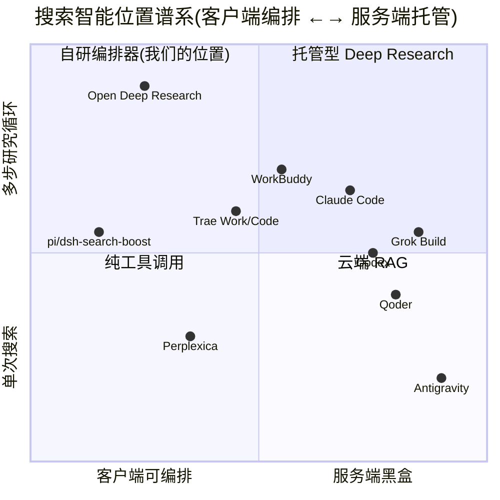

# 综合对比:12 个目标的 Agent / 技能 / 工具 / 搜索机制

> 本文是 Phase A-C 全部 12 份单目标报告(01-12)的横向综合。
> 逐项证据见各报告,本文只做对比与收敛,引用格式 `[N]` = reports/NN-*.md。

---

## 0. 一张图看全景

核心结论先行:**闭源大厂产品把搜索智能放在服务端,客户端只留抓取/清洗/注入;开源阵营(含我们自己的 search-boost)把搜索智能放在客户端**。这正好划出我们的生存空间——客户端可观测、可编排、可自选引擎的搜索层,而且闭源产品内部其实也在用"小模型预决策 + 多步循环"这类我们能抄的机制,只是藏在云端。

---

## 1. 目标全景表

| # | 目标 | 类型 | 核心实现语言 | Agent 循环位置 | 搜索实现 | 报告 |
|---|------|------|------------|--------------|---------|------|
| 1 | Grok Build | 开源 | Rust | 客户端(轻) | xAI 托管,客户端无 | 01 |
| 2 | pi-search-boost | 开源(自研) | TS | 插件内编排 | 客户端多引擎+剪枝 | 02 |
| 3 | Antigravity | 闭源 | Electron+Go | Go LS | 近乎无 web 搜索 | 03 |
| 4 | Qoder | 闭源 | Electron+JS SDK | 本地 JS SDK | 云端 | 04 |
| 5 | Trae Work (SOLO) | 闭源 | Electron+Rust | **原生 Rust**(:40005) | 云端两步走+客户端抓取 | 05 |
| 6 | Trae Code | 闭源 | Electron+Rust | 原生 Rust(同引擎) | 云端+deep-research.js 工作流 | 06 |
| 7 | WorkBuddy | 闭源 | Electron+CLI | 独立 CLI(ACP 协议) | hosted agentic_search(SSE) | 07 |
| 8 | Claude Code | 闭源 | Bun 原生二进制 | 单二进制内 | hosted+旁路小 agent+specialist | 08 |
| 9 | Codex | 开源 | Rust | 客户端(双层循环) | hosted web_search + BM25 工具发现 | 09 |
| 10 | dsh-search-boost | 开源(自研) | TS(Cordis) | 插件内编排 | 四路免费并行+SSRF 守卫 | 10 |
| 11 | Open Deep Research | 开源 | Python/LangGraph | 状态机 | 多 provider 可插拔 | 11 |
| 12 | Perplexica (Vane) | 开源 | TS/Svelte | 单次 RAG+轻 agent | SearXNG 单点 | 12 |

---

## 2. Agent 工作流对比

### 2.1 循环的三种流派

| 流派 | 代表 | 机制 | 优势 | 代价 |
|------|------|------|------|------|
| **LLM 自主循环** | Claude Code、Codex、Grok Build | 模型输出 item 类型决定调工具还是回话,无显式状态机 | 灵活、可处理意外 | 行为不可预测,依赖模型质量 |
| **显式状态机** | Open Deep Research(LangGraph)、Trae deep-research.js | 节点/边固定,每步可观测 | 可控、可恢复、可 budget | 灵活性受限 |
| **混合** | Trae SOLO(SimpleStartLoop+RalphLoopStopHook)、WorkBuddy(Tier 分层+max_loops 降级) | 模型自主但有硬护栏 | 平衡 | 实现复杂 |

### 2.2 多 Agent 拓扑对比

| 目标 | 拓扑 | 关键细节 |
|------|------|---------|
| Claude Code | Coordinator + Workers | coordinator 砍掉文件工具只留 Task/SendMessage;特权动作 spawn fresh worker 防 prompt-injection 链 [08] |
| Codex | 单 agent + Stop-hook 续跑 | 工具暴露四档(Direct/Deferred/CodeModeOnly/Hidden);Code Mode 在 V8 isolate 内编排,中间结果不进 context [09] |
| Trae SOLO | agent_run 父子树 + per-plan-item reviewer | run_agent 派生子 agent;每个 plan_item 独立 review;V8 Code Mode 与 Codex 趋同 [05] |
| WorkBuddy | AgentTask 子代理 + Teams + 9 个隐藏小 agent | compact/contentAnalyzer/autoModeClassifier 都是小 agent;深度/预算/MaxTurns 降级 [07] |
| ODR | supervisor-researcher 双层 | stop condition 三保险:显式 ResearchComplete 工具 + 无 tool_calls 隐式 + 双层硬上限(6×10) [11] |
| Trae deep-research.js | 工作流脚本 | 5 角度并行 → URL 去重+fetchSlots 预算 → 15 源断言抽取 → **3 票对抗验证且弃权≠存活** → 综合;journal.jsonl 断点恢复 [06] |

**共性结论(可直接抄):**
1. 子代理边界 = 上下文防火墙:中间结果不进主 context(Claude specialist "the caller never sees the page content"、WorkBuddy agentic_search 只回 synthesis、Codex Code Mode)——这个模式在 4 个目标里独立出现,是**最值得复制的单一机制**。
2. Stop condition 必须三件套:显式信号工具 + 隐式兜底 + 硬上限 [11]。
3. 特权动作隔离到 fresh worker [08],审批与执行分离。

### 2.3 自主性增强机制

- **Ralph Loop**(Trae SOLO): hook 强制"循环到做完为止" [05] — 对应 Codex 的 Stop hook 强制续跑 [09],两大厂趋同。
- **checkpoint.sh**(Trae): 把"上下文保真"做成可执行协议——每次工具调用前自问"RFC 全文还在吗",专治长任务压缩失真 [05]。
- **对抗验证**(Trae deep-research): 3 票投票且"弃权≠存活",防止验证 agent 老好人 [06]。

---

## 3. 技能仓库对比

| 目标 | 技能形态 | 发现机制 | 渐进披露 |
|------|---------|---------|---------|
| Claude Code | SKILL.md + plugins | 4 层 scope + catalog | ToolSearch/select: 语法,阈值=工具描述占 context 百分比 [08] |
| Codex | SKILL.md(4 层)+ AGENTS.md 层级合并 | catalog 渐进披露 + $mention 注入 | Direct/Deferred/CodeModeOnly/Hidden 四档 [09] |
| Trae | `.claude/skills` 兼容 + 内置技能 CDN 分包(scene=default/solo_work) | 兼容 Claude 生态 | defer_loading 工具分组 [05][06] |
| WorkBuddy | SKILL.md + CODEBUDDY.md 全套兼容 | Claude 血统 | defer + MiniSearch(top5,name boost 2,字符预算) [07] |
| Grok Build | 5 层 scope skill | ToolSearchIndex(backend-agnostic BM25/OpenSearch/内存) | — [01] |
| Qoder | Skill 工具 + --disable-builtin-skills | Claude 派生 | — [04] |

**结论:** 技能系统已经事实上收敛到 **SKILL.md + 分层 scope + 渐进披露** 三件套,Claude Code 是生态锚点,连闭源竞品(Trae/WorkBuddy)都直接兼容它的格式。我们的工具应该直接采用这个事实标准,不要发明新格式。工具多了以后的通用解法是:**先暴露工具目录,按需加载正文**(Claude 的加权打分/Codex 的 BM25/Grok 的可换后端索引是三种实现,小规模用加权打分即可)。

---

## 4. 工具系统对比

| 目标 | 工具数 | 协议 | 沙箱 | 特色 |
|------|-------|------|------|------|
| Claude Code | ~15 核心+deferred | Anthropic 原生+MCP | 无内置(靠权限系统) | hooks(Pre/PostToolUse)体系 |
| Codex | 15+ | Responses API ToolSpec | landlock/seccomp 双层 | Code Mode(V8 编排,中间结果不进 context) |
| Trae | 60+ | 自有 JSON-RPC(:40005)+MCP | trae-sandbox(seccomp)+TraeVM | Compact 也是工具;30+ Browser* 工具 |
| WorkBuddy | 56+ | ACP(stdio JSON-RPC)+MCP | 服务端 | Promise.race 竞速降级;Galileo 威胁域名库 |
| Grok Build | 少 | OpenAI function+MCP | 无 | ToolSearchIndex 后端可换 |
| ODR | 少(搜索为主) | LangChain tools+MCP | 无 | MCP 白名单+认证包装 |
| Perplexica | 6 | LangChain tools | 无 | __reasoning_preamble 伪装工具补思考 |

**结论:** MCP 已是普遍连接层(12 个目标 10 个支持);工具沙箱只有大厂闭源做重(Trae seccomp+VM、Codex landlock)。我们的 v0 做客户端编排器,工具面窄(搜索/抓取/研究),不需要沙箱,但 hooks/权限门控要预留接口。

---

## 5. 搜索实现对比(核心章)

### 5.1 六层解剖

把 12 个目标的搜索链路拆成六层逐层对比:

| 层 | 托管派(闭源+大厂开源) | 编排派(自研+研究开源) |
|----|---------------------|---------------------|
| **意图/查询** | Trae: `query_rewrite`+`context_select` 云端小模型预决策 [05];Perplexica: 一次 generateObject 同时出路由+重写+widget [12];ODR: research brief 五原则+单次澄清追问 [11] | pi/dsh: 复杂度路由 |
| **引擎选择** | Trae 内嵌 You/Toutiao/火山/豆包/Brave 枚举但全云端黑盒 [05][06];Claude/Codex/Grok 全 hosted | dsh: Bing+DDG+Yahoo+Exa 四路免费并行+Antigravity CLI 当引擎 [10];Perplexica: SearXNG engines 参数化 [12];ODR: tavily/openai/anthropic/MCP 白名单 [11] |
| **结果融合** | 服务端黑盒 | ODR: URL keep_first 去重 [11];Perplexica: embedding 双阈值(>0.5 过滤/>0.75 去重) [12];pi/dsh: 并行后合并 |
| **抓取** | Trae: 客户端批量抓+Auto 策略+域名黑名单+小模型清洗 [05];WorkBuddy: 服务端/本地 fetch **Promise.race 竞速**+>15k 才触发 contentAnalyzer 小模型+15min 缓存+SSRF/Galileo [07];Claude: 客户端抓取+HTML→md+small fast model 摘要+15min 缓存,可升级为 web-reading specialist 子代理 [08] | dsh: Focus Fetch 命中段+邻接段省 90-95% token,**缓存存原文、focus 读时过滤**(一页多角度复用) [02][10];Perplexica: Playwright 惰性单例+Readability+4000/500 分块+逐块 LLM 压缩 [12] |
| **注入/引用** | Trae: 搜索结果是统一引用体系的一等公民(`<web_search_result no=...>`),与 mention/attachment 同管线 [05];Perplexica: index=N → prompt [n] → 前端正则,三段式零解析器 [12] | ODR: 引用全在 prompt 层无代码校验(风险) [11] |
| **循环** | WorkBuddy agentic_search: 服务端 agent 多步检索,中间事件走 SSE,只回 synthesis [07];Claude: 旁路查询小 agent(thinking 关、tool_choice 强制)+200 次/会话配额软停止 [08] | ODR: 三保险 stop condition [11];Trae deep-research.js: fetchSlots 预算+对抗验证 [06];dsh: step 模式一轮覆盖度分析,循环控制权上交主 agent [10] |

### 5.2 高频共识机制(≥3 个目标独立验证)

1. **抓取后置/按需抓取**: Trae 两步走、WorkBuddy 竞速、Claude specialist、dsh focus fetch — 没有任何一家把全文直接塞 context。
2. **小模型做脏活**: 查询改写/正文抽取/相关性判断全部用便宜模型(Trae query_rewrite、WorkBuddy contentAnalyzer、Claude small fast model、Perplexica classify)。
3. **缓存 15min 起步**: WorkBuddy/Claude 明确 15min,dsh 磁盘缓存存原文。抓取页面的复用价值远高于时效性。
4. **域名治理**: 黑名单(Trae)、allowed/blocked_domains(Claude/WorkBuddy/Codex)、威胁域名库(WorkBuddy Galileo)、SSRF 守卫(dsh 182 行含 Clash TUN fake-ip 豁免)。
5. **搜索结果不自成协议**: 挂进统一引用/上下文体系(Trae ReferenceItem 与 file/symbol 并列)。

### 5.3 各家的独门绝技(单目标验证但高价值)

| 机制 | 来源 | 价值 |
|------|------|------|
| reference 先行/抓取后置的**双预算池**(fetchSlots) | Trae deep-research.js [06] | 直接解决"抓多了浪费 token,抓少了漏信息" |
| **对抗验证 + 弃权计票** | Trae [06] | 搜索结果可信度分级的基础设施 |
| **6 问量化反思**(Q1-Q6+Tier 分层+max_loops 降级) | WorkBuddy [07] | 迭代终止判定的工程化模板 |
| **Promise.race 双路竞速** | WorkBuddy [07] | 服务端/本地互为降级,可用性↑ |
| **缓存原文+读时过滤** | dsh [10] | 一页服务多角度查询,缓存命中率倍增 |
| **embedding 双阈值免 reranker** | Perplexica [12] | 零 GPU/零 API 的相关性方案 |
| **一次性 classify**(路由+重写+意图单调用) | Perplexica [12] | 省掉 planner 的多轮开销 |
| **X 搜索降级链**(官方 API→多引擎 site:→oEmbed→Guest GraphQL queryId 轮换自愈) | dsh [10] | 无订阅拿 X 数据的完整工程方案 |
| **journal.jsonl 断点恢复** | Trae [06] | 长研究循环的崩溃韧性 |
| **bge_m3+sqlite-vec 本地语义栈** | Trae ckg [05][06] | 闭源产品验证过的轻量本地向量方案 |

### 5.4 反面教材(必须避免)

1. Perplexica: `searchAsync` 整个无 try/catch(SearXNG 超时 → SSE 静默挂死)、全链路无缓存、quality 模式无 token 预算 [12]。
2. ODR: `or True` 异常处理吞错 [11]、**无全局预算参数**(最坏 300 次 LLM 调用失控)、字符串匹配判 token 超限 [11]。
3. ODR/Perplexica: 引用无代码校验,模型可以编 [11][12]。
4. Trae Work 全无本地 fallback: 云端搜索挂了客户端搜索就瘫 [05];dsh 无 key 时 HTML 抓取腿脆弱 [10] — 单点依赖是共同软肋。
5. pi 版 thin-pool 剪枝在 dsh 版被删导致回退 [10] — 迭代时好机制会意外丢失,需要回归测试清单。

### 5.5 搜索的账户绑定全景(Phase Q 扩展): 眼睛都锁在谁的账户里

> 2026-09-03 追加。背景: 用户问"这些工具的搜索都依赖账户吗? BYOK 之后搜索是不是就没了?"——用本仓库 12 份逆向报告的原始证据回扫一遍(证据来自反编译/抓包,比官方宣传更硬)。外部实抓证据见 [search-landscape/e 报告附二](../analysis/search-landscape/e-ai-invocable-domain-routing.md)。

**四种绑定模式**(12 产品全落位):

| 模式 | 产品 | 搜索执行位置 | 绑定物 | BYOK 换模型后搜索还在吗 |
|------|------|------------|--------|----------------------|
| **A. 托管跟随厂商账户** | Grok Build [01] | xAI Responses API 服务端 agentic sampler | xAI 账户/订阅 | ❌ 搜索是 LLM 端 hosted tool,换通道即消失 |
| | Codex [09] | OpenAI Responses API hosted spec | OpenAI 账户 | ❌ 同构: 客户端只拼 `{type:"web_search"}` |
| | WorkBuddy [07] | 自家网关 /agenttool/v1/*(Bearer+会话头) | 厂商账户 | ❌ hosted agentic_search SSE 全在服务端 |
| | Qoder [04] | Qoder Cloud API | 厂商账户 | ❌ 云端委托 |
| | Trae Work/Code [05][06] | 字节云端 api/ide/v1/web_search(两步走) | 字节账户 | ❌ 且**全无本地 fallback**(5.4 反面教材#4) |
| | Claude Code [08] | Anthropic 服务端 web_search_20250305 | Anthropic 一方 API | ❌ Bedrock/Vertex 官方明示不可用; AWS 解法=挂 MCP 搜索 connector |
| | Kimi Desktop [14] | Kimi API 云端 agent | Kimi 账户 | ❌ 开源 kimi-code CLI 里根本不存在 web_search 客户端工具,只有 fetch |
| **B. BYOK 跟着大脑走** | ZCode [15] | 模型 provider 的 server-side tools(OpenAI web_search/Anthropic web_search)+ Z.ai 官方云端 MCP(JWT) | 跟随所配推理商 + Z.ai 账户(官方 MCP) | ⚠️ 混轨: 模型可 BYOK 多路由(fireworks/minimax/vultrinference),但搜索要么跟 provider 的 server-side tool 走,要么回头找 Z.ai 官方 MCP 租眼睛——**眼睛不随大脑 BYOK 独立存在** |
| **C. 全自托管零账户** | Perplexica [12] | 自建 SearXNG 单点 | 无(自己扛运维) | ✅ 无账户概念;但公共 SearXNG×Google 已三层锁死(e 报告),自建才有真结果 |
| | Open Deep Research [11] | 多 provider 可插拔(自带搜索 API key) | 自带 key | ✅ 换什么都行,代价是自己管 key 和预算(反面教材: 无全局预算) |
| **D. 免 key 客户端直连** | pi/dsh-search-boost [02][10] | 客户端多引擎(DDG/Mojeek/SE/npm...) | 无 | ✅ 零账户零 key,token 可控——本仓库的位置 |

**机制层大白话**: A 模式产品里"web_search 工具"根本不是搜索代码,是一个**发给厂商云端的规格声明**(Grok Build 与 Codex 在此完全同构)——搜索智能、上游引擎费、计费计量全部在厂商服务器,所以天然绑账户;BYOK 只覆盖大脑推理费,眼睛是另一条计费管线。**七个闭源产品无一例外**,这个模式不是产品选择差异,是成本结构决定的行业共性。

**对本项目的意义**: A 模式留出的缝隙 = "不绑账户的眼睛"——免 key 直连(D)是唯一零依赖解,自托管(C)次之;ZCode 的 B 模式证明"BYOK 大脑 + 托管眼睛"可以共存但眼睛仍绑官方——**把 D 模式包成 MCP server(Claude Code on Bedrock 等场景官方推荐的补法)就能把"不绑账户的眼睛"卖给 A/B 模式的用户**,此为 v0.7 出口形态候选。

---

## 6. 上下文管理对比

| 目标 | 压缩机制 | 特色 |
|------|---------|------|
| Claude Code | 9 段式 compact prompt + microcompact + **后台预计算压缩**(阈值处先算好摘要,爆了再 swap)+ thrashing 熔断 | 预计算是独门 [08] |
| Codex | 软限(auto_compact+fallback buffer)/硬限(window%)双触发 + "handoff to another LLM" checkpoint + 工具输出默认 10k token 头尾截断 | 截断保头尾 [09] |
| Trae | condense_shallow_memento / manage_core_memory 三层记忆 + checkpoint.sh 保真协议 + DB/snapshot 持久化 | 记忆分层 [05][06] |
| WorkBuddy | compact 隐藏小 agent + Tier 分层降级 | [07] |
| ODR | compress_research + summarize_webpage(60s 超时降级)三层压缩漏斗 | 渐进截断重试 [11] |

**共识:** 工具输出必须截断(10k 级别、保头尾);压缩要有预计算;长任务必须有 checkpoint/恢复机制。

---

## 7. 模型路由对比

| 目标 | 路由证据 |
|------|---------|
| Claude Code | opusplan = "Opus in plan mode, else Sonnet";worker 默认继承 session 模型且**禁止自作主张降级**;WebFetch 用 small fast model [08] |
| Codex | 服务端 preset `is_default` 决定默认;auto-review/记忆固化各有专属模型;支持 Responses over WebSocket [09] |
| Trae | 场景×模型→history adapter 路由表;Doubao-Seed-2.x/DeepSeek-V4/glm-5/gpt-5.x hardcoded;OpenAI+Anthropic 双协议 [05] |
| WorkBuddy | autoModeClassifier 小 agent 先分类再路由;深度/预算决定模型档位 [07] |
| Perplexica | 双模型架构(主模型+quality 模式的 LLM picker) [12] |

**共识:** "小模型管脏活、大模型管决策"是普遍分层;模型选择权收归系统(不许 agent 自作主张换模型)。

---

## 8. 对我们 v0 的收敛结论

1. **定位**: 做客户端**搜索编排器**(pi/dsh 的进化),不做搜索引擎(Perplexica 的位置)也不做托管 API(大厂的位置)。差异化 = 引擎可换 + 全链路可观测 + 免 key 可用 + token 可控。
2. **必须抄**(高频共识): 双预算池抓取、小模型预决策、缓存原文读时过滤、域名治理四件套、统一引用体系、子代理上下文防火墙、三保险 stop condition。
3. **值得赌**(单源验证): 对抗验证+弃权计票、6 问反思、Promise.race 竞速、journal 断点恢复。
4. **必须避**: 5.4 的五条反面教材。
5. **生态选型**: 技能格式用 SKILL.md 事实标准;连接层用 MCP;接口设计参考 WorkBuddy 的 SSE 事件形态 + dsh 的免费层方案。

→ 具体设计见 [design/v0-spec.md](../design/v0-spec.md)。
